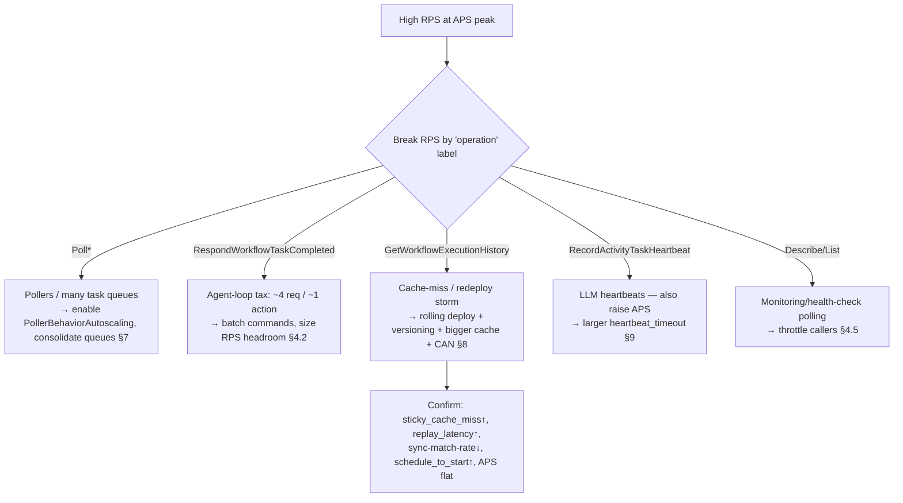

# Temporal Worker Tuning — Exhaustive Guide

**Scope:** Temporal **Cloud** + Temporal **Python SDK** (`temporalio`) workers running **Pydantic AI** agents.
**Primary goal:** understand and control **why RPS is high relative to APS at peaks**, plus a complete, reusable tuning playbook.

> Grounded in the `temporal-workertuning` skill (`~/.claude/skills/temporal-workertuning`) and verified against
> `docs.temporal.io`, `python.temporal.io`, and `ai.pydantic.dev` (mid-2026). Load-bearing claims were
> adversarially fact-checked; corrections from that pass are folded in and flagged with **⚠ Myth-buster** callouts.

---

## Table of contents

1. [TL;DR — the 60-second answer](#1-tldr)
2. [Mental model & architecture](#2-mental-model)
3. [RPS vs APS vs OPS — the precise definitions](#3-rps-vs-aps)
4. [★ Diagnosing YOUR symptom: high RPS at APS peaks](#4-diagnosing-your-symptom)
5. [The three tuning dimensions (compute / memory / IO)](#5-three-dimensions)
6. [Slot suppliers & Worker Tuners (Python)](#6-slot-suppliers)
7. [Pollers & poller autoscaling (Python)](#7-pollers)
8. [Sticky cache, replay & the redeploy history storm](#8-sticky-cache)
9. [Pydantic AI on Temporal — the agentic-workload angle](#9-pydantic-ai)
10. [Metrics & monitoring (how to actually see all this)](#10-metrics)
11. [Gotchas (the compiled list)](#11-gotchas)
12. [Rules of thumb / cheat sheet](#12-rules-of-thumb)
13. [A recommended starting config for your workload](#13-recommended-config)
14. [Sources](#14-sources)

---

<a name="1-tldr"></a>
## 1. TL;DR — the 60-second answer

**RPS is *supposed* to be several times larger than APS.** They measure different things and are enforced
as *separate* limits:

- **APS (Actions Per Second)** — the billed, state-advancing operations (start workflow, schedule activity,
  signal, timer, query, heartbeat-that-reaches-server, …).
- **RPS (Requests Per Second)** — *every* gRPC call to the Cloud frontend, including all the machinery that
  produces **zero actions**: task-queue **polls**, `RespondWorkflowTaskCompleted` / `RespondActivityTaskCompleted`,
  `GetWorkflowExecutionHistory`, `DescribeWorkflowExecution`.

Your RPS/APS ratio rises at peak for three compounding reasons, in order of likelihood for an
agentic (Pydantic AI) workload on single-digit pods:

1. **Structural overhead of the agent loop.** Each orchestration step is a round-trip: poll a workflow task →
   respond → poll an activity → respond, plus periodic heartbeats. An agent that does *one model call per
   workflow task* (a sequential tool loop) generates **~4+ requests per ~1–2 actions**. More concurrent agent
   runs at peak ⇒ proportionally more of this non-action request traffic. This is inherent, not a bug.
2. **Sticky-cache misses → replays (and, for large histories, `GetWorkflowExecutionHistory` pagination).**
   Python's default `max_cached_workflows` is only **1,000**. At peak you may have more in-flight workflows than
   cache slots ⇒ forced evictions ⇒ replays ⇒ extra requests + CPU, **with flat APS**.
3. **Your redeploy burst is the smoking gun for #2.** A *full* fleet redeploy wipes every worker's in-memory
   sticky cache at once ⇒ every in-flight workflow's next task is a cache miss ⇒ a transient storm of
   replays, history pagination, sticky→normal-queue re-dispatch, and a **dropped sync-match rate** — all RPS,
   **no APS**.

**Pollers are usually *not* the dominant cause** at single-digit pods (5 default pollers × ~8 pods = a few dozen
long-polls; even with empty polls that's modest RPS). The exception is if you run **many task queues** (poller
count multiplies per queue per pod) or set poller counts manually high. **Fix pollers by switching to
`PollerBehaviorAutoscaling`**, which only polls when a slot is free.

**Two myths this guide kills:**
- ⚠ Heartbeats do **not** inflate RPS-without-APS. A heartbeat that reaches the server is **both** a Request
  **and** a billable Action (1:1). They're ratio-neutral. (Throttled heartbeats cost nothing.)
- ⚠ A cache miss does **not** always fire a separate `GetWorkflowExecutionHistory` RPC — the full history rides
  *inline* in the poll response; the discrete RPC only appears when history is large enough to paginate.

**What to do first:** break RPS down **by `operation`** in Cloud metrics (§10). That single query tells you
whether it's polls, task-completions, or history-fetches — and ends the guessing.

---

<a name="2-mental-model"></a>
## 2. Mental model & architecture

A Worker is three resource systems bolted together: **IO** (pollers + network), **compute** (task-execution
slots), and **memory** (the sticky workflow cache). Tuning = balancing these three against your host and your
Cloud limits.

```
                          TEMPORAL CLOUD (frontend / matching / history)
                          ┌───────────────────────────────────────────────┐
                          │  Task Queue "agents"        Namespace limits:   │
                          │   ├─ Workflow Task Queue      APS / RPS / OPS    │
                          │   ├─ Activity Task Queue                         │
                          │   └─ Sticky Queue (per worker, ephemeral)       │
                          └───▲───────────▲───────────────▲─────────────────┘
             long-poll (RPS) │           │ respond (RPS)  │ GetHistory (RPS, on cache miss+big history)
                             │           │                │
   ┌─────────────────────────┴───────────┴────────────────┴───────────────────────┐
   │  WORKER PROCESS (one of your single-digit pods)                                │
   │                                                                               │
   │  IO ───────────────┐   COMPUTE ───────────────────┐   MEMORY ──────────────┐ │
   │  Pollers           │   Task slots (SlotSupplier)   │   Sticky cache         │ │
   │  • wf pollers (5)  │   • wf-task slots   (100)     │   max_cached_workflows │ │
   │  • act pollers (5) │   • activity slots  (100)     │   (default 1000)       │ │
   │  • autoscaling?    │   • local-act slots (100)     │   hit → run in memory  │ │
   │                    │                               │   miss → fetch+replay  │ │
   │  A poller only     │   1 running task = 1 slot     │                        │ │
   │  fetches if a      │   Long LLM activity holds a   │   Eviction when full → │ │
   │  slot is free ─────┼─► slot for its FULL duration  │   replay next time     │ │
   └────────────────────┴───────────────────────────────┴────────────────────────┘
```

Key life-of-a-task facts that drive everything below:

- A poller issues a **long-poll** (`PollWorkflowTaskQueue` / `PollActivityTaskQueue`). This is **1 gRPC request
  = 1 RPS**, whether or not a task comes back. (An empty timeout is surfaced as `poll_timeout_count`.)
- When a workflow task completes, the worker sends **`RespondWorkflowTaskCompleted`** (1 request). The
  *commands inside it* — schedule activity, start timer, continue-as-new, upsert search attribute — are what
  count as **Actions**. So **one request can carry many actions, or zero.** This is the crux of the ratio.
- **Sticky execution:** after a worker runs a workflow task, the service routes that workflow's *next* task to a
  per-worker **sticky queue**, so it can send only *new* events instead of the whole history. A **hit** replays
  nothing; a **miss** (new worker, eviction, idle-then-moved, worker gone) forces a **full replay** from history.
- **Replay is CPU on the worker, and it's never billed** — Actions during replay do not count toward APS.

---

<a name="3-rps-vs-aps"></a>
## 3. RPS vs APS vs OPS — the precise definitions

Temporal Cloud enforces **three independent** namespace limits ([capacity-modes](https://docs.temporal.io/cloud/capacity-modes),
[limits](https://docs.temporal.io/cloud/limits)):

| Limit | What it counts | Role |
|---|---|---|
| **APS** — Actions/sec | Billable, state-advancing operations (the [enumerated Actions list](https://docs.temporal.io/cloud/actions)) | High-level; billing + spike control. Default floor **500**. |
| **RPS** — Requests/sec | **All** gRPC requests to the frontend | Lower-level service limit. |
| **OPS** — Operations/sec | Back-end persistence operations an action expands into | Lowest-level. |

**They do not derive from one another.** ⚠ *Myth:* "RPS scales from your APS limit." Reality:
- **On-Demand capacity:** RPS "automatically increases and decreases based on the **last 7 days of RPS usage**"
  and never drops below the floor — independent of APS. (The **APS** limit — not RPS — is set to the
  **greater of** the default floor (500) and the `lesser of 4×APS-avg or 2×APS-P90 over 7 days`.)
- **Provisioned capacity:** limits come bundled per **Temporal Resource Unit (TRU)** at a fixed
  **500 APS : 1,500 RPS : 4,000 OPS** (1 : 3 : 8) ratio. Buying more TRUs raises both — *by bundling*, not derivation.

**Throttling:** exceeding any limit returns gRPC **`RESOURCE_EXHAUSTED`**. SDK clients auto-retry (so you see
**latency first**), but past the retry budget calls fail and *work can be lost*. The
`resource_exhausted_cause` label — `RpsLimit`, `ApsLimit`, `ConcurrentLimit`, `SystemOverloaded`,
`BusyWorkflow` — lets you see that **you can be throttled on `RpsLimit` while under your APS budget.** That is
exactly the failure mode a redeploy storm or a poll-heavy fleet produces.

> ⚠ **Metric caveat:** the `resource_exhausted_cause` breakdown is documented on the
> [Cloud metrics reference](https://docs.temporal.io/production-deployment/cloud/metrics/reference) and
> [service-health](https://docs.temporal.io/production-deployment/cloud/service-health) pages. The
> [v1 OpenMetrics reference](https://docs.temporal.io/cloud/metrics/openmetrics/metrics-reference) currently lists
> **only an `operation` label** for `temporal_cloud_v1_resource_exhausted_error_count` — confirm the
> `resource_exhausted_cause` label is present on your namespace's v1 export before alerting on it.

### Which gRPC operations are Actions vs just Requests

| gRPC operation | Request (RPS)? | Action (APS)? |
|---|:--:|:--:|
| `StartWorkflowExecution` | ✅ | ✅ Start Workflow |
| `SignalWorkflowExecution` / `SignalWithStart` | ✅ | ✅ (SWS = 1 action) |
| `QueryWorkflow` | ✅ | ✅ (incl. "view call stack" in UI) |
| `UpdateWorkflowExecution` | ✅ | ✅ (accept **and** reject) |
| `RespondWorkflowTaskCompleted` | ✅ | ➖ *the commands inside* are actions (schedule activity, timer, CAN, upsert SA…) |
| `RespondActivityTaskCompleted` / `…Failed` | ✅ | ❌ |
| **`RecordActivityTaskHeartbeat`** | ✅ | **✅ if it reaches the server** |
| `PollWorkflowTaskQueue` / `PollActivityTaskQueue` | ✅ | ❌ |
| `GetWorkflowExecutionHistory` | ✅ | ❌ |
| `DescribeWorkflowExecution` / `DescribeTaskQueue` / `List*` | ✅ | ❌ |

**Also actions (no direct client call):** Schedule/Retry Activity (**each retry is a separate action**),
Start Timer (`workflow.sleep` and other workflow-level timers), Continue-As-New, Start Child
Workflow, Upsert Search Attributes, Schedule ops, Nexus schedule/cancel. **Not actions:** Workflow **Replay**,
failed starts, WorkflowID-deduplicated starts, the built-in `__temporal_workflow_metadata` query.
(The [Actions list](https://docs.temporal.io/cloud/actions) enumerates "Start Timer" but does **not** state that
the implicit timers the SDK creates for activity `start_to_close`/`schedule_to_close` timeouts are separately
billed — treat that as unverified.)

> ⚠ **Heartbeat myth-buster.** A heartbeat that reaches the server counts as **both** a Request *and* a
> billable Action (1:1) — so it is *ratio-neutral*, not an RPS-only inflator. Heartbeats the SDK throttles away
> (never sent) cost neither. Your app-code `activity.heartbeat()` **call frequency is irrelevant**; only the
> throttle interval decides how many reach the server (see §9).

---

<a name="4-diagnosing-your-symptom"></a>
## 4. ★ Diagnosing YOUR symptom: high RPS at APS peaks, single-digit pods, poller suspicion, redeploy history burst

This is the section written specifically for you. Work it top-to-bottom.

### 4.0 First move — break RPS down by operation (ends the guessing in one query)

Cloud request counts carry an **`operation`** label = the gRPC method name. Split your peak RPS by it:

```promql
# v1 OpenMetrics (current). v0 name: temporal_cloud_v0_frontend_service_request_count
topk(10, sum by (operation) (
  rate(temporal_cloud_v1_service_request_count{temporal_namespace=~"$namespace"}[5m])
))
```

Read the top operations:

| Dominant operation at peak | Root cause | Go to |
|---|---|---|
| `PollWorkflowTaskQueue` / `PollActivityTaskQueue` | Too many pollers / too many task queues / empty-poll spin | §4.1 |
| `RespondWorkflowTaskCompleted` (≫ actions) | Chatty agent loop: many WFT round-trips per action | §4.2 |
| `GetWorkflowExecutionHistory` | Cache-miss replays / large histories / **redeploy storm** | §4.3 |
| `RecordActivityTaskHeartbeat` | Heartbeats — but note these raise **APS too** | §4.4 |
| `DescribeWorkflowExecution` / `List*` | Monitoring, UI, health-check polling | §4.5 |

Cross-check with: `poll_success_sync_count / poll_success_count` (**sync match rate**, want >95%, ideally
>99%), `poll_timeout_count` (empty polls), `resource_exhausted_error_count{resource_exhausted_cause=...}`,
and the SDK-side `temporal_sticky_cache_miss`, `temporal_workflow_task_replay_latency`,
`temporal_*_schedule_to_start_latency`.

### 4.1 If polls dominate

At single-digit pods with default `PollerBehaviorSimpleMaximum(maximum=5)`, raw poll RPS is usually small.
Suspect polls only if:
- You run **many task queues** — poller count = `pods × task_queues × (wf_pollers + act_pollers)`. With Pydantic AI
  you may have separate queues per agent/model; this multiplies fast.
- Poll counts were set manually high, or you have far more pollers than slots (pollers with no free slot to fill
  still cost poll RPS).

**Fix:** enable poller autoscaling (§7) — it only polls when a slot is free, and it *reduces* pollers when long
LLM activities hold all the slots. Also **consolidate task queues** where you don't need isolation.

> Why it "seemed odd" that pollers were the cause: they usually aren't at your scale. The poll RPS you *do* see
> is real but modest; the big ratio movers are §4.2 and §4.3.

### 4.2 If `RespondWorkflowTaskCompleted` dominates (the agent-loop tax)

This is the most likely structural driver for a Pydantic AI workload. A sequential agent run looks like:

```
WFT poll ─► respond(schedule model activity)   # 2 requests, 1 action
ACT poll ─► respond(model result)              # 2 requests, 0 actions   ← model call itself = 1 ScheduleActivity action
WFT poll ─► respond(schedule next tool/model)  # 2 requests, 1 action
... repeat per turn ...
```

So **~4 requests per turn** but often only **1 action per turn** ⇒ a baked-in **RPS/APS ≈ 4–6×**, *before*
any cache effects. At peak, concurrency multiplies this. Levers:
- **Batch commands per workflow task** where the agent logic allows (fan out parallel tool/model calls in one
  turn instead of strictly sequential) — more actions per `RespondWorkflowTaskCompleted`, lower ratio.
- Accept it as the cost of durable orchestration; make sure your **RPS ceiling** (capacity mode) has headroom
  for `~5× peak APS`, and watch `resource_exhausted_cause=RpsLimit`.

### 4.3 If `GetWorkflowExecutionHistory` dominates — the cache-miss / redeploy story

This is where your **"burst of history fetches on full redeploy"** lands, and it's the clearest lever.

**Mechanism.** Sticky cache is **per-worker, in-memory**. A **full redeploy restarts every pod simultaneously**,
so *every* in-flight workflow's next task is a cache miss. Each miss forces a **full replay**; when a history is
large it is **paginated via `GetWorkflowExecutionHistory`** (the first page rides inline in the poll response —
⚠ so the discrete RPC scales with *history size*, not with every miss). Simultaneously, tasks the service had
aimed at now-dead sticky queues wait out the sticky schedule-to-start timeout and fall back to the **normal
queue as async matches**, so your **sync-match rate dips** and **schedule-to-start latency spikes**. Through all
of this, **APS stays flat** — replay isn't billed. That's your RPS-up-APS-flat burst.

**It's transient** (caches re-warm as each workflow replays once and re-establishes a sticky queue), but it can
trip `RESOURCE_EXHAUSTED{cause=RpsLimit}` at the worst moment.

**Confirm it:** at redeploy you'll see `temporal_sticky_cache_miss` ↑, `temporal_workflow_task_replay_latency`
↑, sync-match-rate ↓, `schedule_to_start_latency` ↑, and `GetWorkflowExecutionHistory` RPS ↑ (bigger if
histories are large).

**Fixes, in priority order:**
1. **Stop doing full redeploys.** Use **rolling** (or blue-green / rainbow) deploys so only a fraction of caches
   invalidate at once — the storm becomes small staggered waves.
   ([deployment strategies](https://docs.temporal.io/production-deployment/worker-deployments))
2. **Worker Versioning with PINNED behavior / Worker Deployments** — each execution stays on the version it
   started on until it completes; old versions **Drain** instead of being yanked. Avoids mass invalidation and
   gives instant rollback. (AUTO_UPGRADE *does* move executions and can trigger replay — use PINNED.)
   ([worker-versioning](https://docs.temporal.io/production-deployment/worker-deployments/worker-versioning))
3. **Raise `max_cached_workflows`** above your peak concurrent in-flight workflow count *per pod* (if RAM
   allows) so steady-state evictions stop. Default **1,000** is low for agentic fan-out.
4. **Keep histories small** with **Continue-As-New** (and small payloads) so each replay/fetch is cheap. Warn
   zone begins ~10K events / 10 MB; hard cap 51,200 events / 50 MB.
5. **Don't restart workers gratuitously** — every restart is a mini-storm.

### 4.4 If heartbeats dominate

Then your LLM activities are heartbeating a lot. Remember they raise **APS too**. To reduce their volume,
**increase `heartbeat_timeout`** (throttle interval = `min(0.8 × heartbeat_timeout, 60s)`), *not* your app-code
call frequency. The 60s cap means a long activity emits **at least ~1 heartbeat/60s** regardless. See §9.

### 4.5 If Describe/List dominate

Something is polling the Cloud API — a dashboard, a custom health check, the UI, or app code calling
`DescribeWorkflowExecution` in a loop. These are pure RPS. Cache/'throttle those callers.

### 4.6 The single diagram of your situation



---

<a name="5-three-dimensions"></a>
## 5. The three tuning dimensions (compute / memory / IO)

Tune in this order (Temporal's Recipe 3): **compute → memory → IO**. Actively tune — defaults are for dev,
not prod.

### Python SDK defaults (`temporalio.worker.Worker`)

| Dimension | Option | Python default |
|---|---|---|
| Compute | `max_concurrent_workflow_tasks` | **100** (constructor shows `None` → 100-slot fixed tuner) |
| Compute | `max_concurrent_activities` | **100** |
| Compute | `max_concurrent_local_activities` | **100** |
| Memory | `max_cached_workflows` | **1,000** |
| IO | `workflow_task_poller_behavior` | `PollerBehaviorSimpleMaximum(maximum=5)` |
| IO | `activity_task_poller_behavior` | `PollerBehaviorSimpleMaximum(maximum=5)` |
| Lifecycle | `graceful_shutdown_timeout` | **`timedelta()` = 0** ⚠ |
| Sticky | `sticky_queue_schedule_to_start_timeout` | `timedelta(seconds=10)` |
| Heartbeat | `default_heartbeat_throttle_interval` | 30 s |
| Heartbeat | `max_heartbeat_throttle_interval` | 60 s |

> ⚠ These per-kind defaults are ~100 in Python but differ wildly by SDK (Go 1,000; Java 200; TS 40/100). Don't
> carry numbers across SDKs.

### The tuning sequence (what to change, and the metric that tells you to)

| Symptom (metric) | Meaning | Action |
|---|---|---|
| `worker_task_slots_available` frequently **0** *and* host CPU/mem **low** | Slots too few | ↑ `max_concurrent_*` (or use a tuner) |
| `schedule_to_start_latency` high *and* host CPU/mem **high** | Workers saturated | Scale out pods / up CPU |
| `schedule_to_start_latency` high *and* slots available *and* CPU low | Pollers too few / latency to server | Poller autoscaling (§7) |
| `sticky_cache_total_forced_eviction` / miss rate high | Cache too small | ↑ `max_cached_workflows` (if RAM) |
| Poll success rate **low** + latency low + CPU low | **Too many** workers/pollers | Scale *down* / fewer pollers |

**"Too many workers" is real:** low poll-success-rate + low schedule-to-start + low host utilization = over-provisioned.
Poll Success Rate = `(poll_success + poll_success_sync) / (…+ poll_timeout)`; target **>90%** (>95% high-volume).

---

<a name="6-slot-suppliers"></a>
## 6. Slot suppliers & Worker Tuners (Python)

Slots cap concurrent tasks. You set them either with the simple `max_concurrent_*` options **or** with a
`WorkerTuner` — **never both**. The two are mutually exclusive and passing them together raises an error at
Worker initialization.

**Three supplier strategies:**
- **Fixed-size** — hand out up to N slots. Best for predictable workloads, lowest latency, max throughput.
  **Recommended for workflow tasks always**, and for LLM activities (see §9).
- **Resource-based** — auto-adjust to hit target CPU/mem. Good for *unprofiled* or OOM-risky workloads. Can
  never beat a well-chosen fixed size, and ⚠ **under-provisions I/O-bound LLM activities** (they're low-CPU
  while holding a slot, so a CPU target keeps slot count low).
- **Custom** (`CustomSlotSupplier`) — full control.

```python
from datetime import timedelta
from temporalio.worker import (
    Worker, WorkerTuner, FixedSizeSlotSupplier,
    ResourceBasedSlotSupplier, ResourceBasedSlotConfig, ResourceBasedTunerConfig,
    PollerBehaviorAutoscaling,
)

# Recommended for LLM/agent workloads: fixed workflow slots + generous fixed activity slots.
tuner = WorkerTuner.create_fixed(
    workflow_slots=200,        # WFTs are cheap; keep them from starving
    activity_slots=300,        # = peak concurrent in-flight model calls PER POD you want to allow
    local_activity_slots=50,
)

# Alternative — resource-based (only if you can't profile; NOT ideal for pure LLM I/O):
tuner_rb = WorkerTuner.create_resource_based(
    target_memory_usage=0.8,
    target_cpu_usage=0.9,
    activity_config=ResourceBasedSlotConfig(minimum_slots=20, maximum_slots=500,
                                            ramp_throttle=timedelta(seconds=1)),
)

# Composite — fixed workflow, resource-based activity (best-of-both when activities are heterogeneous):
tuner_composite = WorkerTuner.create_composite(
    workflow_supplier=FixedSizeSlotSupplier(200),
    activity_supplier=ResourceBasedSlotSupplier(
        ResourceBasedSlotConfig(minimum_slots=20, maximum_slots=500),
        ResourceBasedTunerConfig(target_memory_usage=0.8, target_cpu_usage=0.9),
    ),
    local_activity_supplier=FixedSizeSlotSupplier(50),
    nexus_supplier=FixedSizeSlotSupplier(10),
)

worker = Worker(client, task_queue="agents", workflows=[...], activities=[...], tuner=tuner)
```

> **Metric caveat:** `worker_task_slots_available` only works with **fixed-size** suppliers. For resource-based,
> use `worker_task_slots_used`.

---

<a name="7-pollers"></a>
## 7. Pollers & poller autoscaling (Python)

**Enable poller autoscaling for almost everything.** It picks the poller count from server feedback, only polls
when a slot is free (critical when long LLM activities occupy slots), and improves schedule-to-start latency —
directly cutting the wasted-poll RPS you suspected.

```python
from temporalio.worker import Worker, PollerBehaviorAutoscaling

worker = Worker(
    client, task_queue="agents", workflows=[...], activities=[...],
    tuner=tuner,
    workflow_task_poller_behavior=PollerBehaviorAutoscaling(),   # sane minimum/maximum/initial defaults
    activity_task_poller_behavior=PollerBehaviorAutoscaling(),
)
```

> ⚠ **Spelling trap.** The current knobs are `workflow_task_poller_behavior` / `activity_task_poller_behavior`.
> The *count* params `max_concurrent_workflow_task_polls` / `..._activity_task_polls` (note **`polls`**, not
> `pollers`) are **deprecated** and, if set, **silently override** the poller-behavior value. There is no
> `..._pollers` parameter. Requires Temporal Server ≥ v1.28.0 — **Temporal Cloud always qualifies.**

Manual tuning is warranted only when hosts are underutilized **and** slots are available **and**
schedule-to-start is high; then raise pollers on the elevated side (workflow vs activity). Otherwise autoscaling
wins.

---

<a name="8-sticky-cache"></a>
## 8. Sticky cache, replay & the redeploy history storm

Covered operationally in §4.3; here's the tuning surface.

- **Size it:** `max_cached_workflows` (default 1,000). Rule of thumb: **≥ peak concurrent in-flight workflows
  per pod**, bounded by RAM. Watch `temporal_sticky_cache_size` (should stay ≤ your cap) and
  `temporal_sticky_cache_miss` (should be low in steady state).
  > Note: `sticky_cache_total_forced_eviction` is **Go/Java only**; in Python infer eviction pressure from
  > `sticky_cache_miss` rising while `sticky_cache_size` sits at the cap.
- **`max_concurrent_workflow_tasks` must be ≥ 2 if `max_cached_workflows > 0`** (SDK requirement).
- **Replay cost** scales with history size ⇒ keep histories short (Continue-As-New, small payloads, avoid
  chatty signal loops). High `temporal_workflow_task_replay_latency` ⇒ big histories or slow data converter.
- **Deploys:** rolling/blue-green/rainbow + **Worker Versioning (PINNED)** to avoid the synchronized cache wipe.
  The `temporalio/temporal-worker-controller` automates rainbow deploys on Kubernetes.

---

<a name="9-pydantic-ai"></a>
## 9. Pydantic AI on Temporal — the agentic-workload angle

Pydantic AI ships a **first-party** Temporal integration in `pydantic_ai.durable_exec.temporal`.

- **Current API:** attach the `TemporalDurability` capability to a normal agent:
  `Agent('openai:gpt-5.6-sol', name='geography', capabilities=[TemporalDurability()])`, plus `PydanticAIPlugin`
  on the client/worker. Install with `pip install 'pydantic-ai[temporal]'`.
  ⚠ The older `TemporalAgent(agent)` wrapper is **deprecated (docs say it *will be* removed in v3, still a
  supported legacy path today)**; context7's indexed docs and the local pydantic-ai skill still show it. Your
  installed version dictates which API you have — check before copying.
- **Execution split:** the **agent run loop lives in the Workflow**; **each model request, tool call, and MCP
  interaction becomes a Temporal Activity.** Activity names are **derived from the agent `name` and toolset
  `id`s** (stable — treat as a versioned contract; the exact format is an implementation detail, not documented).

### Why this workload naturally produces high RPS/APS

Each model call = **1 `ScheduleActivity` action** but a **full poll→respond round-trip** on both the workflow
and activity queues, plus automatic heartbeats. A multi-turn agent (tool loop) repeats this per turn. So the
agent pattern is *the* textbook "**few actions, many requests, long-held slots**" shape (§4.2).

### Pydantic-AI-specific tuning that matters

| Concern | Setting | Guidance |
|---|---|---|
| Model-request timeout | `model_activity_config=ActivityConfig(start_to_close_timeout=…)` | Base default is **60 s** — too tight for reasoning models. Size to a full provider round trip. |
| Heartbeat | model activities heartbeat automatically, default `heartbeat_timeout=30 s` | Raise it to cut heartbeat volume (also lowers APS from heartbeats); keep < provider-latency-variance to catch dead workers. |
| Retry layering | `OpenAIProvider(max_retries=0)` (disable provider/HTTP retries) | ⚠ Temporal already retries the activity; double-retry = surprise cost + broken `Retry-After`. |
| Slot starvation | route model activities to a **dedicated task queue** via `ActivityConfig(task_queue=…)` | Stops slow LLM calls from starving workflow-task and tool-call slots. Then tune each queue's worker independently. |
| Slot strategy | **fixed-size, generous** activity slots | Resource-based under-provisions I/O-bound model activities (low CPU while holding a slot). |
| Streaming | **model events are delivered live inside the model-request activity**; each tool event in its own event-handler activity | Set an `event_stream_handler` (the direct `run_stream()`/`run_stream_events()`/`iter()` APIs are unavailable under Temporal). It runs in the activity and **must be idempotent** (may retry); payloads are subject to Temporal's **2 MB** limit. |
| Sandbox | `PydanticAIPlugin` registers each agent's `TemporalDurability` activities + sets Pydantic (de)serialization | Other third-party imports in workflow code may still need `with workflow.unsafe.imports_passed_through():`. |
| Versioning | agent `name` + toolset `id`s become **stable activity names** | ⚠ Changing them after deploy **breaks in-flight workflows** — treat as a versioned contract. |

### Python concurrency (GIL) for LLM activities

- **Async `def` activities** run on the worker's single event loop — ideal for I/O-bound LLM calls with
  async-safe clients (Pydantic AI uses `httpx`). ⚠ *Any* blocking call in an async activity stalls the **whole
  worker**.
- **Sync `def` activities** require `activity_executor` (a `ThreadPoolExecutor`; set `max_workers ≥
  max_concurrent_activities` or the SDK warns). Use `ProcessPoolExecutor` + `shared_state_manager` for CPU-bound
  work (local inference/tokenization) — the GIL means one Python process = one core for CPU work.
- ⚠ **Set `graceful_shutdown_timeout`** (default **0**!) generously so pod restarts let in-flight model
  activities finish instead of being cancelled into retries. And **don't scale a pod down while
  `worker_task_slots_available` is near 0** — you'll trigger expensive LLM retries.

---

<a name="10-metrics"></a>
## 10. Metrics & monitoring (how to actually see all this)

### Enable SDK (Prometheus) metrics in Python

```python
from temporalio.client import Client
from temporalio.runtime import Runtime, TelemetryConfig, PrometheusConfig

runtime = Runtime(telemetry=TelemetryConfig(
    metrics=PrometheusConfig(bind_address="0.0.0.0:9000")))
client = await Client.connect("your-ns.acct.tmprl.cloud:7233", runtime=runtime, ...)
```

One process-wide `Runtime`; metrics carry the `temporal_` prefix by default (override via
`TelemetryConfig.metric_prefix`).

### The two metric families (don't confuse them)

**SDK-side (from your worker → Prometheus):**
`temporal_worker_task_slots_available` / `_used`, `temporal_sticky_cache_size`, `temporal_sticky_cache_miss`,
`temporal_workflow_task_schedule_to_start_latency`, `temporal_activity_schedule_to_start_latency`,
`temporal_workflow_task_replay_latency`, `temporal_num_pollers`, `temporal_long_request` /
`temporal_long_request_failure` (long-poll RPCs), `temporal_request` / `temporal_request_failure`.

**Cloud-side (from Temporal Cloud → your Prometheus/Grafana/Datadog):**
`temporal_cloud_v1_service_request_count` (by `operation`), `temporal_cloud_v1_service_request_throttled_count`,
`temporal_cloud_v1_poll_success_count` / `_sync_count`, `temporal_cloud_v1_poll_timeout_count`,
`temporal_cloud_v1_resource_exhausted_error_count` (the v1 OpenMetrics reference documents only an `operation`
label; the `resource_exhausted_cause` breakdown is on the Cloud metrics reference / service-health pages — verify
it on your export), `temporal_cloud_v1_billable_action_count`, and the limit gauges `…_service_request_limit`,
`…_action_limit`, `…_operations_limit`.

> ⚠ **"long_request" is an SDK metric, not a Cloud metric.** Temporal Cloud has no `long_request` series — use
> `service_request_count` (by operation) + poll metrics for Cloud-side RPS analysis.
> ⚠ **v0 PromQL metrics** (`temporal_cloud_v0_*`) were **deprecated 2026-04-02, disabled 2026-10-05** — migrate
> dashboards to **v1 OpenMetrics** (the `frontend_` segment is dropped: `v0 frontend_service_request_count` →
> `v1 service_request_count`).

### Minimal alert set (configure before prod)

| Alert | Threshold |
|---|---|
| `workflow_task_schedule_to_start_latency` p99 | > 200 ms |
| `activity_schedule_to_start_latency` p99 | > 200 ms |
| Sync Match Rate p99 | < 95% |
| Poll Success Rate p99 | < 90% |
| `worker_task_slots_available` | == 0 |
| `resource_exhausted_error_count{cause="RpsLimit"}` | > 0 at peak |
| `approximate_backlog_count` | growing over time |

### The RPS/APS ratio panel (build this)

```promql
sum(rate(temporal_cloud_v1_service_request_count{temporal_namespace=~"$ns"}[5m]))
/
sum(rate(temporal_cloud_v1_billable_action_count{temporal_namespace=~"$ns"}[5m]))
```

Plot it alongside the by-`operation` breakdown. A ratio that *spikes* at peak (rather than staying flat)
points at cache-miss/replay or poll amplification — exactly what §4 diagnoses.

---

<a name="11-gotchas"></a>
## 11. Gotchas (the compiled list)

1. **RPS ≫ APS is normal.** Don't alarm on the ratio itself; alarm on `RESOURCE_EXHAUSTED{cause=RpsLimit}` and
   on the ratio *spiking* at peak.
2. **Heartbeats are APS *and* RPS** (1:1 if they reach the server). App-code `heartbeat()` frequency doesn't
   matter; only `heartbeat_timeout` (throttle = `min(0.8×timeout, 60s)`) does. Min ~1 heartbeat/60 s.
3. **Cache miss ≠ a `GetWorkflowExecutionHistory` RPC** every time — full history rides inline in the poll
   response; the discrete RPC is for pagination of large histories.
4. **`graceful_shutdown_timeout` defaults to 0** — long LLM activities get cancelled on redeploy. Set it.
5. **`tuner` + `max_concurrent_*` = error at init.** They're mutually exclusive — pick one.
   (`max_cached_workflows` and the poll params *can* coexist with a tuner.)
6. **`max_concurrent_workflow_task_polls` (not `pollers`) is deprecated** and overrides `..._poller_behavior`.
7. **Activity retries each bill as an Action** — a flaky activity with an aggressive retry policy multiplies APS.
8. **Timers are Actions** — `workflow.sleep` and other workflow-level timers each start a billable Start-Timer
   action. (Whether the SDK's implicit activity-timeout timers are separately billed is *not* documented — don't
   count on it.)
9. **Queries are Actions** — including "view call stack" in the UI. `DescribeWorkflowExecution` is a Request but
   not an Action.
10. **Resource-based tuners under-provision LLM activities** (low CPU while holding a slot). Prefer fixed/generous.
11. **Async activity + any blocking call = whole worker stalls.** Keep async activities strictly non-blocking.
12. **AUTO_UPGRADE worker versioning moves running executions** (replay risk). Use **PINNED** to avoid it.
13. **Sync tools in Pydantic AI always become activities** (threads aren't deterministic); only no-I/O async
    tools can opt out with `metadata={'temporal': False}`.
14. **Streaming: model events are delivered live inside the model-request activity** (tool events in their own
    event-handler activity) via an `event_stream_handler`; payloads are 2 MB-capped and the handler may re-run on
    retry → must be idempotent.
15. **Changing a Pydantic AI agent `name`/toolset `id` breaks in-flight workflows** (they're stable activity names).
16. **`sticky_cache_total_forced_eviction` is Go/Java only** — Python infers eviction from miss + size-at-cap.
17. **`schedule_to_start_timeout` on activities is discouraged** — it's non-retryable and masks capacity issues;
    use `start_to_close` + `heartbeat_timeout`.
18. **Migrate off v0 Cloud metrics** before 2026-10-05.

---

<a name="12-rules-of-thumb"></a>
## 12. Rules of thumb / cheat sheet

- **Schedule-to-start latency is your #1 signal.** Near-zero = healthy. Rising = a bottleneck; correlate with
  host CPU/mem to decide *slots vs pollers vs pods*.
- **Slots ≈ peak concurrent tasks per pod.** For LLM activities: `activity_slots ≈ concurrent in-flight model
  calls you want per pod`. Each long call holds its slot for the whole call.
- **Pollers ≪ slots**, always. Better yet, **use autoscaling** and stop thinking about poller counts.
- **`max_cached_workflows` ≥ peak in-flight workflows per pod** (RAM permitting). Default 1,000 is low for agents.
- **≥ 2 workers per task queue** for availability.
- **Separate task queues** for workflows vs LLM activities vs tools — isolation + independent tuning + prevents
  slow model calls starving workflow tasks.
- **Provision RPS headroom ≈ 4–6 × peak APS** for agent workloads (the round-trip tax), more if histories are
  large or you full-redeploy.
- **Deploy rolling + PINNED versioning**, never full-fleet restart. It's the single biggest fix for your redeploy
  RPS burst.
- **Keep histories < ~10K events** via Continue-As-New; keep payloads small (2 MB hard cap).
- **Don't over-provision**: low poll-success + low schedule-to-start + low CPU = too many workers/pollers → scale down.
- **Benchmark under realistic load** before trusting any of these numbers.

---

<a name="13-recommended-config"></a>
## 13. A recommended starting config for your workload

For Pydantic AI agents on Temporal Cloud, single-digit pods. Adjust the two decision points to your measured
concurrency and RAM, then verify against §10 before/after.

```python
from datetime import timedelta
from concurrent.futures import ThreadPoolExecutor
from temporalio.client import Client
from temporalio.runtime import Runtime, TelemetryConfig, PrometheusConfig
from temporalio.worker import Worker, WorkerTuner, PollerBehaviorAutoscaling

# --- observability first: you cannot tune what you cannot see (§10) ---
runtime = Runtime(telemetry=TelemetryConfig(metrics=PrometheusConfig(bind_address="0.0.0.0:9000")))
client = await Client.connect(TARGET, namespace=NS, tls=..., runtime=runtime)

# DECISION 1: activity_slots = peak concurrent in-flight MODEL CALLS you want PER POD.
# DECISION 2: max_cached_workflows >= peak concurrent in-flight WORKFLOWS per pod (bounded by RAM).
tuner = WorkerTuner.create_fixed(workflow_slots=200, activity_slots=300, local_activity_slots=50)

# Dedicated worker for model-request activities keeps slow LLM calls off the workflow queue.
model_worker = Worker(
    client, task_queue="agent-model-requests",
    activities=[...],                       # model-request activities routed here via ActivityConfig(task_queue=...)
    tuner=tuner,
    activity_task_poller_behavior=PollerBehaviorAutoscaling(),
    max_cached_workflows=0,                 # activity-only worker needs no workflow cache
    activity_executor=ThreadPoolExecutor(max_workers=300),  # only if any activity is sync def
    graceful_shutdown_timeout=timedelta(seconds=120),       # let long LLM calls finish on redeploy
)

# Orchestration worker: workflows + light/tool activities.
orch_worker = Worker(
    client, task_queue="agents",
    workflows=[...], activities=[...],
    tuner=WorkerTuner.create_fixed(workflow_slots=200, activity_slots=100, local_activity_slots=50),
    workflow_task_poller_behavior=PollerBehaviorAutoscaling(),
    activity_task_poller_behavior=PollerBehaviorAutoscaling(),
    max_cached_workflows=2000,              # ↑ from default 1000 for agentic fan-out
    graceful_shutdown_timeout=timedelta(seconds=120),
)
```

Pydantic AI side (raise the tight defaults; route model activities to their own queue):

```python
from datetime import timedelta
from temporalio.workflow import ActivityConfig
from pydantic_ai import Agent
from pydantic_ai.durable_exec.temporal import TemporalDurability   # verify import for your installed version

agent = Agent(
    "openai:gpt-5.6-sol", name="geography",
    capabilities=[TemporalDurability(
        model_activity_config=ActivityConfig(
            task_queue="agent-model-requests",           # dedicated queue (matches model_worker above)
            start_to_close_timeout=timedelta(minutes=5), # reasoning models blow past the 60s default
            heartbeat_timeout=timedelta(seconds=60),     # fewer heartbeats; still catches dead workers
        ),
    )],
)
```

**Deploy strategy:** rolling deploy + Worker Versioning **PINNED**. Never a synchronized full-fleet restart.

---

<a name="14-sources"></a>
## 14. Sources

- Temporal Worker tuning skill: `~/.claude/skills/temporal-workertuning/` (`concepts`, `configuration-defaults`,
  `metrics-and-monitoring`, `troubleshooting`, `recipes`, `tuner-examples`).
- Cloud limits & capacity: <https://docs.temporal.io/cloud/capacity-modes>, <https://docs.temporal.io/cloud/limits>,
  <https://docs.temporal.io/cloud/actions>, <https://docs.temporal.io/best-practices/managing-aps-limits>
- Cloud metrics: <https://docs.temporal.io/cloud/metrics/openmetrics/metrics-reference>,
  <https://docs.temporal.io/cloud/worker-health>
- Worker performance: <https://docs.temporal.io/develop/worker-performance>,
  <https://docs.temporal.io/develop/worker-tuning-reference>,
  <https://docs.temporal.io/troubleshooting/performance-bottlenecks>, <https://docs.temporal.io/references/sdk-metrics>
- Sticky execution & deploys: <https://docs.temporal.io/sticky-execution>,
  <https://docs.temporal.io/production-deployment/worker-deployments/worker-versioning>
- Python SDK: <https://python.temporal.io/temporalio.worker.Worker.html>,
  <https://python.temporal.io/temporalio.worker.WorkerTuner.html>,
  <https://python.temporal.io/temporalio.runtime.html>,
  <https://docs.temporal.io/develop/python/python-sdk-sync-vs-async>
- Pydantic AI + Temporal: <https://ai.pydantic.dev/durable_execution/temporal/>,
  <https://temporal.io/blog/build-durable-ai-agents-pydantic-ai-and-temporal>

_Numbers (slot/cache/poller counts) are starting points — benchmark under realistic load and adjust._
