# Experiments: the plan, as commands

Numbering follows the original plan (Phase 0-5, chaos experiments #1-#18). For every experiment:
**write your prediction in `atlas.md` first**, run it, then fill in the rest. Dashboard: http://localhost:3000.

```sh
# shell helpers used throughout (paste once per terminal)
alias lg='docker compose run --rm --no-deps --name loadgen loadgen'      # load generator:  lg ramp ... | lg smoke
alias t='docker compose exec admin-tools temporal'              # temporal CLI (namespace lab preset)
alias ch='chaos/chaos.sh'                                       # fault injection; also logs + annotates Grafana
```

Workflow IDs are `<run-id>-<shape>-<process>-<seq>`, so with `--run-id foo` the first workflow of the `noop` shape is `foo-noop-0-0`.
`make history WF=<id>` prints the annotated event history. `make count RUN=<run-id>` shows how a run ended.

**Reset between experiments** (worker knobs back to defaults, faults healed, stragglers gone):
`ch db-heal; make workers; make unsplit; make cleanup RUN=<id>`.

**Screenshots from a run of this plan.** Every experiment here was run on 2026-10-19 and the relevant dashboard
panels are shown in a *What it looked like* section after each phase. The run was scripted with shorter steps than
the commands below (45-60 s instead of 60-120 s; each experiment's exact commands are in `results/exp-logs/<id>.log`
on the machine that ran it). Read the panels with these notes in mind:

- Times are UTC. Red dashed lines are annotations: load started, fault injected, fault healed.
- **SDK latency histograms are coarse.** Schedule-to-start buckets go 50 ms, 100 ms, ... 50 s, 100 s, 200 s, 500 s,
  1000 s, and activity execution has no bucket between 10 s and 60 s. A flat line at 50 ms, 100 ms, 1.67 min (100 s)
  or 16.7 min (1000 s) is a bucket edge, not a measurement: read it as "under 100 ms" or "over 100 s".
- **The lab's start ceiling is a lock in the frontend, not history.** `config/dynamicconfig/docker.yaml` sets
  `system.forceSearchAttributesCacheRefreshOnRead: true`. With it, every StartWorkflowExecution reads cluster metadata
  from Postgres twice while holding the search-attribute cache lock (`cacheUpdateMutex` in
  `common/searchattribute/manager.go`), so starts are serialized on that read. In the noop ramp (2) the read ran at
  ~1,150/s, i.e. ~575 starts/s, which is exactly where starts levelled off. Later in the day, with Postgres busier
  (~0.1 s per read at p99), the same lock held the frontend to ~65 starts/s while history answered the same calls in
  under 0.5 s (3C). Remove that setting before measuring start throughput.
- **The worker runs SDK defaults:** 5 workflow-task pollers, split 1 normal-queue + 4 sticky. The chaos experiments
  push 50-100 chain workflows/s, far more than this worker completes, so most chaos runs complete 3-12 workflows/s
  and build a backlog. Read the shape around the fault marker, not the absolute rates.
- **`RESOURCE_EXHAUSTED` "result errors" in the loadgen summaries are the generator's own waits.** It waits for each
  result with a `PollWorkflowExecutionHistory` long poll, and above 1,200 concurrent long polls per namespace the
  frontend refuses the rest (`resource_exhausted_cause="ConcurrentLimit"`, ~2.9 million refusals over the day). The
  workflows did not fail. Ramps that left thousands of results pending also hit the driver's deadline and print
  `ERROR: only 0/N generator processes reported results` instead of a table; their panels are still valid.
- The reset between experiments did not always finish draining the previous experiment; captions say where a panel
  shows leftovers.
- Before this run, `lg` / `make load` used `docker compose run` **without `--no-deps`**, which quietly removed every
  extra replica created by `make scale` as soon as load started. That is fixed (the alias above and the Makefile now
  pass `--no-deps`), and the experiments that scale (1.3, 3B.3, 3C.2, #2, #4, #5, #10) were rerun after the fix.

---------------------------------------------------------------------------------------------------

## Phase 0: is the lab alive?

```sh
make up && make smoke           # 12 checks; every one should PASS before you trust anything else
make metric-names PATTERN=schedule_to_start    # do the dashboard's metric names exist in YOUR versions?
```
If a dashboard panel is empty, fix the query in `tools/gen_dashboard.py` (`make dashboard`) using the real names.

**What it looked like:** `make smoke` passed 12/12. Twelve workflows do not register on rate panels, so there is
nothing to screenshot.

## Phase 1: anatomy of one workflow

```sh
lg ramp --shape anatomy --rate 1 --duration 1 --run-id anat --params '{"timer_s": 5}'
make history WF=anat-anatomy-0-0                       # parked at "waiting-for-signal"
t workflow query  -w anat-anatomy-0-0 --type stage
t workflow update execute -w anat-anatomy-0-0 --name add_note --input '"hello"'
t workflow signal -w anat-anatomy-0-0 --name proceed
make history WF=anat-anatomy-0-0                       # complete history, with who-produced-each-event notes
t workflow show -w anat-anatomy-0-0 --output json      # the raw thing
```

1. **Map events.** Read the `history` output line by line against the `^` notes. Questions: why is there a `WorkflowTaskScheduled/Started/Completed` triple *before* `ActivityTaskScheduled`? Which events did the worker create (commands) and which did the server?
2. **Path of a start.** `make shard WF=anat-anatomy-0-0 SHARDS=4`, then confirm with `make cli-tdbg ARGS="workflow describe -w anat-anatomy-0-0"` (look for the shard id; if they disagree, my hash assumption is wrong for your version: tell me). Count persistence operations per activity round trip: run `lg ramp --shape chain --rate 20 --duration 30 --params '{"n":1}'` then again with `{"n":2}` and compare `sum(increase(persistence_requests[1m]))` per starts; the difference per extra activity is the answer to the checkpoint question.
3. **Sticky queues.** `make scale SVC=sdk-worker N=2`, start ~20 anatomy workflows with `timer_s: 20`, then `ch kill-one sdk-worker`. Workflows that were cached on the dead worker stall until the sticky schedule-to-start timeout (default 10 s; change with `W_STICKY_QUEUE_TIMEOUT_S` + `make workers`). Find one in `make history` with `WorkflowTaskTimedOut` followed by a `WorkflowTaskScheduled` on a normal queue (`task_queue=lab-tq` instead of `STICKY`).
4. **Replay.** `docker compose logs sdk-worker | grep replay-probe` shows `replaying=False` lines. Then `docker compose restart sdk-worker` (cache gone), `t workflow signal ... --name proceed`, grep again: the *earlier* steps print again with `replaying=True`. That duplicate print is why workflow code must be deterministic and why `workflow.logger` suppresses replay logs.
5. **Timers.** `lg ramp --shape timer --rate 1 --duration 1 --params '{"min_s":60,"max_s":60}' --run-id tm`; in `make history WF=tm-timer-0-0` compare `+ms` of `TimerStarted` and `TimerFired` with 60000.

### What it looked like (Phase 1)

**1. Anatomy** and **5. Timers** are single workflows, too small to show on the dashboard. The CLI steps behaved as
described: the query returned `"waiting-for-signal"`, the update returned `1`, the signal completed the workflow.

**2. Path of a start.** Two 30 s runs at 20 workflows/s: one activity per workflow (13:28:49), then two (13:29:59).

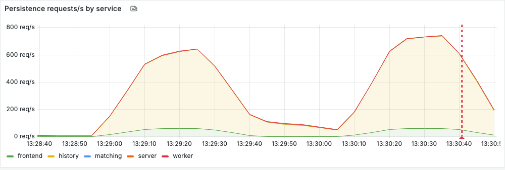
*Persistence requests/s by service: history issues ~640/s with one activity per workflow and ~730/s with two. At
20 workflows/s that is about 4-5 extra persistence calls per extra activity. Frontend stays near 50/s.*

**3. Sticky queues.** Two workers, 20 anatomy workflows (21:16:30), one worker killed at 21:16:40.

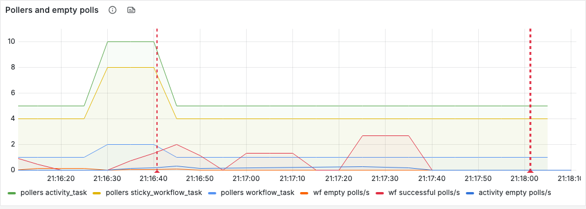
*Pollers: activity pollers drop from 10 to 5 and sticky workflow pollers from 8 to 4 at the kill: half the fleet
is gone.*

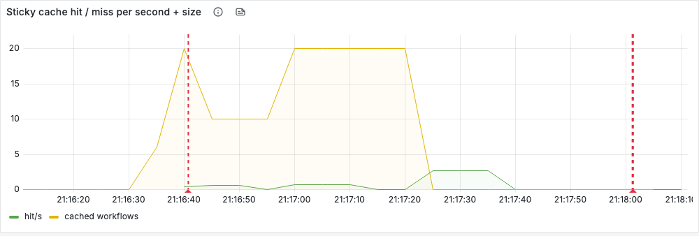
*Sticky cache: 20 workflows cached across both workers, 10 after the kill, back to 20 at ~21:17:00 as the
surviving worker loads the dead worker's workflows, and 0 at ~21:17:22 when all 20 have completed. The sticky
timeout itself is not on the server timeout panel (it is a schedule-to-start timeout on the sticky queue): find it
with `make history`.*

**4. Replay.** Five anatomy workflows (13:33:41), worker restarted at 13:34:12, then signalled.

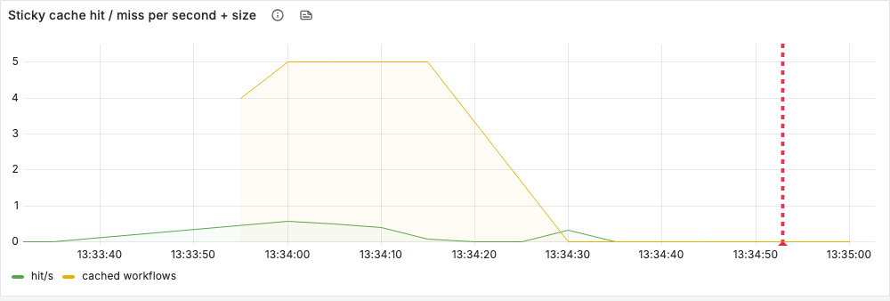
*Sticky cache: the five parked workflows are cached until the restart at 13:34:12 empties the cache.*

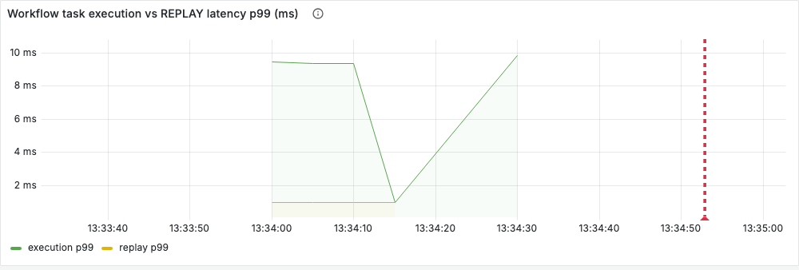
*Execution p99 ~9-10 ms, replay p99 ~1 ms: five short histories are cheap to replay. Replay cost only shows with
long histories (Phase 2 long-lived, Phase 3A.3).*

## Phase 2: load profiles (ramps)

Rates are starts/sec. Each step holds `--step-seconds`. Use `--processes 2` (or more) above ~500/s and **check the `lag p99` column**: if it is > 250 ms you are measuring the generator.
After a ramp: `python3 tools/curve.py results/<run-id>.jsonl` marks the knee.

```sh
# Noop: start-API throughput, shard write rate
lg ramp --shape noop   --rates 10,50,100,500,1000,2000 --step-seconds 120 --processes 2 --run-id noop1
# Activity chain: matching, dispatch, history growth
lg ramp --shape chain  --rates 10,50,100,200,500 --step-seconds 120 --params '{"n":5,"spec":{"work_ms":50}}' --run-id chain1
# Fan-out: repeat with n = 100, 1000, 5000. 5000 exceeds the pending-activity limit: predict what happens first.
lg ramp --shape fanout --rates 1,2,5,10 --step-seconds 60 --params '{"n":1000,"max_parallel":0}' --run-id fan1000
lg ramp --shape fanout --rates 1,2,5,10 --step-seconds 60 --params '{"n":1000,"max_parallel":100}' --run-id fan1000b   # bounded
# Timer storm: ~100k sleeping workflows (1000/s x 100 s). Watch task_latency_queue and timer bursts.
lg ramp --shape timer  --rates 100,500,1000 --step-seconds 100 --params '{"min_s":60,"max_s":300}' --run-id timers
# Signal firehose: many signals to a few workflows.   Hot key: all to ONE workflow id.
lg ramp --shape signal --keys 20 --rates 100,500,1000,2000 --step-seconds 60 --run-id sig20
lg ramp --shape signal --keys 1  --rates 100,500,1000,2000 --step-seconds 60 --run-id hot1
lg ramp --shape noop   --keys 1  --rates 50,200,500 --step-seconds 60 --run-id hotstart   # start the same id repeatedly
# Long-lived: histories growing
lg ramp --shape longlived --rate 5 --duration 120 --params '{"iterations":3000,"sleep_ms":100,"can_mode":"never"}' --run-id ll
# Child fan-out: cross-shard traffic
lg ramp --shape parent --rates 1,2,5 --step-seconds 60 --params '{"n":1000,"max_parallel":200}' --run-id kids
```
For each step record: throughput vs target, rpc/e2e percentiles (table), schedule-to-start (dashboard row 2), **and the first container that hits its CPU ceiling** (dashboard row 4, `Container CPU`). Clean up leftovers: `make cleanup RUN=timers`.

***Example***

`lg` is the shell alias from the experiments guide: `docker compose run --rm --no-deps --name loadgen loadgen`. So this runs the load generator container, which starts Temporal workflows at increasing rates and measures how the cluster copes.

****The flags****

- **`ramp --shape chain`**: start `ChainWorkflow` executions. Each one runs N activities one after another.
- **`--rates 10,50,100,200,500`**: five steps, at 10, 50, 100, 200, and 500 workflow starts per second.
- **`--step-seconds 120`**: hold each step for 2 minutes, so the ramp takes about 10 minutes in total.
- **`--params '{"n":5,"spec":{"work_ms":50}}'`**: each workflow runs 5 sequential activities, and each activity simulates 50 ms of I/O wait. These are actually the defaults for the `chain` shape, so the flag changes nothing here. It's a template you can edit.
- **`--run-id chain1`**: names the run. Workflow IDs become `chain1-chain-0-0`, `chain1-chain-0-1`, and so on. Each workflow is tagged with the search attribute `LabRunId=chain1`, which is how `make count RUN=chain1` and `make cleanup RUN=chain1` find them.

****What happens****

- It starts about 103,000 workflows in total: (10+50+100+200+500) × 120.
- Starts are scheduled at fixed times, whether or not the server keeps up.
- Because `chain` waits for results by default, it also measures end-to-end latency from the intended start time to the workflow result.
- The top step is roughly 2,500 activity executions per second.
- At the end it prints a per-step table with target vs. achieved rate, p50/p99/p99.9 latencies, errors, and generator `lag p99`.
- It then writes `results/chain1.jsonl` and counts workflows by status in visibility.
- Afterwards, `python3 tools/curve.py results/chain1.jsonl` marks the knee, the first step where latency jumps or throughput falls short.

****What to watch for****

- At 500 starts/s, each workflow lives about 0.3–0.5 s, so roughly 150–250 workflows are in flight. That probably exceeds the worker's default 100 activity slots.
- Predict where it breaks before you run it.
- Compare your prediction against the activity schedule-to-start panel and `slots_available` on the dashboard.

This run uses one generator process. If `lag p99` goes above about 250 ms at the high steps, add `--processes 2`, or you'll be measuring the generator instead of Temporal.

### What it looked like (Phase 2)

**Noop** (`--rates 10,50,100,500,1000,2000`, 60 s steps, 2 processes; 13:36:53-13:46:39).

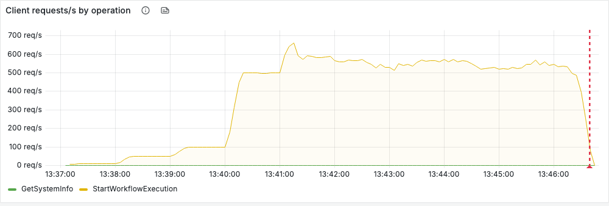
*Client StartWorkflowExecution/s follows the 10, 50, 100 and 500/s steps, then levels off at ~550/s through the
1000 and 2000/s steps. That is the lab's start ceiling (see the note on `forceSearchAttributesCacheRefreshOnRead`
at the top).*

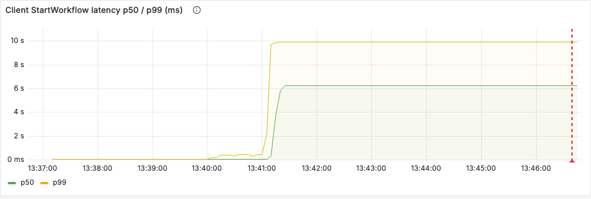
*Client start latency: p99 jumps to 10 s and p50 to ~6 s as soon as the 1000/s step begins (13:41). Starts queue
instead of failing.*

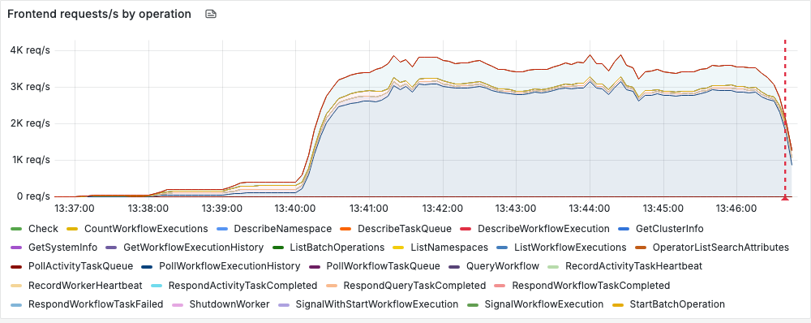
*The frontend handles 3.5-4K requests/s on the plateau, about 7 per start.*

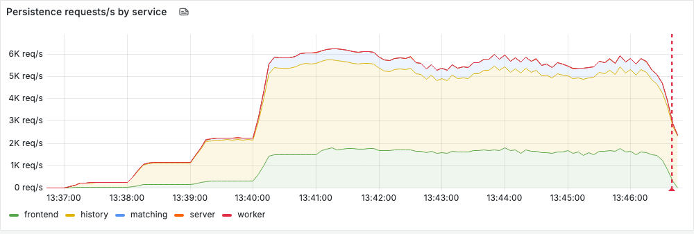
*Persistence: ~5.5-6K requests/s on the plateau. About 1.7K/s of it is the frontend (the cluster-metadata and
namespace reads behind the start ceiling); the rest is history.*

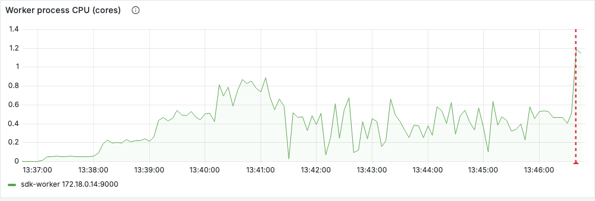
*Worker CPU 0.3-0.8 cores: the worker was not the limit.*

**Activity chain** (`--rates 10,50,100,200,500`, 60 s steps; 13:59:15-14:05:28).

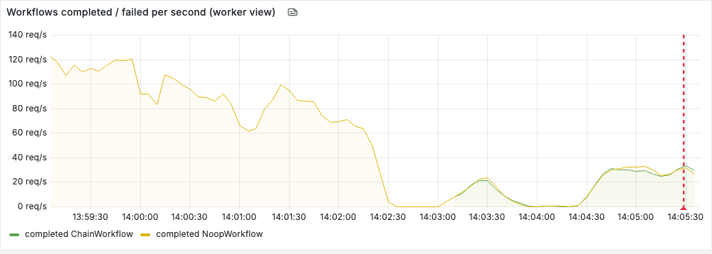
*For the first ~3 minutes the worker was still finishing NoopWorkflows left over from the noop ramp (yellow, ~110/s,
gone by 14:02:20). ChainWorkflow completions (green) only appear after that and never exceed ~30/s, although starts
reached 200 and 500/s.*

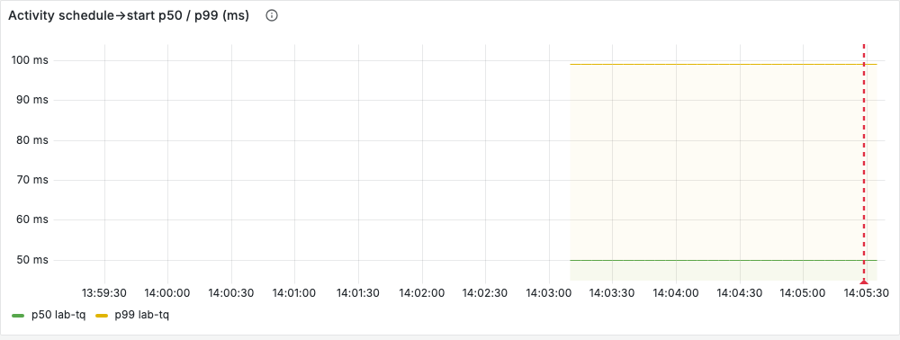
*Activity schedule-to-start stays under the 100 ms bucket: activities never queued.*

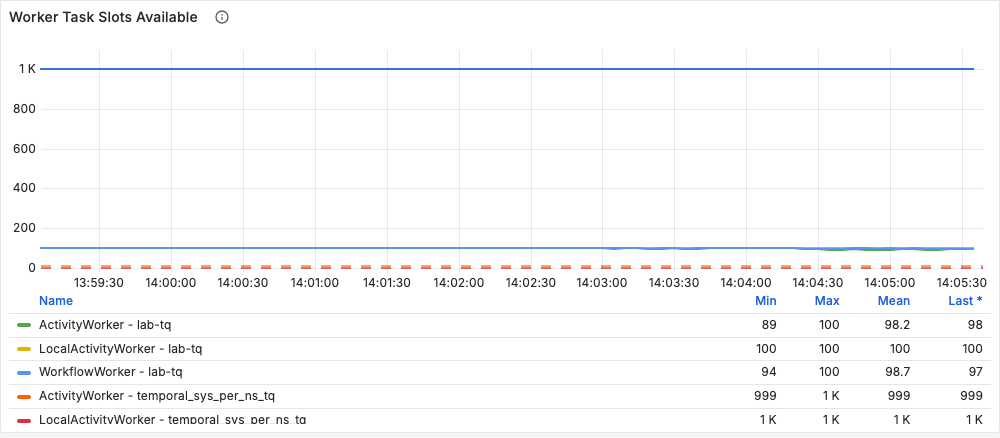
*Slots available (SDK dashboard): activity slots never fell below 89 of 100 and workflow slots below 94. Slots were
not the limit either; new workflows wait for the worker's single normal-queue poller (see the top of this file).*

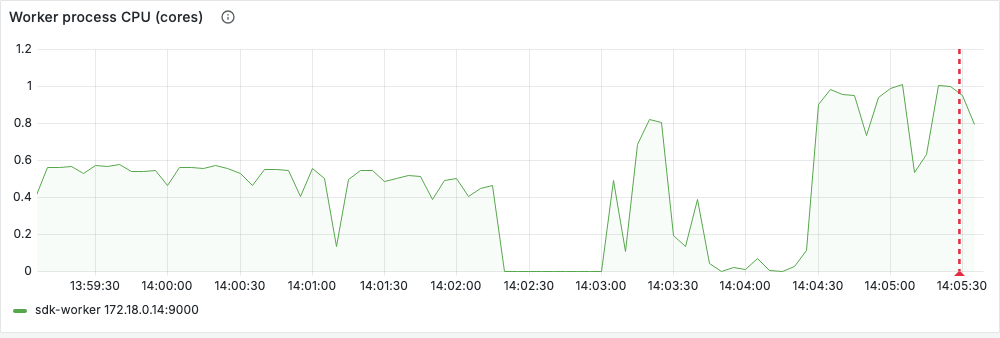
*Worker CPU ~0.5 cores while draining the noop leftovers, near zero 14:02:30-14:03, ~1 core at the top steps.*

**Fan-out, unbounded** (`n=1000`, `max_parallel=0`, rates 1, 2, 5/s for 45 s each; 14:18:07-14:21:38). None of the
360 workflows finished within the 120 s result timeout.

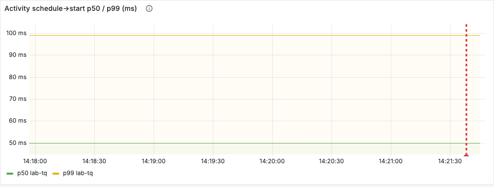
*Activity schedule-to-start stays under the 100 ms bucket the whole time...*

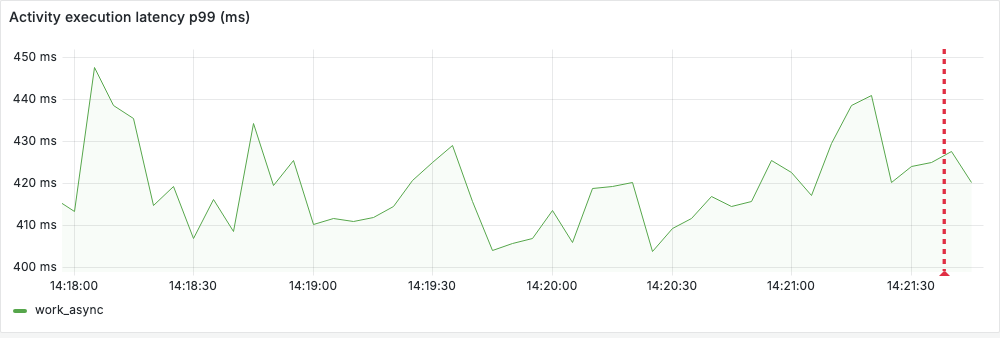
*...but execution p99 is 400-450 ms for activities that sleep 50 ms...*

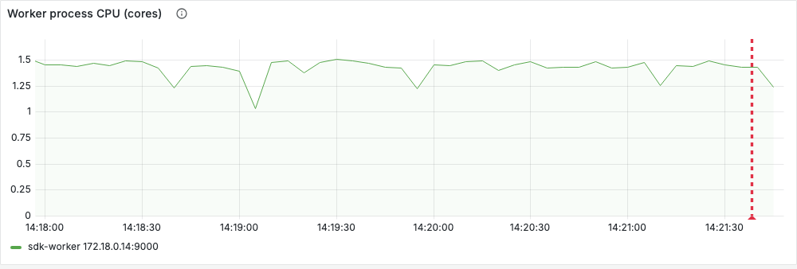
*...and worker CPU is pinned at ~1.45 cores. Tasks are picked up immediately and then wait inside the worker
process, which is why schedule-to-start alone misses this bottleneck.*

**Fan-out, bounded** (`max_parallel=100`; 14:26:36-14:30:07). 25 of the first 45 workflows finished (end-to-end p50
43 s); none of the later 315 within 120 s.

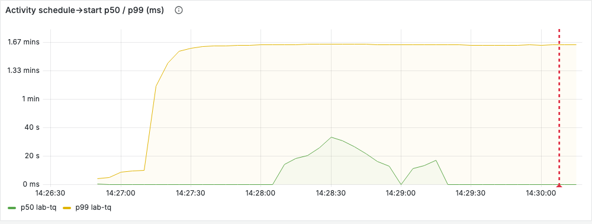
*Here activities do queue: p99 is past the 100 s bucket from 14:27:15, and p50 reaches ~30 s.*

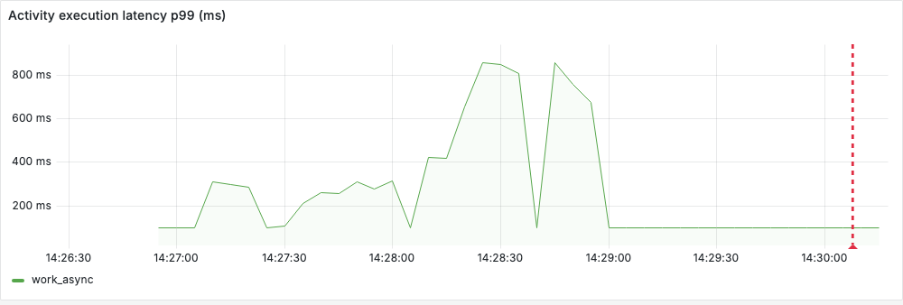
*Execution p99 100-850 ms.*

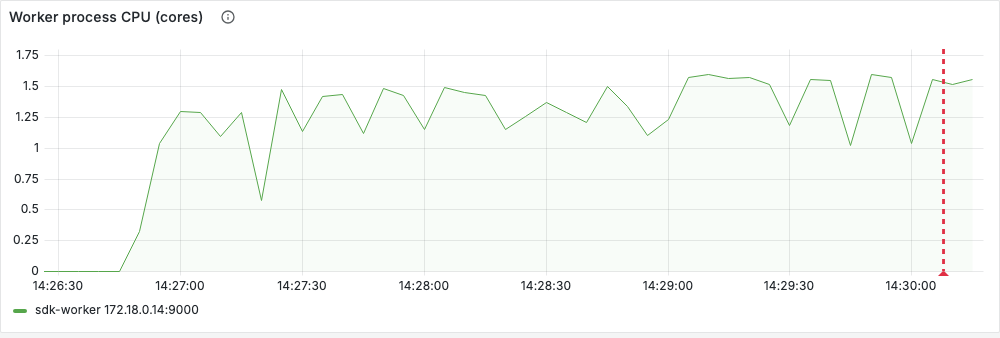
*Worker CPU ~1.1-1.6 cores.*

**Timer storm** (6,000 starts at 100/s, then 30,000 at 500/s, timers of 60-300 s; 14:31:37-14:38:43).

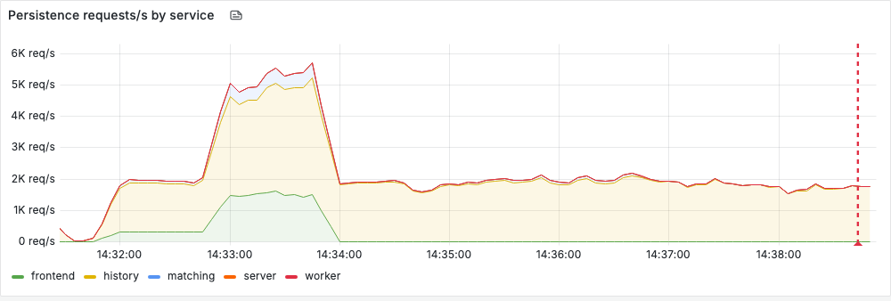
*Persistence: ~5K/s during the 500/s start step (14:32:37-14:33:37), then a steady ~1.8K/s while timers fire.*

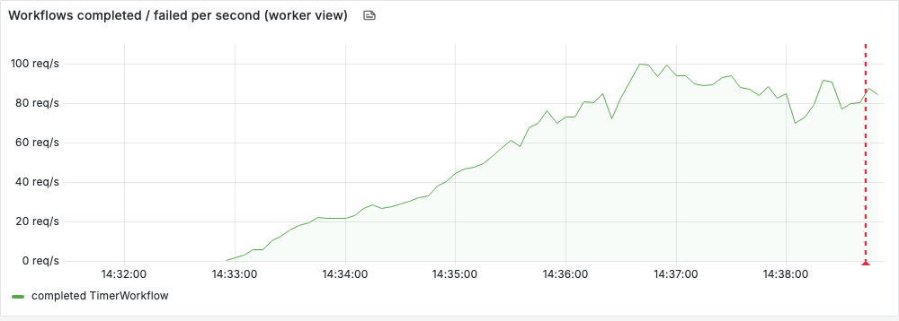
*TimerWorkflow completions begin as the first 60 s timers fire and climb to 80-100/s.*

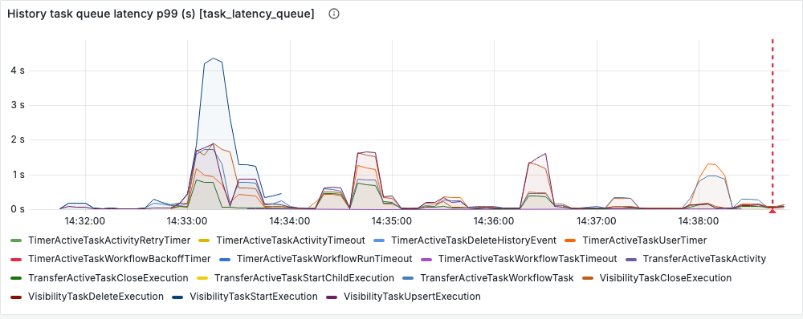
*History task latency p99 peaks at ~4.3 s at 14:33:15, with 1-1.6 s bursts afterwards. The slowest tasks are
visibility tasks (VisibilityTaskStartExecution up to 3.5 s), not timer tasks.*

**Signals to 20 workflows** (100, 500, 1000/s; 14:42:41-14:45:34). At 1000/s the generator lagged 29 s, so the top
step measured the generator.

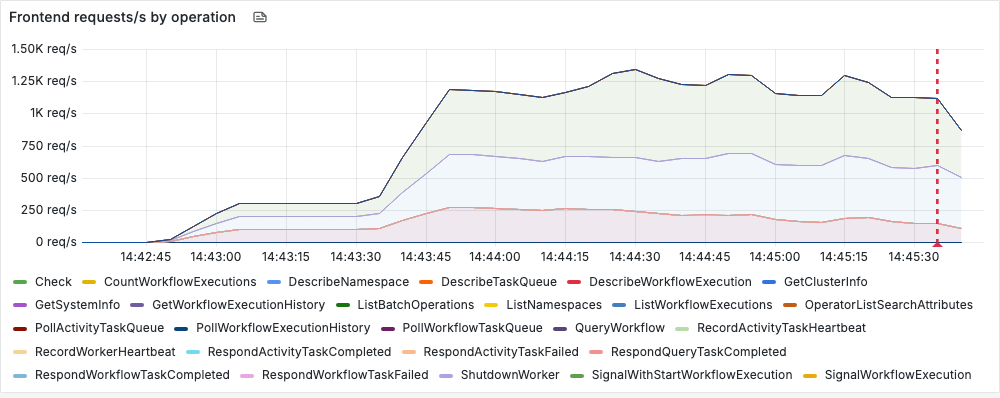
*The frontend peaks at ~1.3K requests/s.*

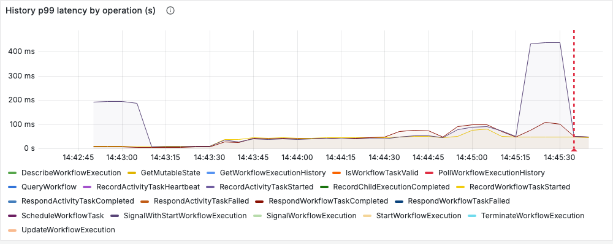
*History p99 mostly under 100 ms, with a ~430 ms spike at the end.*

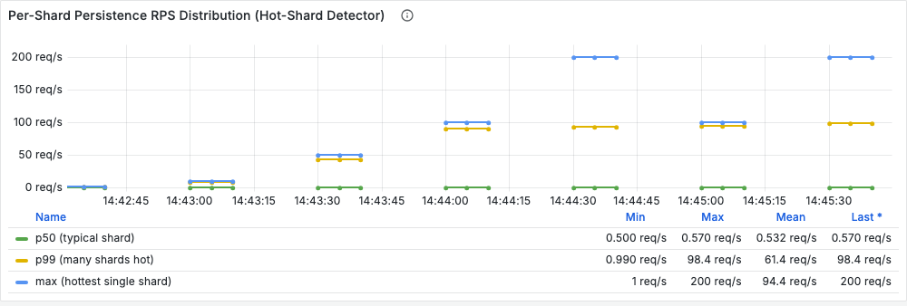
*Hot-shard detector (server dashboard): the hottest shard reaches 200 persistence requests/s while the median shard
stays at 0.5. With 20 target workflows, ~20 shards share the load.*

**Signals to one workflow** (`--keys 1`; 14:46:40-14:50:23). At 500/s only 122/s were accepted. The workflow hit the
per-execution signal limit (`history.maximumSignalsPerExecution`, default 10,000: exactly 10,000 signals succeeded),
after which every signal got `INVALID_ARGUMENT`. The frontend also refused ~94,000 SignalWithStart calls with
`PersistenceLimit`.

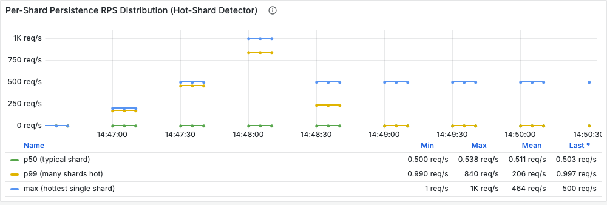
*One shard takes up to 1K persistence requests/s while the median shard stays at 0.5: the hot shard.*

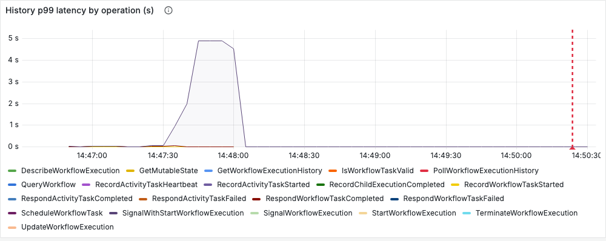
*SignalWithStartWorkflowExecution p99 reaches ~5 s at 14:47:45.*

**Start the same workflow ID repeatedly** (`--keys 1`, noop at 50, 200, 500/s; 14:51:28-14:54:37). Only ~20 starts/s
(~40/s in the last step) succeeded: a new run of the same ID can only start once the previous run has closed.

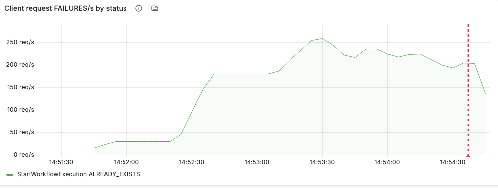
*The rest fail with `ALREADY_EXISTS`, up to ~250/s.*

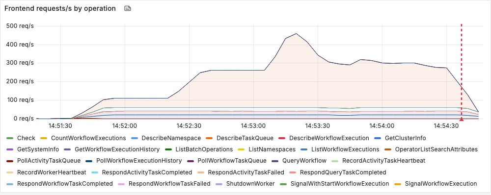
*Frontend at 300-450 requests/s.*

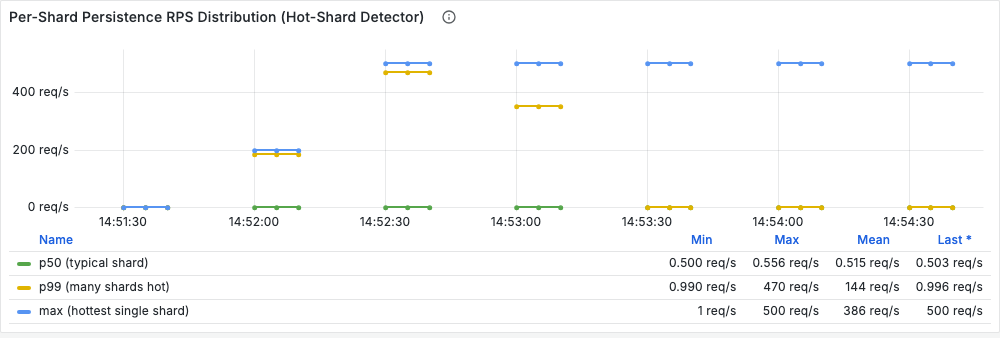
*The hottest shard does up to 500 persistence requests/s.*

**Long-lived** (300 workflows, 3,000 iterations each, never Continue-As-New; 14:55:36-14:59:42).

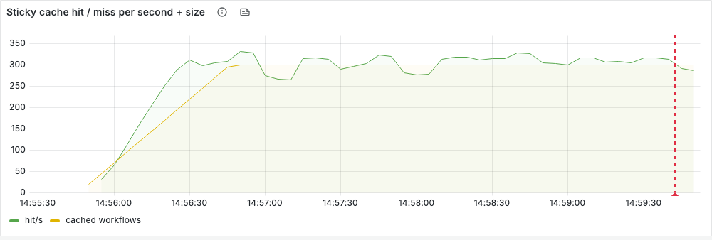
*All 300 workflows stay cached, with ~300 cache hits/s.*

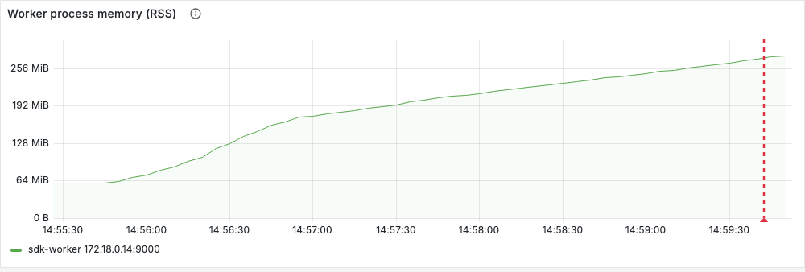
*Worker memory grows from 64 to ~270 MiB in 4 minutes as the cached histories grow.*

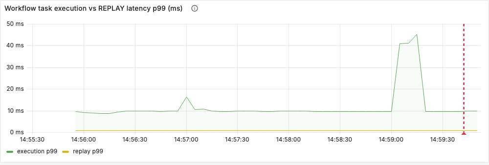
*Execution p99 ~10 ms, one spike to 45 ms. With everything cached there is nothing to replay.*

**Child fan-out** (parents at 1 and 2/s, 500 children each; 15:01:07-15:03:54). Only 6 of the first 45 parents
finished within 180 s (end-to-end p50 62 s). History refused 17 RecordChildExecutionCompleted calls with
`BusyWorkflow` (many children reporting to one parent at once).

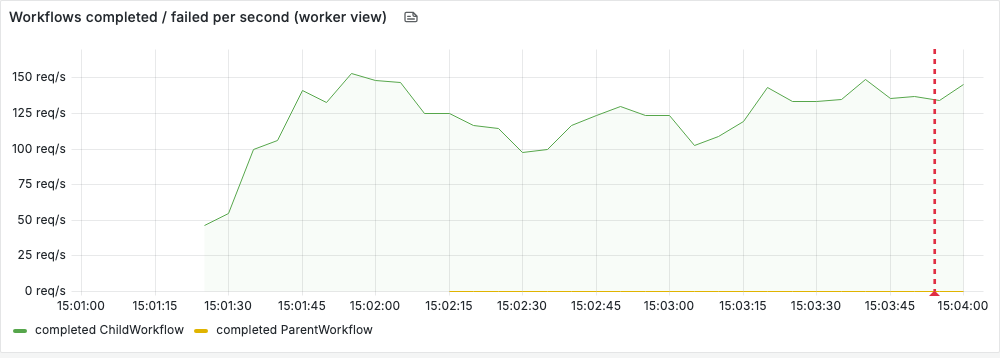
*100-150 child workflows complete per second.*

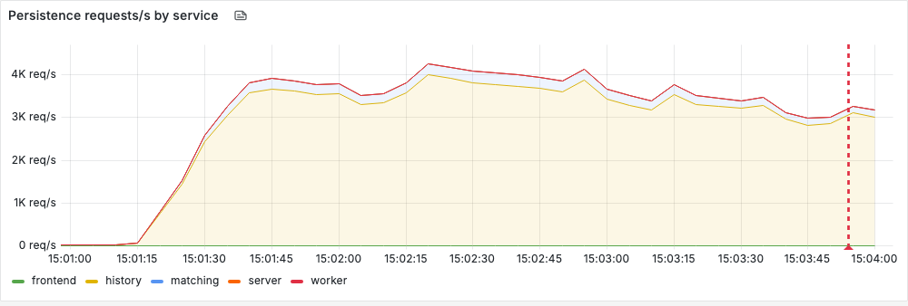
*Persistence ~4K/s, almost all of it history.*

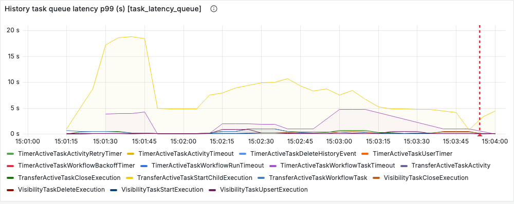
*StartChildExecution transfer tasks wait up to 18 s at p99: children are started by history tasks, and those queue.*


## Phase 3: find and move bottlenecks

Worker knobs are env vars: prefix the command, then `make workers`. Reset by running `make workers` without them.

**A. Worker side**
```sh
# 1. starve activity slots. Predict slots_available and activity schedule->start; server panels stay green.
W_MAX_CONCURRENT_ACTIVITIES=5 make workers
lg ramp --shape chain --rates 20,50,100 --step-seconds 60 --run-id starve
# 2. starve pollers (SDK may require >= 2), then compare with 50 and with W_POLLER_AUTOSCALE=1 (server >= 1.28)
W_MAX_CONCURRENT_WORKFLOW_TASK_POLLS=2 W_MAX_CONCURRENT_ACTIVITY_TASK_POLLS=2 make workers
# 3. tiny sticky cache: the classic hidden cost. Watch cache miss rate, replay latency, then throughput.
W_MAX_CACHED_WORKFLOWS=5 make workers
lg ramp --shape longlived --rate 20 --duration 90 --params '{"iterations":300,"sleep_ms":200}' --run-id cache5
make workers    # default cache (1000) and repeat the same command as cache1000
# 4. CPU-bound workflow code. First with the SDK's deadlock detector (fails the task after ~2 s):
lg ramp --shape poison --rate 1 --duration 5 --params '{"mode":"cpu"}' --run-id spin
docker compose logs sdk-worker | grep -i deadlock
#    then with the detector off, so the SERVER's workflow-task timeout does the work:
W_DEBUG_MODE=1 make workers
lg ramp --shape poison --rate 1 --duration 5 --params '{"mode":"cpu"}' --wft-timeout-s 2 --run-id spin2
make history WF=spin2-poison-0-0     # WorkflowTaskTimedOut
```
Bonus (Python-specific): sync vs async activities and the GIL. Compare `--params '{"call":{"activity":"work_sync"},"spec":{"cpu_ms":20}}'` against `"work_async"` with the same `cpu_ms` at 100/s: the async variant blocks the worker's event loop, so *workflow tasks and polls on the same process* slow down too (watch workflow-task schedule-to-start).

**B. Server side**
```sh
# 1. task queue partitions: edit config/dynamicconfig/docker.yaml (uncomment the two numTaskqueue* keys, value 1), wait 5 s
#    Compare against value 4 (default) and 16. Use make tq to see pollers/backlog.
lg ramp --shape noop --rates 500,1000,2000 --step-seconds 60 --processes 2
# 2. throttle the DB and follow the causal chain (dashboard row 3, top to bottom, plus the ch log timeline)
ch cpu postgres 0.5
ch db-latency 20          # then 100, then 500
lg ramp --shape chain --rates 50,100 --step-seconds 90 --run-id slowdb
ch db-heal; ch cpu postgres 0
# 3. hot key: more history hosts do not help. Explain in terms of shard ownership.
make scale SVC=history N=4
lg ramp --shape signal --keys 1    --rates 500,1000 --step-seconds 60 --run-id hotK1
lg ramp --shape signal --keys 1000 --rates 500,1000 --step-seconds 60 --run-id hotK1000
make shard WF=hotK1-signal-k0 SHARDS=4     # one shard, one owner, one CPU-bound history replica
python3 -m lab.probe shard-dist --pattern 'order-{i}' --count 100000 --shards 512   # ID scheme skew (needs pyfarmhash locally)
# worker bottlenecks, end to end (slots / cpu / blocking / pollers / cache / ratelimit): experiments/worker-performance.md
make workerperf ARGS="run --scenario slots"                        # PASS = issue reproduced AND diagnosed via Recipe 2
make workerperf ARGS="run --scenario slots --fix"                  # PASS = healthy after the recommended fix
# rejected database calls (persistence QPS limits): four checks -> outcome A/B/C/D, and the config traps: experiments/history-persistence-qps.md
make persistenceqps ARGS="run --scenario throttle"                 # PASS = outcome A surfaced (limit too low, DB had room)
make persistenceqps ARGS="run --scenario raise"                    # PASS = refusals down >= 70% vs throttle, DB latency flat
# history task processing + the write-reject loop (reproduce -> playbook readings -> scheduler limits): experiments/history-task-processing.md
make historytasks ARGS="run --scenario loop"                       # PASS = write-reject loop surfaced (indicator > 5, > 10 refused/s)
make historytasks ARGS="calibrate" && make historytasks ARGS="run --scenario fix"   # PASS = nothing refused, tasks wait at the scheduler
# 3b. hot shard, end to end (reproduce -> playbook detection -> verified fixes): experiments/hot-shard.md
make hotshard ARGS="run --kind restart"                            # PASS = hot shard detected AND neighbours slowed
make hotshard ARGS="run --kind restart --expect healthy"           # after a fix from the guide
# 4. shard count
make reset SHARDS=1     # then noop ramp; then make reset SHARDS=512 and repeat the identical ramp
```

**C. Limits and back-pressure**
```sh
# 1. edit dynamicconfig: frontend.namespaceRPS (per host) or frontend.globalNamespaceRPS = 200
lg ramp --shape noop --rates 100,200,400,800 --step-seconds 60 --run-id rps
#    dashboard row 1: temporal_request_failure {status_code="RESOURCE_EXHAUSTED"}, and rpc p99 rising BEFORE errors surface
#    (the SDK retries RESOURCE_EXHAUSTED itself). Does your generator back off or amplify? (--max-inflight bounds it.)
# 2. ceilings: the knee from `python3 tools/curve.py results/noop*.jsonl` at SHARDS=4 vs 512, 1 vs 3 history replicas
```

### What it looked like (Phase 3)

**A1. Starve activity slots** (`W_MAX_CONCURRENT_ACTIVITIES=5`, chain at 20, 50, 100/s; 15:08:24-15:11:20).
End-to-end p50 was 13 s at 20/s and 57 s at 50/s.

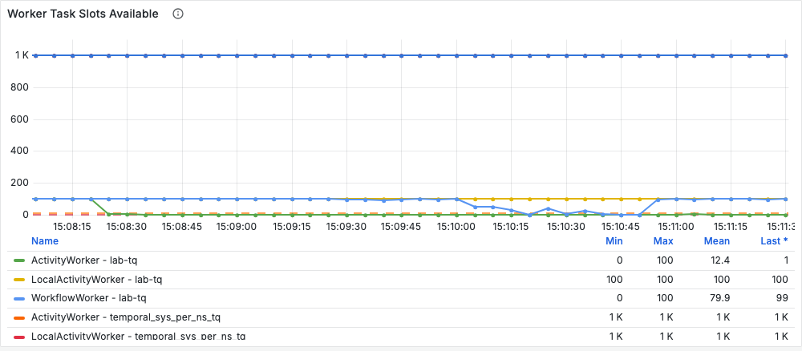
*Slots available (SDK dashboard): activity slots on `lab-tq` sit at 0 free from ~15:08:30.*

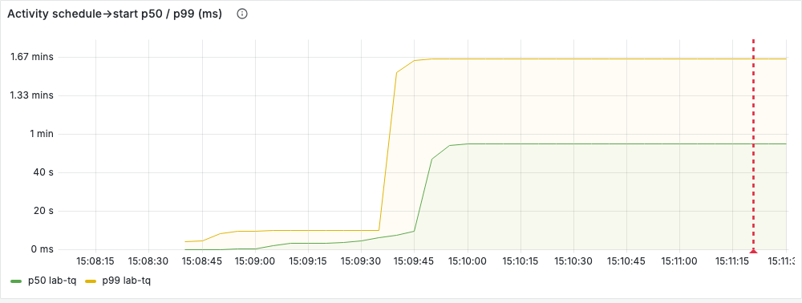
*Activity schedule-to-start: p50 rises to ~55 s and p99 is past the 100 s bucket by 15:09:50.*

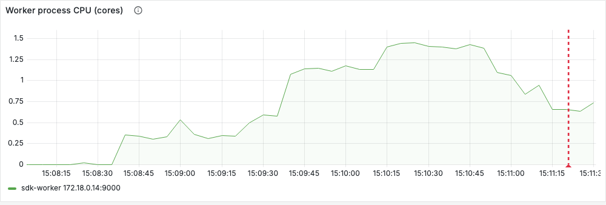
*Worker CPU still climbs to ~1.4 cores.*

**A2. Pollers**: 2 pollers (15:14:00), then 50 (15:16:15), then autoscaling (15:18:30); chain at 50 and 100/s each.

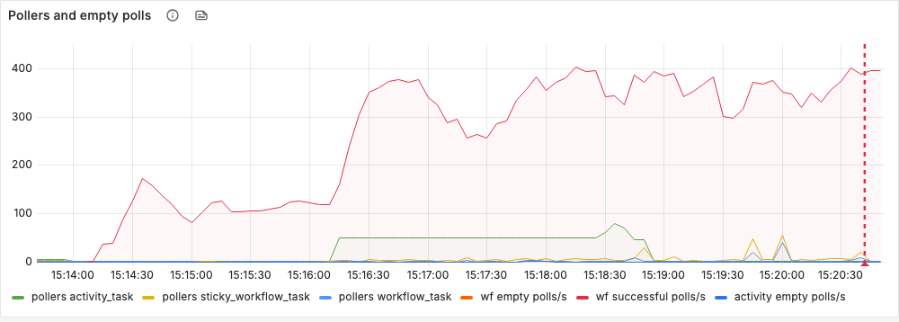
*Successful workflow-task polls: 100-170/s with 2 pollers, 350-400/s with 50 and with autoscaling.*

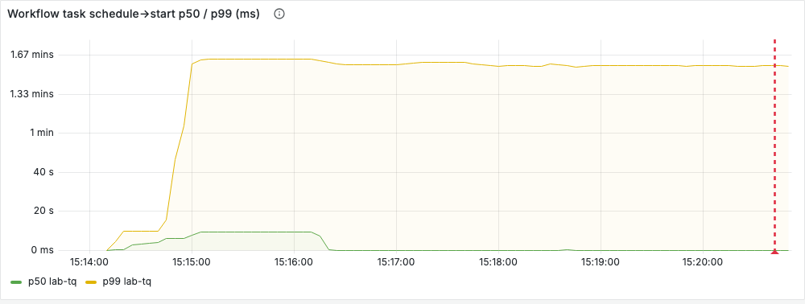
*Workflow-task schedule-to-start: p50 ~10 s in the 2-poller run, near zero from ~15:16 on; p99 stays past the 100 s
bucket throughout because the chain load is above what one worker completes.*

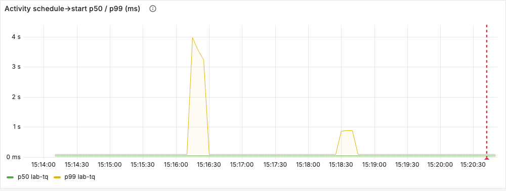
*Activity schedule-to-start: p99 spikes to 4 s at 15:16:10, otherwise near zero.*

**A3. Sticky cache 5 vs 1000** (longlived at 20/s for 90 s: cache5 at 15:22:37, cache1000 at 15:27:18).

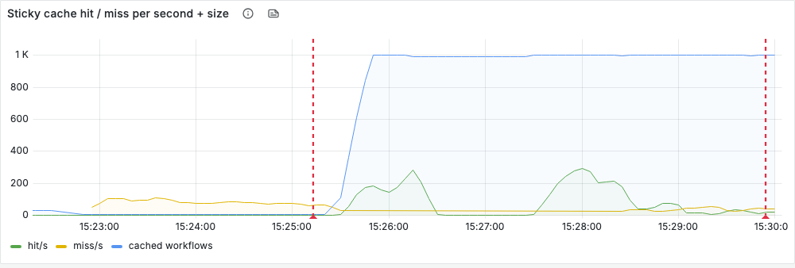
*With 5 entries: ~100 misses/s. With 1,000: the cache fills to its limit within a minute (the run opens 1,800
workflows, so it overflows too) and hits arrive in waves of up to ~280/s.*

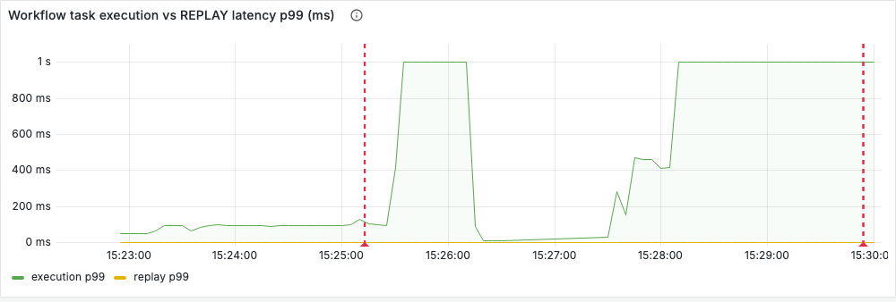
*Execution p99 ~100 ms with 5 entries and up to ~1 s late in the 1,000-entry run, when 1,800 open workflows
overflow the cache. `worker-performance.md` (scenario `cache`) runs a cleaner version of this comparison.*

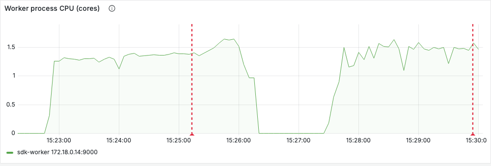
*Worker CPU ~1.3 cores in the first run, ~1.5 in the second.*

**A4. CPU-bound workflow code.**

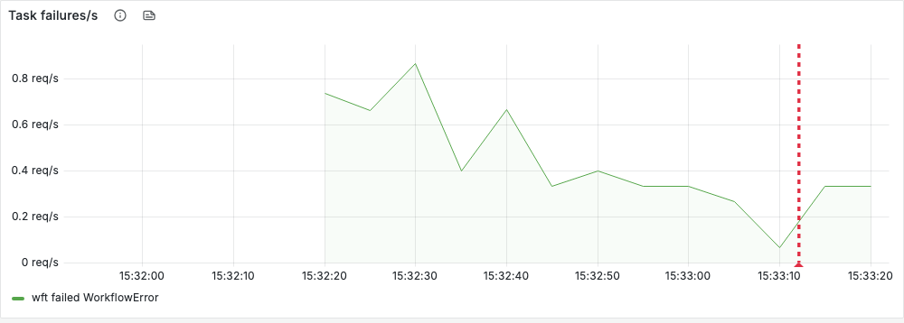
*Detector on: workflow tasks fail with `WorkflowError` at 0.3-0.9/s (the SDK's deadlock detector), and the server
retries them.*

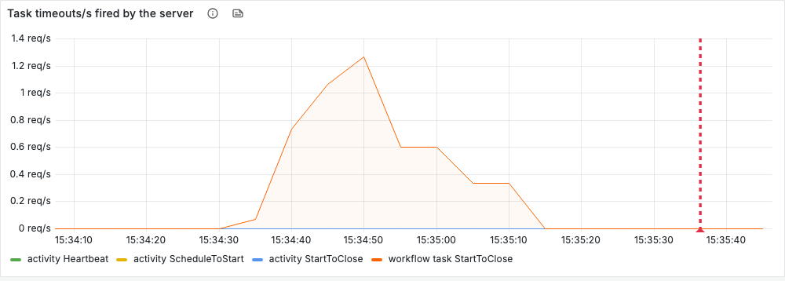
*Detector off (`W_DEBUG_MODE=1`, `--wft-timeout-s 2`): nothing fails on the worker; the server's workflow-task
StartToClose timeout fires instead, up to ~1.3/s.*

**Sync vs async activities** (`cpu_ms=20` at 100/s: work_sync at 15:35:55, work_async at 15:37:41). End-to-end p50
17 s (sync) vs 19 s (async).

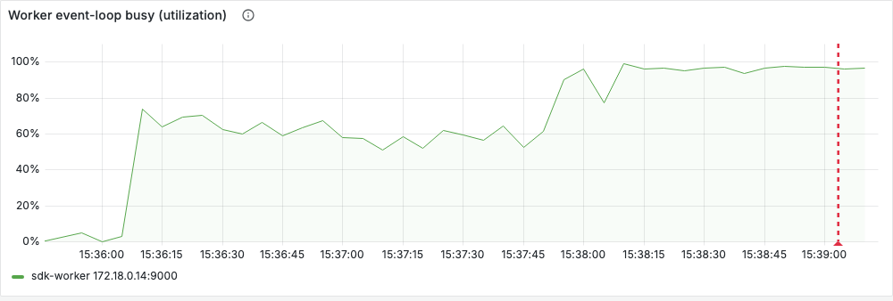
*Event loop busy: 60-70% with the sync activity (it runs in a thread pool), 95-100% with the async one (CPU work
on the event loop).*

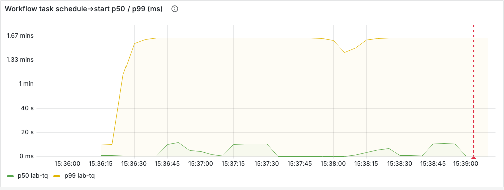
*Workflow-task schedule-to-start: p99 is past the 100 s bucket in both runs, so at this load it cannot tell the two
apart; p50 bumps to ~10 s now and then.*


*Worker CPU ~1.1 cores in both: same work, different place.*

**B1. Task queue partitions** 1 (15:41:58), 4 (15:45:58), 16 (15:50:15); noop at 500 then 1000/s. All three runs
were above the lab's start ceiling and the worker's pickup rate (generator lag 40-55 s), so this run does not
isolate the effect of partitions.


*`poll_success` 50-90/s with 1 partition, up to ~240/s with 4 and ~210/s with 16. `poll_success_sync` stays near
zero: every task went through the database backlog.*


*Workflow-task schedule-to-start: p99 past the 1000 s bucket from 15:44, p50 up to ~9 minutes.*

**B2. Slow database**: Postgres capped at 0.5 CPU, then +20 ms (16:07), +100 ms (16:08), +500 ms (16:09), healed at
16:11:18. Only 322 of 4,500 starts were accepted in the 50/s step and none at 100/s; the rest were cancelled by the
client deadline.


*Persistence p99 climbs to tens of seconds after the +500 ms step...*


*...history operations follow (several at ~50 s p99)...*


*...and frontend StartWorkflowExecution p99 reaches minutes. The cascade runs persistence → history → frontend →
client.*

**B3. Hot key with 4 history replicas** (rerun after the `--no-deps` fix): keys=1 at 21:18:47, keys=1000 at 21:22:04.
With one key, 10,000 signals were accepted (the per-execution limit) and the rest got `INVALID_ARGUMENT` or
`RESOURCE_EXHAUSTED`.


*Four history replicas for the whole run.*


*One key: one shard at up to 1K, then ~500 persistence requests/s while the median shard sits at 0.5. 1000 keys
(from 21:22): the hottest shard falls to tens of requests/s. Four hosts did not help one key, because one workflow
lives on one shard and one shard has one owner.*


*SignalWithStartWorkflowExecution p99 ~7 s at 21:19 with one key; with 1000 keys history p99 stays at 1-2 s.*

**B4. Shard count: 1 vs 512.** `make reset SHARDS=1` and then `SHARDS=512` (each a fresh database), with the same
noop ramp (10, 50, 100, 500, 1000, 2000/s for 60 s, 2 processes). Both clusters keep up to 100/s.

| | 1 shard | 512 shards |
|---|---|---|
| Starts/s on the plateau | ~250 | ~570 (the frontend lock from the top of this file) |
| History StartWorkflowExecution p99 | ~10 s | 0.1-0.35 s |
| Workflows completed/s by the worker on the plateau | ~0.4 | 55-130 |
| Persistence requests/s (all services) | ~1.6-2K | ~5.5-6K |

With one shard, every workflow's writes go through one shard's single queue, so history itself becomes the
bottleneck. New starts and existing workflows' tasks compete for that queue, and workflow progress almost stops
(~0.4 completions/s while 250 starts/s are still accepted). With 512 shards history answers in well under a second
and the ceiling moves back to the frontend.


*1 shard: StartWorkflowExecution follows the ramp to 100/s, spikes to ~370/s at the 500/s step, then holds at
~250/s.*


*512 shards: ~500/s at the 500/s step, then ~570/s through the 1000 and 2000/s steps.*


*1 shard: start p99 at the 10 s deadline and p50 ~6 s from the 500/s step...*


*...and the same with 512 shards from the 1000/s step. The client sees the same picture; the server-side numbers in
the table show the cause has moved.*


*1 shard: persistence levels off at ~1.6-2K requests/s in total.*


*512 shards: ~5.5-6K requests/s, about three times as much database work.*

**C1. `frontend.namespaceRPS: 200`** (noop at 100, 200, 400, 800/s; 16:30:31-16:37:12). This did **not** test the
namespace limit. Nothing was refused with `RpsLimit`. Starts were held in the frontend by the search-attribute lock
described at the top: frontend StartWorkflowExecution p99 was 20-50 s while history's was 0.43 s, and the same
pattern appears in C2 with no RPS limit set. Rerun this with `forceSearchAttributesCacheRefreshOnRead` removed.


*Client failures are `TRANSPORT_ERROR` (the client's deadline), 30-75/s, not `RESOURCE_EXHAUSTED`.*


*Client start latency at the 10 s deadline from 16:31.*


*Frontend p99: StartWorkflowExecution held for ~50 s; the lines at 1.67 min are long polls.*

**C2. Three history replicas** (rerun after the `--no-deps` fix; noop ramp 10-2000/s; 21:29:29-21:39:15). Starts
levelled off at ~55-80/s, far below the ~550/s that one history replica reached in the Phase 2 noop ramp. Frontend
StartWorkflowExecution p99 was ~50 s while history's was 0.46 s. The ceiling moved with Postgres read latency (the
search-attribute lock), not with the number of history replicas.


*Three history replicas for the whole run.*


*StartWorkflowExecution follows 10 and 50/s, reaches 100/s briefly, then oscillates at 55-80/s.*


*Client start latency at the 10 s deadline from 21:32.*

## Phase 4: chaos

Run each **with load applied** (start a ramp in one terminal, inject in another). Every `ch` call is logged in `results/chaos.log` and marked on Grafana.

| # | Fault and workload | Watch |
|---|---|---|
| 1 | Long heartbeating activity: `lg ramp --shape chain --rate 5 --duration 60 --no-await --params '{"n":1,"spec":{"work_ms":30000,"heartbeat_every_ms":1000},"call":{"activity":"work_sync","start_to_close_s":300,"heartbeat_timeout_s":5}}'` then `ch kill sdk-worker 5`. Repeat with `heartbeat_timeout_s` removed and `heartbeat_every_ms` 0: predict the retry time. | activity attempts in `make history`, retry gap |
| 2 | `make scale SVC=history N=3`; chain load at 100/s; `ch kill-one history 30` | membership panel, `ShardOwnershipLost`, throughput recovery time, in-flight workflow results |
| 3 | chain load; `ch kill matching 20`; `make tq` before/after | backlog drain, lost tasks (there should be none) |
| 4 | noop load; `ch kill frontend 15`. Then `make scale SVC=frontend N=2` and repeat (client-side DNS balancing) | client failures, rpc p99 |
| 5 | `make scale SVC=frontend N=2`, same for `matching` and `history`; chain load; `ch rolling-restart history 20`, then matching, frontend. Success = `make count RUN=<id>` has zero Failed/Terminated | count by status |
| 6 | `ch db-pause 30`, then 120, then 600 under chain load | when history starts erroring, thundering herd on resume |
| 7 | `ch db-latency 500` | cascade: persistence -> history -> frontend -> client timeouts |
| 8 | no replicated DB in the lab; nearest analogues: `ch db-kill 10`, `ch db-cut`, `ch db-reset-peer` (then `ch db-heal`) | shard ownership stability, error types |
| 9 | Long activities (see #1) and `ch partition sdk-worker 5`, then `20` (shorter / longer than the 10 s workflow task timeout) | `WorkflowTaskTimedOut`, duplicate activity execution, worker logs on reporting a stale attempt |
| 10 | `make scale SVC=history N=2`; chain load; `ch partition history 40` (cuts one history host off completely; not exactly "DB only", the lab has one shared DB path) | shard range-id fencing: writes from the old owner must be rejected |
| 11 | **Non-determinism.** See below | `temporal_workflow_task_execution_failed`, `WorkflowTaskFailed` |
| 12 | **Poison pill.** `lg ramp --shape poison --rate 10 --duration 10 --params '{"mode":"raise"}' --run-id pz` (also `raise_after_activity`, and `fail` for contrast). Then add `--exec-timeout-s 60`. | workflows stay Running; task retries with backoff; history does **not** grow per retry, so use `t workflow describe -w pz-poison-0-0` for the pending task attempt count |
| 13 | **Retry storm.** `lg ramp --shape fanout --rate 2 --duration 30 --run-id storm --params '{"n":200,"call":{"initial_interval_ms":100,"backoff":1.0,"max_interval_s":1,"schedule_to_close_s":60},"spec":{"fail_rate":1.0}}'`. Compare with default backoff (`"backoff":2.0,"max_interval_s":100`). | `service_requests` for activity RPCs, `temporal_activity_execution_failed`, server CPU |
| 14 | **Hanging activity.** `--params '{"n":1,"spec":{"work_ms":600000},"call":{"start_to_close_s":900}}'`, `ch kill sdk-worker 5`: how long until it is retried? Fix: add `"heartbeat_every_ms":1000` to spec and `"heartbeat_timeout_s":5` to call | time to detection |
| 15 | **Unbounded history.** Lower `limit.historyCount.warn/error/suggestContinueAsNew` in dynamicconfig, then `--shape longlived --params '{"iterations":20000,"sleep_ms":0,"can_mode":"never"}'`; repeat with `"can_mode":"suggested"` and `"every"` | warnings in `docker compose logs history`, terminal failure, replay latency |
| 16 | **Oversized payloads.** `lg ramp --shape noop --rate 1 --duration 1 --payload-bytes 3000000` (over 2 MB blob limit) and `5000000` (over 4 MB gRPC). Then a big activity result: `--shape chain --params '{"n":1,"spec":{"response_bytes":3000000}}'` | where the error appears and how visible it is (client error vs stuck workflow) |
| 17 | **Pending/signal limits.** `--shape fanout --params '{"n":3000}'` (pending activities), `--shape parent --params '{"n":3000}'` (pending children), `--shape signal --keys 1 --rate 500 --duration 60` (signals per execution). Check exact limits for your version. | what fails first, and whether the workflow or the task fails |
| 18 | **Clock skew.** `docker compose run -d --name skewed --no-deps --entrypoint faketime sdk-worker -f "+90s" python -m lab.worker`, run chain load, compare behaviors that depend on the worker's clock (local timers, heartbeat throttling) with those the server owns (timeouts, timers). Expect mostly "nothing" and explain why. | |

**#11 Non-determinism, step by step** (v1 = A,B,wait,C; v2 = B,A,wait,C; v3 = v2 behind `workflow.patched`):
```sh
make deploy-variant V=v1
lg ramp --shape evolving --rate 5 --duration 10 --run-id evo --no-await     # runs A,B then parks waiting for a signal
make deploy-variant V=v2                                                     # "deploy" the reordered code
t workflow signal --query 'LabRunId="evo"' --name proceed --yes             # wakes them: replay hits B where history has A
make history WF=evo-evolving-0-0                                             # WorkflowTaskFailed; workflow still Running
# recover, three ways (try each on a fresh 'evo' run):
make deploy-variant V=v1                                                     # (a) roll back: stuck tasks succeed on their next retry
t workflow reset --query 'LabRunId="evo"' --type FirstWorkflowTask --reason fix --yes   # (b) reset (check flags: t workflow reset --help)
make deploy-variant V=v3                                                     # (c) patch: old histories replay as A,B; new runs execute B,A
```
Question for the atlas: why does (c) fix executions that were *already* broken under v2?

### What it looked like (Phase 4)

Activity timeouts are enforced by the server, so a dead or cut-off worker does not show up in its own metrics. The
lab dashboard's **Task timeouts/s fired by the server** panel (`activity_task_timeout` by `timeout_type`, plus
workflow-task StartToClose) is the one to watch for #1, #9 and #14.

**#1 Heartbeating activity, worker killed** (30 s activities at 5/s, heartbeat every 1 s, heartbeat timeout 5 s;
worker killed at 17:08:48 for 5 s).


*Heartbeat timeouts fire 10-25 s after the kill: the server notices the lost attempts quickly and retries them.*

**#1 without heartbeats** (start-to-close 60 s; worker killed at 17:11:54).


*Only StartToClose timeouts, 50-75 s after the kill: each lost attempt is noticed only when its 60 s start-to-close
runs out.*

**#2 Kill one of 3 history replicas for 30 s** (chain at 100/s from 21:43:02; kill at 21:43:42; rerun after the
`--no-deps` fix). Of 12,000 starts, 4,501 were accepted; 7,467 were cancelled by the client deadline (rpc p50 29 s).


*History goes from 3 replicas to 2 at the kill and back to 3 about 30 s later.*


*Start failures are `TRANSPORT_ERROR` (client deadline), in waves of up to ~85/s from 21:44 to 21:46:30.*


*ChainWorkflow completions run at 2-7/s throughout, with no clear dip at the kill, and rise to ~12/s once the load
stops. The worker, not history, sets the pace here.*

**#3 Kill matching for 20 s** (chain at 50/s; killed 17:30:58, back 17:31:19). No client-side failures.


*ChainWorkflow completions drop to zero during the outage and resume at ~4/s by 17:31:45; ~10/s after the load
ends.*


*Matching hands out 10-20 tasks/s, dips at the outage, and reaches ~75/s once new starts stop at 17:32:40.*

**#4 Kill the frontend for 15 s** (noop at 50/s; rerun after the `--no-deps` fix). With one frontend (killed
21:51:35), start rpc p50/p99 was 11 s / 19 s. With two (one killed at 21:54:16), it was 165 ms / 1.6 s. Every start
succeeded in both runs: the SDK retried until a frontend answered.


*One frontend, then two from ~21:53:30; one of the two is down 21:54:16-21:54:31.*


*One frontend: p50 and p99 sit at the 10 s deadline for about a minute and take until ~21:54 to recover. Two
frontends: p99 ~2.5 s, p50 ~1.5 s, for about a minute.*

**#5 Rolling restart, 2 replicas of each service** (chain at 50/s from 21:58:36; history restarted 21:59:06,
matching 22:00:26, frontend 22:01:46; rerun after the `--no-deps` fix). This run does **not** show the effect of the
restarts: completions were near zero before the first restart and stayed there. Matching added ~90 workflow tasks/s,
but `poll_success` stayed at ~1.4/s and the worker's CPU at 0. The worker had one normal-queue poller (SDK default),
so new workflows waited for it. Repeat with more workflow-task pollers.


*Two replicas of frontend, matching and history.*


*A ~2.5/s blip at 21:59:15, then nothing.*


*The large series is frontend `ResourceExhausted`, up to ~430/s: the generator's result long polls over the
1,200 limit, not the restarts.*


*Only a brief ~2.3/s burst of `TRANSPORT_ERROR` at 21:59:45; 38 of 13,500 starts failed.*

**#6 Database paused 30 s** (chain at 50/s; paused 18:08:04-18:08:35). Completions resumed ~35 s after the unpause.


*History persistence `Unavailable` errors up to ~370/s during the pause.*


*Persistence p99 up to ~50 s: operations waited out the pause.*


*~45 start failures/s (`TRANSPORT_ERROR`) for 30 s after the unpause, as queued starts hit their deadline.*


*Completions stop at the pause and recover to ~8/s by 18:10:15.*

**#6 Database paused 120 s** (18:23:52-18:25:54). 9,161 of 10,500 starts were cancelled. Completions resumed ~23 s
after the unpause.


*~300 errors/s for the whole pause, with a spike to ~350/s at the unpause.*


*Persistence p99 climbs to the length of the pause.*


*Every start fails (~50/s) from 18:24:30 to 18:27:40.*


*Zero completions 18:24-18:26:15, then ~9/s, rising to ~20/s as the backlog drains.*

**#6 Database paused 600 s** (18:33:25-18:43:32). 34,788 of 36,000 starts were cancelled. Completions resumed ~48 s
after the unpause.


*Errors at 150-220/s, falling to ~50/s, with a burst at the unpause.*


*Persistence p99 grows with the pause, to ~16 minutes.*


*Every start fails for 11 minutes.*


*Zero completions until 18:44:20.*

**#7 Database latency +500 ms** (18:47:45-18:48:45). Completions resumed ~15 s after the heal.


*Persistence p99 rises across operations, one to ~1.5 minutes.*


*Frontend operations follow, several to over a minute...*


*...and every start fails (~50/s, `TRANSPORT_ERROR`) from 18:48:30 to 18:49:40.*

**#8 Database killed for 10 s** (18:56:45, back 18:56:56). 390 starts failed with `NOT_FOUND`: the frontend could not
load the namespace from the database (the server logged `NamespaceNotFound`). Completions resumed ~104 s after the
database came back.


*History `Unavailable` persistence errors up to ~1K/s for ~30 s.*


*`NOT_FOUND` start failures up to ~20/s for ~30 s after the kill.*


*Server errors peak at ~400/s and last ~90 s after the database is back.*


*1-2 completions/s until the load ends, ~12/s from 18:58:40.*

**#8 Database connections cut** (proxy disabled 19:07:28, healed 19:07:58). The slowest recovery of the faults:
completions only resumed at ~19:11:43, about 3¾ minutes after the heal and outside the panels' window.


*~1K persistence errors/s while connections are refused.*


*Server errors climb to ~480/s after the heal and last until ~19:09:45.*


*`NOT_FOUND` starts at ~22/s (namespace lookups failing), then transport errors.*


*No completions after the cut, to the end of the window.*

**#8 TCP reset on every DB connection** (19:19:55, healed 19:20:25). Completions resumed ~30 s after the heal.


*~1K persistence errors/s for ~40 s.*


*Server errors ~300-350/s for ~90 s after the heal.*


*`NOT_FOUND` at ~22/s for 30 s, then a few transport errors.*


*~3/s shortly after the heal, ~11/s from 19:22.*

**#9 Worker partitioned for 5 s** (19:30:23-19:30:28; heartbeating 30 s activities).


*A handful of Heartbeat timeouts (under 0.1/s): only attempts whose 5 s heartbeat window spanned the partition.*

**#9 Worker partitioned for 20 s** (19:33:29-19:33:49).


*Heartbeat timeouts up to ~7/s within seconds of the partition, plus a few workflow-task StartToClose timeouts.*


*The retried attempts queue: p50 rises to ~55 s, p99 past the 100 s bucket.*

**#10 Partition each of 2 history replicas for 40 s** (history-1 22:18:05-22:18:46, then history-2 until 22:19:27;
rerun after the `--no-deps` fix). 6,690 of 7,500 starts were accepted. Range-id fencing (rejected writes from the
cut-off owner) is not visible on these panels: look for `ShardOwnershipLost` in the history logs.


*History drops from 2 to 1 live replica while each one is cut off.*


*Frontend → history client errors spike to ~600/s as the second partition begins.*


*Server errors rise during each partition and for about a minute after each heal.*


*Start failures peak at ~135/s (`UNAVAILABLE`) right after the second partition begins.*

**#11 Non-determinism** (50 workflows on v1; v2 deployed at 19:48:39; signalled 19:48:50; rolled back to v1 at
19:50:20).


*`NonDeterminismError` at 3-6/s from the signal until the rollback. The workflows stay Running and the task keeps
retrying.*


*After the rollback the stuck workflows complete (~3.5/s at 19:51:05).*

**#11 Fix by patching** (v2 at the signal, then v3 with `workflow.patched` at 19:53:47).


*`NonDeterminismError` at 3-7/s under v2, stopping shortly after v3 is deployed.*


*The workflows then complete.*

**#12 Poison pill**: `raise` (19:55:37), `raise_after_activity` (19:56:23), `fail` (19:57:08), `raise` with
`--exec-timeout-s 60` (19:57:54).


*Workflow-task failures (`WorkflowError`) in bursts of up to ~27/s that decay as the retry backoff grows. The
workflows stay Running.*


*Only the `fail` mode ends workflows: ~6.5 PoisonWorkflow failures/s at 19:57:30.*

**#13 Retry storm**: 100 ms fixed retry (20:01:05) vs exponential backoff with a 10 s cap (20:02:45), 200 always-
failing activities per workflow.


*150-210 failed attempts/s in both runs...*


*...300-430 frontend requests/s in both...*


*...and ~0.35-0.45 worker cores in both. Over 60 s windows the two runs look the same: the worker's throughput, not
the retry interval, set the attempt rate. A longer run would show backoff spreading attempts out.*

**#14 Hanging activity** (no heartbeat, start-to-close shortened to 120 s; worker killed at 20:05:41. Then with
heartbeat every 1 s and a 5 s heartbeat timeout; killed at 20:08:22).


*Without heartbeats, StartToClose timeouts at ~20:07:30, two minutes after the attempts started. A second
StartToClose burst at ~20:09:35 is the retries of those attempts timing out again on a hanging worker. With
heartbeats, Heartbeat timeouts fire at ~20:09:25, about 60 s after the kill: much sooner than the 900 s
start-to-close, but slower than the 5 s heartbeat timeout suggests. The reset terminated these workflows at 20:09:35,
so this run does not explain the gap.*

**#15 Unbounded history** (`limit.historyCount.suggestContinueAsNew` 1000, `warn` 2000, `error` 5000). No panel shows
this; the outcomes do. With `can_mode=never` the server terminated each workflow at 5,001 events ("Workflow history
count exceeds limit.", identity `history-service`). With `suggested` the workflows continued-as-new 88 times, and
with `every` 13 times; neither reached the limit.

**#16 Oversized payloads.** A 3 MB start input was refused with `INVALID_ARGUMENT` and a 5 MB one with
`RESOURCE_EXHAUSTED` (gRPC message size). Both are client errors, immediately visible to the caller.


*The 3 MB activity **result** is the quiet failure: the workflow starts fine, and the activity attempt fails and
retries (~0.07-0.2/s from 20:19:50) while the workflow stays Running.*

**#17 Limits.** The fan-out of 3,000 activities and the parent with 3,000 children were each still unfinished after
the result timeout. Signals at 500/s to one workflow: 10,000 accepted, then 17,569 `INVALID_ARGUMENT` (the
per-execution signal limit) and 2,386 `RESOURCE_EXHAUSTED`.


*Resource-exhausted (server dashboard): the series is SignalWithStartWorkflowExecution `PersistenceLimit`, up to
~850/s.*


*Server errors up to ~850/s during the signal run.*

**#18 Clock skew** (a second worker with its clock +90 s from 20:25:40; chain at 20/s).


*Workflow-task schedule-to-start p99 jumps to the 100 s bucket at 20:26:10 while p50 stays near zero. That is
consistent with the skewed worker reporting ~90 s for the tasks it picks up.*


*Activity schedule-to-start is unchanged (under 100 ms). The skew distorts a worker-side metric while the work
itself carries on.*

## Phase 5: recovery and operations

```sh
# Bulk repair: use the reset from #11(b). Verify with: make count RUN=evo
# Drain a backlog: stop workers, queue ~100k workflow tasks, then add workers and time the drain.
docker compose stop sdk-worker
lg ramp --shape noop --rates 1000 --step-seconds 100 --processes 2 --no-await --run-id backlog
make tq                         # ApproximateBacklogCount
make scale SVC=sdk-worker N=1   # then 2, 4, 8: drain rate per worker count; what stops scaling linearly?
# Latency SLO alerts: http://localhost:9090/alerts (rules in config/prometheus/rules.yml).
#   Make WorkflowTaskScheduleToStartHigh fire with W_MAX_CONCURRENT_WORKFLOW_TASKS=2, then make it stop firing by fixing the cause, not the threshold.
# Worker deploy while long-running workflows are active: repeat #11 with several `make deploy-variant` steps;
#   for Worker Versioning (deployments) read the SDK docs, it needs server-side support enabled.
```

### What it looked like (Phase 5)

**Drain a backlog**: workers stopped at 20:28:43; 30,000 noop workflows queued (500/s for 60 s); then 1 worker
(20:33:30), 2 (20:35:02), 4 (20:36:34), 8 (20:38:06).


*~135 completions/s with 1 worker, only ~100/s with 2, and the backlog is gone by ~20:36:40, before the 4- and
8-worker steps begin.*


*One worker at ~0.55 cores; two at ~0.3 each. A second worker halved each worker's load instead of doubling
throughput: the drain was limited outside the workers.*


*Successful workflow-task polls follow the same shape: ~140/s, then ~100/s. Poller counts grow with each step.*

**Latency SLO**: 2 workflow-task slots (20:40:07), fixed back to the default at 20:43:12; chain at 30/s.


*Slots available (SDK dashboard): workflow slots at 0 free for the whole 2-slot run, back to 100 after the fix.*


*Workflow-task schedule-to-start p99 peaks at ~4.7 s once, then stays under ~0.5 s.*


*The worker still completed the 30/s target. Two slots were exhausted but enough for this load, so
`WorkflowTaskScheduleToStartHigh` had little to fire on. Use a heavier load or 1 slot to make it fire.*

## Deliverables
`experiments/atlas.md`: the Failure Atlas table (pre-filled with every experiment above), the capacity-model template, and the runbook template.
