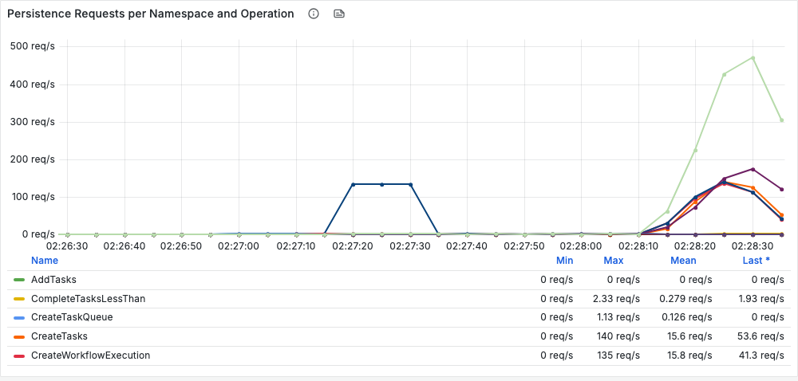

# Rejected database calls: produce them, investigate them, fix them

A runnable version of the playbook
[History Persistence QPS Limits — Rejected Database Calls](https://github.com/tsurdilo/temporal-server-operations/blob/main/playbooks/history-persistence-qps-limits.md)
and its alert runbook
[86 — History Database Calls Rejected](https://github.com/tsurdilo/temporal-server-operations/blob/main/observability/alerts/server/runbooks/86-history-database-calls-rejected.md).

The test is `lab/persistenceqps.py` (`make persistenceqps ARGS="..."`). Each **scenario** sets the history
service's persistence QPS limits a particular way, runs the same burst of work against them, reads the playbook's
panels from Prometheus, walks the playbook's **four checks** (section 4.5) and prints the **outcome** it lands on
(section 4.6). Run `throttle` to reproduce the problem, `raise` to show the fix, and the other scenarios to reproduce
the configuration traps and the case where raising the limit is the wrong answer.

The companion guide, [history-task-processing.md](./history-task-processing.md), covers pacing task processing
(the task scheduler). This one covers the limits themselves.

## Background, in four lines

Every database call the history service makes passes through a rate limiter first. When a limit is reached, the call
is **refused before the database sees it**, with `RESOURCE_EXHAUSTED` and cause `PersistenceLimit`. A refused
history task is retried after 3 s, then 1.5x longer each time, up to 5 minutes, forever; a refused API call goes back
to the caller. Five settings decide the limits, and three of their interactions are traps that leave a cluster
looking configured while it does something else.

## What the test does

```
 settle (75 s)              burst                                              drain
 ── settings applied ──►  1,200 client starts (NoopWorkflow, 120/s)       ──►  until everything completed
                          + 100 ParentWorkflows x 8 children (20/s)
    probe workflow every 2 s, start to finish (does unrelated work still move?)
```

* **Two kinds of traffic on purpose.** Client starts run at **priority 1** in the limiter; child completions and most
  history tasks at **priority 4** (playbook 3.1). Seeing which of them gets refused is part of the diagnosis.
* **The report is the playbook's checklist.** It confirms the cause (4.1), puts the three throttling counters side by
  side (4.3), shows the panels that stay clean (4.2), then answers checks 1–4 and prints the outcome:

```
            | requests failing        | none failing
    --------+-------------------------+-------------------
    DB room |  A  raise the limit     |  B  your call
    no room |  C  the hard one        |  D  leave it alone
```

  "Requests failing" counts client-facing methods **and** internal RPCs that carry workflow progress (the playbook's
  qualifier on check 4: those stall executions without returning an error).

| Scenario | Settings | Playbook | PASS means |
|---|---|---|---|
| `throttle` | `persistenceMaxQPS: 300` | 4.6 outcome A | > 10 refused/s at scope `System`, database had room, requests failing |
| `raise` | `persistenceMaxQPS: 1200` | outcome A, the fix | refusals down ≥ 70% against the last `throttle` run, database latency still flat |
| `nsequal` | `persistenceMaxQPS: 1200`, `persistenceNamespaceMaxQPS: 300` | 2.4 / 6.1 | refusals continue, scope `Namespace` outweighs `System` |
| `global` | `persistenceGlobalMaxQPS: 300`, `persistenceMaxQPS: 20000` | 2.5 | refused at scope `System` although the per-pod limit is 20,000 |
| `zero` | `persistenceMaxQPS: 0`, `persistenceGlobalMaxQPS: 0`, `persistenceNamespaceMaxQPS: 50` on a **running** pod | 2.6 | every call refused and nothing completes (`--expect unlimited` after restarting history with these settings: nothing refused) |
| `dbslow` | `persistenceMaxQPS: 300` + 3 ms per Postgres response | check 2, outcome C | outcome C: latency climbing, requests failing |
| `backoff` | `persistenceMaxQPS: 1200` + adaptive backoff + 3 ms DB latency | check 2's safety net | *Adaptive Rate Limit Multiplier* drops below 1.0 |

Each run writes a marked block at the end of `config/dynamicconfig/docker.yaml` and removes it afterwards; DB
latency goes through toxiproxy and is removed too. After a crash: `make persistenceqps ARGS=reset`.
Exit codes: `0` PASS, `1` FAIL, `2` INVALID (the host slept). Results: `results/<run-id>.json`.

---

## 0. Set up

```sh
make up && make smoke
docker compose build sdk-worker        # only if lab/ changed since the last `make up`
```

* **Keep the machine awake** (`caffeinate -dimsu make persistenceqps ARGS="..."`, lid open). A sleeping laptop freezes
  Docker and every retry timer; the test detects it and reports `INVALID`.
* **Start from an idle cluster.** Retention clean-up after downtime, or a previous run still draining, puts its own
  database calls into every reading. `make cli ARGS="workflow count --query 'ExecutionStatus=\"Running\"'"` should be 0.

---

## 1. Produce the issue

```sh
make persistenceqps ARGS="run --scenario throttle"
```

About 6 minutes. A real run (server 1.32.0, 512 shards, one history pod, local Postgres):

```
baseline: history DB calls 15.3/s, refused 0.0/s, UpdateWorkflowExecution p95 5.0 ms

burst: 1200 client starts (NoopWorkflow, 120.0/s) + 100 parents x 8 children (20.0/s)
  t=   10s executions done 18/2100    refused 309.4/s {'Namespace,PersistenceLimit': 179.5, 'System,PersistenceLimit': 129.9}
  t=   30s executions done 257/2100   refused 247.9/s {'System,PersistenceLimit': 238.3, 'Namespace,PersistenceLimit': 9.5}
  t=   70s executions done 976/2100   refused 283.7/s {'System,PersistenceLimit': 283.7}    requests failed 18.5/s
  t=  130s executions done 1726/2100  refused   8.2/s {'System,PersistenceLimit': 8.2}
  t=  191s executions done 2099/2100  refused   0.0/s

PERSISTENCE-QPS TEST  scenario=throttle  burst window=239 s
workload    2100 executions drained in 239 s   client start latency p50 4 ms p99 10 ms

4.1 confirm  history DB calls refused, by scope and cause: System,PersistenceLimit 89.1/s, Namespace,PersistenceLimit 7.7/s
             top refused operations: GetCurrentClusterMetadata 61.4 (lab artifact), GetWorkflowExecution 25.5,
             RangeCompleteReplicationTasks 3.9, GetOutboundTasks 2.9, RangeCompleteOutboundTasks 1.9, UpdateWorkflowExecution 0.8
4.3 counters database calls refused 96.9/s  |  requests failed 5.7/s  |  task attempts throttled 26.5/s   (refused / failed = 17.0x)
4.2 clean    Persistence Availability 100.00%   Total Timer Tasks Errors 0.0/s   <- read healthy whatever is happening

check 1      enforced per-pod limit: persistenceMaxQPS 300
check 2      UpdateWorkflowExecution p95 4.9 ms at baseline -> 5.0 ms (p99 8.9);  persistence errors other than throttling: none  -> DB HAD ROOM
check 3      loop indicator 4.9 (cleared 44.9/s / cache miss 9.1/s)  -> no loop
check 4      requests failed by method: client-facing none;  carrying workflow progress {'history,RespondWorkflowTaskCompleted': 2.9,
             'frontend,RespondWorkflowTaskCompleted': 1.4, 'history,RecordChildExecutionCompleted': 0.9, ...};  other none
saturation  line = 300 / 512 shards = 0.59/s per shard;  per-shard RPS p99 1.3, max 5.0
probe       unrelated workflow start->result p95: 40 ms at baseline, 46719 ms during the burst

4.6 outcome  A: database had room, requests failing -> RAISE the enforced limit, in steps, with adaptive backoff on

RESULT: PASS (outcome A: > 10 refused calls/s at scope System, database had room, requests failing)
```


*History Rejected Database Calls Total by Scope, `throttle` run (01:45–01:48 UTC): a burst at scope `Namespace` in the first seconds, then `System` refusals at ~300/s for a minute, draining as the backlog clears. Cause `PersistenceLimit` throughout.*

What to notice:

* **The database never noticed.** `UpdateWorkflowExecution` p95 stayed at 5.0 ms while the limiter refused up to 309
  calls a second. Every one of those calls was turned away before Postgres saw it.
* **Nobody got an error, and an unrelated workflow took 47 seconds.** Client starts went through in 4 ms (priority 1
  had room); the refusals landed on the worker's workflow-task completions and on child completions, which retry out
  of sight. A one-step probe workflow that takes 40 ms at baseline took up to **47 s**.
* **Most "throttling" metrics disagree with each other by 17x**, and the panel most people check first reads 100%
  (section 2).

## 2. Show and investigate it

Run a scenario in one terminal and watch Grafana (http://localhost:3000, *Temporal Server Dashboard v2.25.0*,
namespace `lab`) in the other. The playbook's order:

### 4.1 Confirm the limiter is what rejected the calls

**Panel:** *History Rejected Database Calls Total by Scope*.

```promql
sum(rate(persistence_errors_resource_exhausted{service_name="history"}[$__rate_interval])) by (resource_exhausted_scope, resource_exhausted_cause)
```


*Rejected Database Calls by Operation and Scope (namespace `lab`), `throttle` run: `CreateWorkflowExecution` refused in the opening seconds (the client starts, at scope `Namespace`), then `GetWorkflowExecution` re-reads for the rest of the burst. The pod's own system work is not in this per-namespace panel.*

Cause `PersistenceLimit`: Temporal's own limiter, the database was never asked. (On a SQL store that is the only
cause this metric can carry.) Scope `System` is the per-pod check; `Namespace` is the per-namespace **or** per-shard
check, which share the tag.

Note the first ten seconds of `throttle`: **179.5/s at scope `Namespace`** although no namespace limit was set. At
`0` the namespace check is not off; it runs at the pod's rate (playbook 2.6), and a single-namespace burst empties
that bucket first. The two scopes side by side is normal (playbook 2.2).

To tell the two namespace checks apart, count the log messages:

```sh
docker compose logs history | grep -hoE "(System|Namespace|Namespace Per-Shard) Persistence Max QPS Reached\." | sort | uniq -c
```

### 4.2 Four panels that stay clean while you are throttled

| Panel | In every throttled run here | Why |
|---|---|---|
| *Persistence Availability* | **100.00%** (99.92% in `backoff`, from real `Unavailable` errors, not throttling) | `persistence_errors` skips resource-exhausted |
| *Total Timer Tasks Errors* | **0** | `task_errors` counts unexpected errors only; throttling is expected |
| *Per-Shard Persistence RPS Distribution* | max 5/s against 309 refusals/s | 30-second average of a one-second bucket |
| *Timer Task Scheduling Latency* | (empty on this lab) | the queue-lag metric is emitted every 5 minutes |


*Persistence Availability over the whole `throttle` run: 100% while up to 309 database calls a second were being refused.*

### 4.3 Three counters, three numbers, all correct

| Counter | Counts | `throttle` | `raise` | `global` |
|---|---|---|---|---|
| `persistence_errors_resource_exhausted` | database calls refused | **96.9/s** | 284.5/s | 110.8/s |
| `task_errors_throttled` | history task attempts refused | 26.5/s | 65.9/s | 35.3/s |
| `service_errors_resource_exhausted` | requests that failed | 5.7/s | 30.9/s | 5.2/s |
| refused ÷ failed | | **17x** | 9x | 21x |

Use the first for **how much** throttling there is. The third is for **who is affected** (check 4); reading it as
the volume under-reports by an order of magnitude.

### 4.4 The rate a pod is actually enforcing

```sh
docker compose logs history | grep '"Quota changed"' | grep '"component":"persistence"'
```

```
"component":"persistence","scope":"host","current-quota":9000,"new-quota":300
```

The only place the enforced value appears (needs `info` logging). The limiter re-reads its quota once a minute,
which is why every run settles for 75 s first.

### The four checks (playbook 4.5)

| Check | Where | `throttle` reading | Means |
|---|---|---|---|
| **1** Is a cluster-wide limit in force? | `history.persistenceGlobalMaxQPS` in dynamic config | 0, so `persistenceMaxQPS` (300) is enforced | tune `persistenceMaxQPS` |
| **2** Was the database struggling? | *Persistence Latencies*; *Persistence Errors by Namespace and Operation* for timeouts | `UpdateWorkflowExecution` p95 4.9 → 5.0 ms, no timeouts | **room** |
| **3** Is the write-reject loop running? | *Write-Reject Loop Indicator* | 4.9 (cleared 44.9/s, miss 9.1/s) | borderline, not running |
| **4** Who is being throttled? | *Resource Exhausted with Cause*, by operation | no client-facing method; `RespondWorkflowTaskCompleted` and `RecordChildExecutionCompleted` refused | **executions stalling** (the playbook's qualifier: treat as affected) |


*Check 2, Persistence Latencies (p95), `throttle` run: every operation stays within 5–18 ms through the burst, as at baseline. The database was never the constraint.*


*Check 3, Write-Reject Loop Indicator, `throttle` run: state cleared (yellow) spikes to ~700/s at the start of the burst against ~170/s of cache misses (blue), then both settle. The test's average ratio for the run was 4.9: borderline, not a running loop.*


*Check 4, Resource Exhausted with Cause, `throttle` run: the purple lines are `RespondWorkflowTaskCompleted` refused in history and at the frontend (the worker finishing workflow tasks), and the red line is `RecordChildExecutionCompleted`. Progress-carrying RPCs, all retried; no client-facing method failed.*

**Saturation line** (playbook 4.5, check 2): `300 / 512 shards = 0.59/s per shard`, below the per-shard p99 of 1.3: by
the playbook's table, "even unremarkable shards are over budget. The limit is low for this workload."

**Outcome A**: database had room, workflow progress affected. Raise the limit.

The test prints this whole table for every run; `results/<run-id>.json` keeps every number.

## 3. Fix it

### Outcome A: raise the enforced limit (playbook 4.6)

```sh
make persistenceqps ARGS="run --scenario raise"        # history.persistenceMaxQPS: 1200, same workload
```

```
vs throttle  refused calls in total (lab artifact excluded) 8,483 -> 3,018 (64% down);  drained 239 s -> 42 s (5.7x faster);
             DB write p95 5.0 -> 8.3 ms
RESULT: PASS (vs the last `throttle` run: refused calls in total down >= 50%, backlog drained >= 2x faster, database latency still flat)
```

| | `throttle` (300) | `raise` (1200) |
|---|---|---|
| backlog drained in | 239 s | **42 s** |
| refused calls in total | 8,483 | **3,018** |
| `UpdateWorkflowExecution` p95 | 5.0 ms | 8.3 ms: the database is starting to feel it; raise in steps and stop when this climbs |
| unrelated probe p95 | 46.7 s | 11.4 s |


*History Rejected Database Calls Total by Scope, `raise` run (limit 1200): a single 40-second burst of `System` refusals, peaking higher than in `throttle` because the same work arrives in a sixth of the time.*


*Persistence Latencies (p95), `raise` run: writes still within 5–19 ms. The database had room for the raise.*

Two readings that look wrong and are not:

* **Refusals per second went *up*** (96.9/s → 284.5/s). The same work was packed into 42 s instead of 239 s, so
  compare totals, never per-second rates across runs of different length.
* **Throttling did not vanish.** The playbook says it moves to task loading after a raise; here the remaining
  workflow refusals were still `GetWorkflowExecution` (52.5/s), because a 1200/s limit is still below what the burst
  asks for at its peak. Raise again in steps, with adaptive backoff on (below), until refusals are gone or latency
  climbs.

Set it in dynamic config:

```yaml
history.persistenceMaxQPS:
  - value: 1200          # in steps; stop when Persistence Latencies starts to climb
```

### Trap: the namespace limit left at the old pod value (playbook 2.4, 6.1)

```sh
make persistenceqps ARGS="run --scenario nsequal"      # persistenceMaxQPS: 1200, persistenceNamespaceMaxQPS: 300
```

```
4.1 confirm  history DB calls refused, by scope and cause: Namespace,PersistenceLimit 122.4/s
check 1      enforced per-pod limit: persistenceMaxQPS 1200;  persistenceNamespaceMaxQPS 300 (checked FIRST)
RESULT: PASS (refusals continue although the pod limit was raised, and scope Namespace outweighs System)
```


*History Rejected Database Calls Total by Scope, `nsequal` run: every refusal at scope `Namespace` (green), none at `System` (flat yellow). The namespace limit of 300 is the ceiling; the raised pod limit of 1200 is never reached.*

Every refusal was at scope **`Namespace`**, none at `System`: the pod limit of 1200 never bound, because the namespace
check runs first and was still at 300. The backlog took **92 s** instead of `raise`'s 42 s. **The fix** is to set
`history.persistenceNamespaceMaxQPS` back to `0` (it then follows the pod limit) or genuinely lower than the pod limit
if you want that namespace capped. The tell is the scope tag moving to `Namespace` after a raise.

### Trap: a cluster-wide limit replaces the pod limit (playbook 2.5)

```sh
make persistenceqps ARGS="run --scenario global"       # persistenceGlobalMaxQPS: 300, persistenceMaxQPS: 20000
```


*History Rejected Database Calls Total by Scope, `global` run: the same shape as `throttle` (a `Namespace` burst, then ~300/s at `System` for a minute), although `persistenceMaxQPS` is 20,000. The cluster-wide 300 is what is enforced.*

Refused at scope `System`, 110.8/s, and drained in **233 s**: the same as `throttle` (239 s). The per-pod value of
20,000 did nothing. With a cluster-wide limit set, **tune that one**, and set `persistenceMaxQPS` to roughly one pod's
share of it anyway: the limiter ignores it, but the task-queue readers size their polling from it.

### Trap: a per-pod limit of 0 (playbook 2.6)

The playbook says that with `persistenceMaxQPS` and `persistenceGlobalMaxQPS` both at `0` "the limiters are never
built", so nothing is limited. **That is only true if the pod starts that way.** Changed on a running pod, it does
the opposite:

```sh
make persistenceqps ARGS="run --scenario zero"         # 0 / 0, plus a namespace limit of 50, on a RUNNING pod
```

```
  t=  107s executions done 0/800  refused 1101.1/s {'System,PersistenceLimit': 1098.5, ...}
4.1 confirm  top refused operations: UpdateShard 442.6, GetOutboundTasks 144.0, GetVisibilityTasks 142.8, GetTransferTasks 141.8, ...
RESULT: PASS (set on a running pod, per-pod 0 does not switch limiting off: the limiters already exist and now refuse
        every call, so history stops)
```


*History Rejected Database Calls Total by Scope, `zero` run on a running pod: `System` refusals climbing to 1.1K a second and staying there; nothing completes.*


*Rejected Database Calls by Operation and Scope (namespace `lab`), `zero` run: every `CreateWorkflowExecution` (the client starts) refused at the start. The rest of the 1.1K/s is the pod's own work (`UpdateShard`, task loading), which this per-namespace panel does not show.*

**Every** call was refused, up to 1,107 a second: not one of 800 executions completed in three and a half minutes,
every client start failed, and `UpdateShard` (shard-ownership renewal) was refused 442 times a second. In
`common/persistence/client/fx.go` the limiters are created once, at pod start, only if `persistenceMaxQPS > 0`; after
that a `0` is just a rate of zero.

The startup case, verified by restarting history while the `0` settings were in place:

```sh
make persistenceqps ARGS="run --scenario zero --expect unlimited"   # and: docker compose restart history during the settle
```

```
4.1 confirm  history DB calls refused, by scope and cause: none
RESULT: PASS (nothing refused at all, not even by the namespace limit of 50: the pod STARTED with per-pod 0, so no limiter was built)
```


*History Rejected Database Calls Total by Scope, `zero` with a restart: until 02:27:10 the 0 setting refuses everything on the running pod; history restarts with 0 in place and refusals stop for good, including during the burst at 02:28.*


*Persistence Requests per Namespace and Operation, the same window: the burst at 02:28:10 goes straight through, unlimited (up to ~470 requests a second for one operation), with no refusals.*

Nothing refused, the namespace limit of 50 ignored, 2,100 executions in 22 s. **The log reads the same both ways**
(`"new-quota":0`), so it cannot tell you which you have. Never set `persistenceMaxQPS` to 0; guard against it where
dynamic config is changed. To recover:

* **Set on a running pod:** put the value back. The limiters still exist and pick the new rate up within a minute; the
  next scenario here ran normally without a restart.
* **The pod started with 0:** putting the value back is not enough. No limiter was built, and none will be until the
  history pod restarts. Restart it.

### Outcome C: the database is the constraint (playbook 4.6, check 2)

```sh
make persistenceqps ARGS="run --scenario dbslow"       # persistenceMaxQPS: 300 + 3 ms per Postgres response
```

```
check 2      UpdateWorkflowExecution p95 8.7 ms at baseline -> 97.4 ms (p99 99.5) -> DB COULD NOT TAKE MORE
4.6 outcome  C: database could not take more, requests failing -> do NOT raise; more DB capacity or less work
```


*Check 2, Persistence Latencies (p95), `dbslow` run: from ~10 ms to ~97 ms for every write as soon as the extra Postgres latency is applied (02:07:20). This is what "latency climbing" looks like.*


*History Rejected Database Calls Total by Scope, `dbslow` run: refusals continue too (the opening spike is task loading, `Get*Tasks`, refused as the burst starts). Raising the limit here would only send more work to a database that is already slow.*

Same limit and workload as `throttle`, but every Postgres response is 3 ms slower (through toxiproxy), so writes take
~100 ms. **Do not raise the limit**: it trades clean, retried refusals for timeouts, and timeouts count toward the
dead-letter queue. Client start latency went to 2.8 s (p50) and 6.6 s (p99). The answer is a database with more
capacity or less work arriving (spread bursts, cut fan-out); if the refused calls are mostly task work, pace task
processing ([history-task-processing.md](./history-task-processing.md)).

### Adaptive backoff: the safety net under a raise (playbook check 2)

```sh
make persistenceqps ARGS="run --scenario backoff"      # persistenceMaxQPS: 1200, slow DB, backoff on
```

```yaml
history.persistenceDynamicRateLimitingParams:
  - value:
      enabled: true
      latencyThreshold: 20.0     # ms, against the pod's AVERAGE persistence latency
      errorThreshold: 0.05
      rateMultiMin: 0.2          # the default 0.8 allows only a 20% cut
```

```
backoff     Adaptive Rate Limit Multiplier reached 0.20 (1.0 = no reduction)
RESULT: PASS (Adaptive Rate Limit Multiplier dropped below 1.0: backoff cut the pod's rate as the database slowed)
```


*Adaptive Rate Limit Multiplier, `backoff` run: falls from 70% to the 20% floor within half a minute of the database slowing, moves between 20% and 50% as latency changes, and settles at the floor.*


*Persistence Latencies (p95), `backoff` run: a spike to ~4.5 s as the extra Postgres latency meets the full burst at a 1200/s limit, then back near the slow-database level once backoff has cut the rate.*

**Panel:** *Adaptive Rate Limit Multiplier* (`dynamic_rate_limit_multiplier`). It reached the 0.2 floor: the pod cut
its own rate to a fifth of 1200 while the database was slow. Two cautions: `enabled: true` alone does nothing (set a
threshold), and the gauge is only recorded when it moves, so **it keeps showing its last value after you turn
backoff off**, until the pod restarts (the next two runs here still read 0.20).

---

## Results at a glance

| Scenario | Verdict | Drained | Refused (avg) | Scope | DB write p95 | Outcome | Unrelated probe p95 |
|---|---|---|---|---|---|---|---|
| `throttle` (300) | PASS | 239 s | 96.9/s | System | 5.0 ms | **A** | 46.7 s |
| `raise` (1200) | PASS | **42 s** | 284.5/s (64% fewer in total) | System | 8.3 ms | A | 11.4 s |
| `nsequal` (1200 / ns 300) | PASS | 92 s | 122.4/s | **Namespace only** | 4.9 ms | A | 4.3 s |
| `global` (300 / pod 20000) | PASS | 233 s | 110.8/s | System | 5.0 ms | A | 80.0 s |
| `zero`, running pod | PASS | **none in 208 s** | up to 1,107/s | System | n/a | (stalled) | n/a |
| `zero`, pod started with 0 | PASS | 22 s | **0** | n/a | 9.9 ms | none | 9.1 s |
| `dbslow` (300 + 3 ms) | PASS | 229 s | 83.6/s | System | **97.4 ms** | **C** | 74.8 s |
| `backoff` (1200 + 3 ms) | PASS | 158 s | 78.1/s | System | 97.6 ms | C | 81.8 s |

---

## 4. Things this test showed that the playbook does not spell out

1. **A per-pod limit of 0 set on a running pod stops history.** The playbook's 2.6 ("the limiters are never built")
   describes a pod that **starts** with 0. A live change, which is how dynamic config is normally changed, gave a
   rate of zero: every call refused, shard updates included, nothing completed. Both cases log
   `"new-quota":0`. This is the most dangerous setting in the playbook.
2. **Refusals per second are not comparable across runs.** After the raise they went *up* 3x while the backlog drained
   5.7x faster and the total fell 64%. Compare totals, and drain time.
3. **Priority 1 did protect client starts here.** No client `StartWorkflowExecution` failed in `throttle`, `raise`,
   `nsequal` or `global` (start p99 10–14 ms): 120 starts a second fit inside the 300/s priority-1 bucket. The
   refusals fell on workflow-task completions and child completions, so the damage was **silent stalling** (a 47 s
   probe) rather than errors. Only with a slow database (`dbslow`) did client starts slow to seconds.
4. **The namespace check catches single-namespace bursts even when it is unset.** At `0` it runs at the pod's rate,
   and a burst from one namespace empties it first: 179.5/s of `throttle`'s first ten seconds were at scope
   `Namespace`.
5. **The adaptive multiplier gauge goes stale.** It is recorded only when backoff moves it, so after backoff is
   disabled it keeps reading the last value (0.20 here) until the pod restarts. Read it only while backoff is on.
6. **Lab artifact: `GetCurrentClusterMetadata`.** It was the most-refused operation in most runs (up to 212.8/s). The
   lab sets `system.forceSearchAttributesCacheRefreshOnRead: true`, which turns every search-attribute read into this
   database call, and a refused call is retried on the next read. It is off by default; the test labels it and leaves
   it out of the `raise` comparison.

## Options

| Option | Default | Meaning |
|---|---|---|
| `--scenario` | (required) | see the table above; `make persistenceqps ARGS=list` |
| `--start-rate` / `--start-s` | 120/s for 10 s | the client-start burst (priority 1) |
| `--parents` / `--children` / `--parent-rate` | 100 / 8 / 20 per second | the parent/child background work (priority 4) |
| `--settle-s` / `--max-drain-s` / `--stall-s` | 75 / 900 / 180 | phases |
