# Shard IO concurrency: produce writes queuing inside shards, investigate, fix

A runnable version of the playbook
[Shard IO Concurrency on PostgreSQL and MySQL — Tuning Playbook](https://github.com/tsurdilo/temporal-server-operations/blob/main/playbooks/shard-io-concurrency.md)
and its alerts 34j (Shard IO Semaphore Deadlock Approaching) and 34f (Shard Deadlock Detected).

The test is `lab/shardio.py`, run through `make shardio ARGS="..."` (the host script `tools/shardio.sh` applies the
server-side settings around it). Each **scenario** sets `history.shardIOConcurrency` (and, for the traps, the
database or the connection pool) a particular way, runs the same write load, reads the playbook's panels from
Prometheus, walks the playbook's **Steps 1-5**, and prints the decision it lands on. Run `issue` to reproduce the
problem, `raise2` and `raise4` for the fix (Steps 6-7), and `slowdb`, `slowdb4` and `pool` for the two cases where
raising the value is the wrong answer.

Related guides: [hot-shard.md](./hot-shard.md) (one shard taking far more load than the rest, which this playbook
explicitly sends elsewhere) and [history-persistence-qps.md](./history-persistence-qps.md) (database calls refused
by the history service's own limits).

## Background, in five lines

Every change to a workflow execution's state is one database write, made by the shard that owns the execution. On
PostgreSQL and MySQL, a shard lets `history.shardIOConcurrency` of those writes be in flight at once (default **1**);
the playbook calls them **IO slots**, the server calls them the **shard IO semaphore**. A write takes a free slot
before its database call and gives it back when the call returns, so on a busy shard writes wait in line, one database
round trip each. The value is read when a history pod **takes ownership of a shard**, so it needs a history restart.
More slots help only while the database has room, and every slot in use holds one connection from the history pod's
SQL pool (`maxConns`).

In the server (v1.32.0): `service/history/shard/context_impl.go` builds the semaphore from
`historyConfig.ShardIOConcurrency()` when the shard context is created (forced to 1 on Cassandra), and every write of
execution state calls `ioSemaphoreAcquire` first. Reads do not take a slot.

## What the test does

```
 make shardio ARGS="run --scenario <name>"
 tools/shardio.sh (host)                               lab/shardio.py (loadgen container)
 ── shardIOConcurrency into a marked block of
    config/dynamicconfig/docker.yaml
 ── recreate history (SQL_MAX_CONNS = the pool size)
 ── cap Postgres' CPU (slowdb scenarios)          ──►  wait until history owns every shard and is quiet
                                                       start 2,000 SignalSinkWorkflows (no worker: they only
                                                         collect signals)
                                                       1,000 signals/s for 150 s, open loop, 4 processes
                                                       read the panels over the last 120 s; walk Steps 1-5
                                                       (Step 7 against the last `issue` run); PASS / FAIL
 ── always: remove the block, uncap Postgres, recreate history with maxConns 20
```

Why this load. A signal is one write of execution state (`UpdateWorkflowExecution`), so it takes an IO slot on the
workflow's shard. With 4 shards on one history pod every shard takes a quarter of the writes, evenly: queuing inside
the shards, not one hot shard. Plain signals also skip the frontend's search-attribute lock that caps workflow starts
in this lab (see [EXPERIMENTS.md](./EXPERIMENTS.md)), so the shards are the first thing to fill up. The load is open
loop: signals are sent on schedule whatever the server does, and a generator process stops sending (and counts it)
only when it already has 256 calls in flight.

| Scenario | `shardIOConcurrency` | Other setting | Playbook section | PASS means |
|---|---|---|---|---|
| `issue` | 1 (default) | | Steps 1-5 | Steps 1-5 land on **raise** |
| `raise2` | 2 | | Steps 6-7 | IO slot wait lower than `issue`, database still under 50 ms, pool not exhausted |
| `raise4` | 4 | | Steps 6-7, then Steps 1-5 again | as `raise2`, and Step 1 now reads below 20 ms: stop raising |
| `slowdb` | 1 | Postgres capped at 0.25 CPU | Step 2 | writes wait AND the database is above 50 ms: **do not raise** |
| `slowdb4` | 4 | Postgres capped at 0.25 CPU | Step 2, ignored | raising anyway gains less than 1.25x and the database stays slow |
| `pool` | 4 | `maxConns` 4 | Step 3 | ceiling below 2, and the pool runs full |

## 0. Set up

The test needs **few shards per history pod**: with this lab's 512-shard setting each shard gets 1/512 of the writes
and nothing queues inside a shard. Use the lab's default of 4 (this wipes the database and Prometheus):

```sh
make reset SHARDS=4
docker compose exec admin-tools temporal operator namespace create -n lab-victim --retention 24h   # other tests use it
make shardio ARGS=list
```

Keep the machine awake during runs (`caffeinate -dimsu make shardio ...`): Docker Desktop freezes when the Mac
sleeps, and the test reports `INVALID` if it notices.

Run the scenarios in this order (`raise2`/`raise4` compare with the last `issue`, `slowdb4` with the last `slowdb`).
Each takes about 5 minutes. A run waits until history has gone quiet first, because each run's 2,000 sink workflows
expire 10 minutes later and keep history busy for a while.

## 1. Produce the issue

```sh
make shardio ARGS="run --scenario issue"
```

The default `shardIOConcurrency: 1` with 1,000 signals/s on 4 shards. What the run printed (2026-10-21):

```
load       1000/s target -> 1000/s signals accepted; client signal latency p50 17 ms, p99 1211 ms
Step 1     Shard IO Semaphore Latency (High Priority) p99 1533.3 ms (p50 12.7)  -> above 100 ms
           Shard IO Semaphore Failures 0.00/s;  deadlock check p99 1920.0 ms (alert 34j at 20 s)
           hot shard? per-shard RPS p50 400.0, max 1000.0  -> flat: no hot shard
Step 2     Persistence Write Latency p99: UpdateWorkflowExecution 9.1 ms  -> under 10 ms, the database answers quickly
Step 3     ceiling = maxConns 20 / 4 shards per pod = 5.00  -> the highest value shardIOConcurrency may go
Step 4     pool utilization max 20% (avg 17%) vs the limit for +1, 1 - 1/ceiling = 80%;  resource exhausted 0.00/s  -> room for +1
Step 5     RAISE history.shardIOConcurrency by 1
RESULT: PASS
```

Every signal was accepted, but the slowest 1% took over a second: they waited in line for their shard's single IO
slot, while the database answered each write in under 10 ms.

## 2. Show and investigate it

All panels are on the **Temporal Shard IO Concurrency** dashboard (`http://localhost:3000`, dashboard uid
`temporal-shard-io-v1`) unless the caption says otherwise. Times are UTC. The playbook reads the panels in this order.

### Step 1: are writes queuing inside shards?

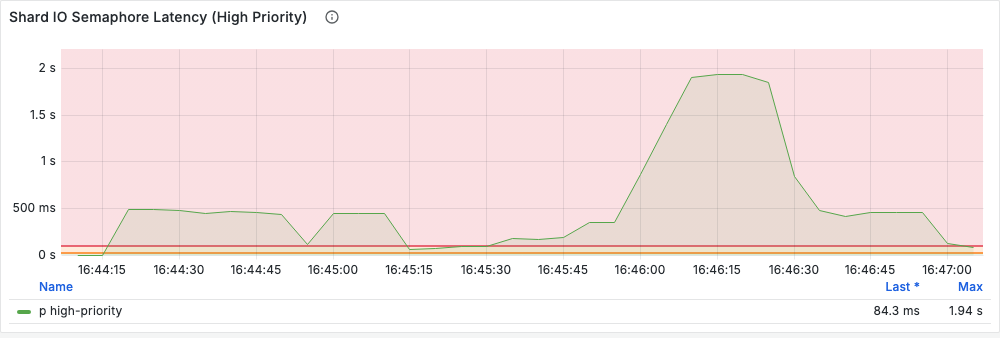
*Shard IO Semaphore Latency (High Priority), p99: far above the red 100 ms line for the whole load (16:44:26-16:46:56),
mostly 0.1-0.5 s with a stretch at ~1.9 s. The orange line is the playbook's 20 ms "worth acting on" mark.*

**Shard IO Semaphore Failures** stayed at zero (the panel shows *No data*: the counter never moved). Writes waited,
but none gave up, so the playbook says to finish the remaining steps at your own pace.

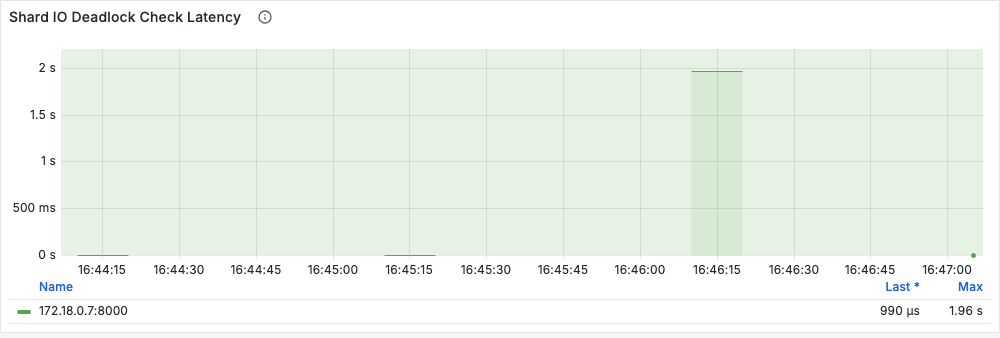
*Shard IO Deadlock Check Latency: the server's once-a-minute check that takes an IO slot on every shard. It waited
~2 s once, because it queues behind the same writes. Alert 34j fires at 20 s for 5 minutes, so this is pressure, not
a deadlock.*

Rule out a hot shard (Step 1, item 4):

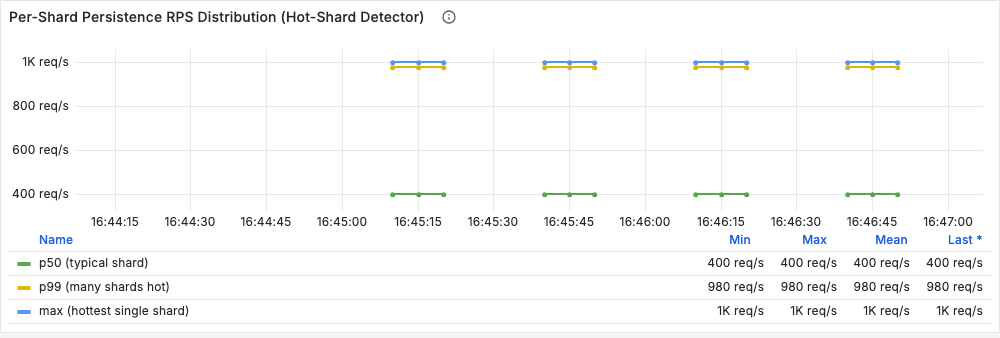
*Hot-shard detector (Temporal Server dashboard): p50 400 req/s, max 1,000 req/s per shard. Within 3x: the four
shards share the load evenly, so this is not a hot shard.*

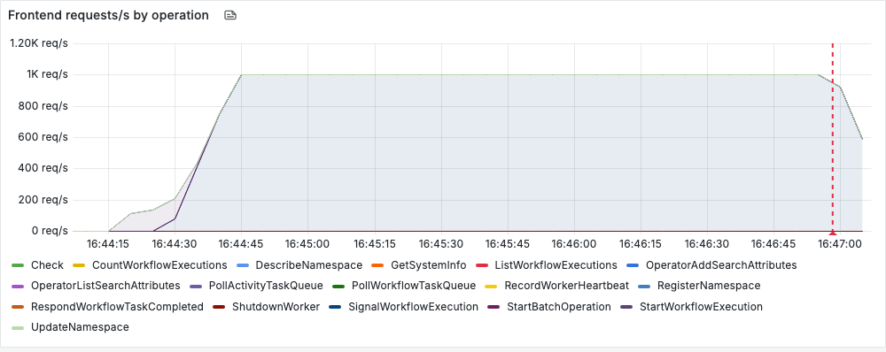
*Lab dashboard, Frontend requests/s: SignalWorkflowExecution at the full 1,000/s. The clients are not being turned
away; they are being made to wait.*

### Step 2: is the database the slow part?

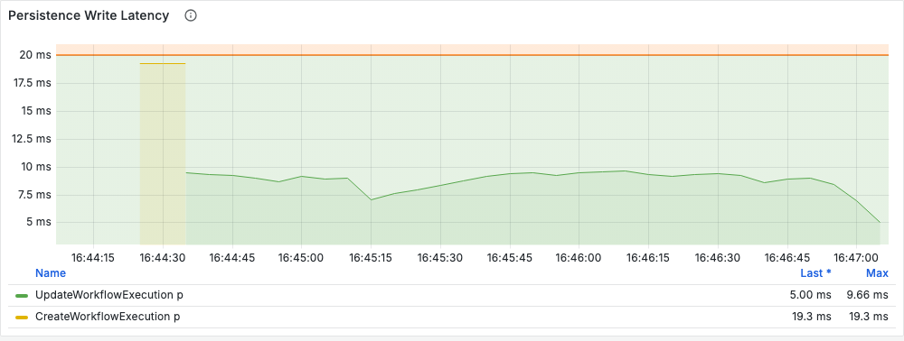
*Persistence Write Latency, p99: UpdateWorkflowExecution at ~8-10 ms throughout (the CreateWorkflowExecution blip
at the start is the 2,000 sink workflows being created). Under the playbook's 10 ms band: the database answers
quickly, so the wait is for the IO slot, not for the database.*

### Step 3: the highest value the connection pool can support

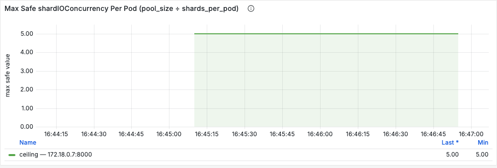
*Max Safe shardIOConcurrency Per Pod: `maxConns` 20 / 4 shards = **5**. That is the ceiling.*

### Step 4: does the pool have room for +1?

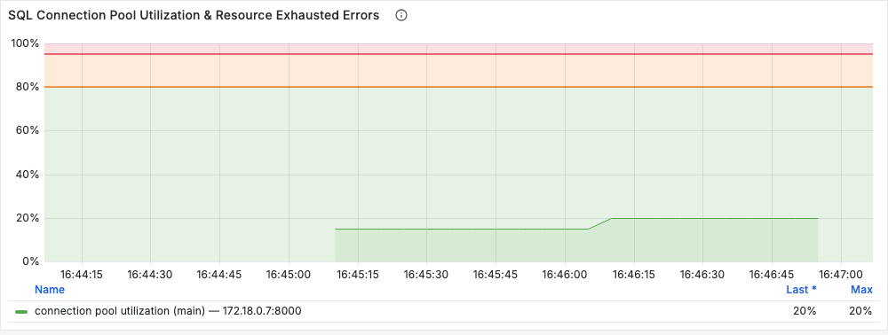
*SQL Connection Pool Utilization: 15-20% at most. With a ceiling of 5 the limit is `1 - 1/5` = 80% (the orange
line), so there is room. No resource-exhausted errors.*

### Step 5: decide

Writes wait 20 ms or more, the database is under 10 ms, the ceiling is 5 and the pool has room: **raise
`history.shardIOConcurrency` by 1** (playbook Step 5, first row).

## 3. Fix it

### Raise by 1, restart history, compare (playbook Steps 6-7)

```sh
make shardio ARGS="run --scenario raise2"
```

```yaml
# config/dynamicconfig/docker.yaml  (the test writes this into a marked block and removes it afterwards)
history.shardIOConcurrency:
  - value: 2
```

Then restart every history pod (`tools/shardio.sh` recreates the lab's one history container). The playbook's
rolling-restart advice is about several pods; with one there is nothing to roll.

```
load       1000/s target -> 1000/s signals accepted; client signal latency p50 4 ms, p99 33 ms
Step 1     Shard IO Semaphore Latency (High Priority) p99 20.6 ms (p50 0.6)  -> 20 ms or more
Step 2     Persistence Write Latency p99: UpdateWorkflowExecution 9.9 ms  -> under 10 ms
Step 4     pool utilization max 35% (avg 21%) vs the limit for +1 = 80%  -> room for +1
Step 5     RAISE history.shardIOConcurrency by 1
Step 7     vs the last `issue` run: IO slot wait p99 1533.3 -> 20.6 ms (lower);  failures 0.00 -> 0.00/s;
           DB write p99 9.1 -> 9.9 ms (under 50 ms);  pool max 20% -> 35% (ok)
RESULT: PASS
```

One more IO slot per shard took the wait from 1.5 s to 21 ms at p99 and client p99 from 1.2 s to 33 ms, with the
database unchanged. Step 7 says the change worked; going through Steps 1-5 again still reads 20 ms or more, so the
playbook says go up by one more.

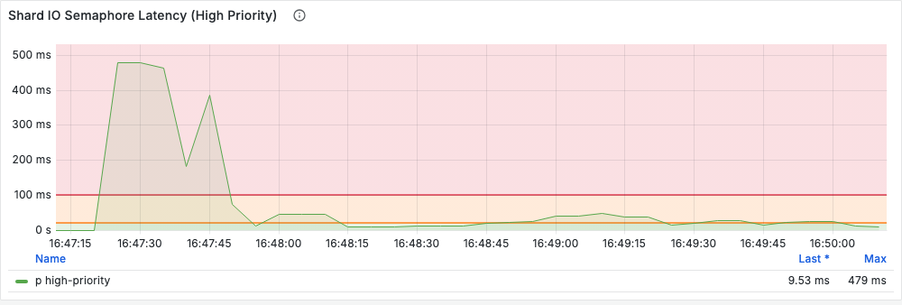
*Shard IO Semaphore Latency, `shardIOConcurrency: 2`: a burst to ~480 ms while the sink workflows are created and the
load starts, then ~10-40 ms for the rest of the run, around the orange 20 ms line.*

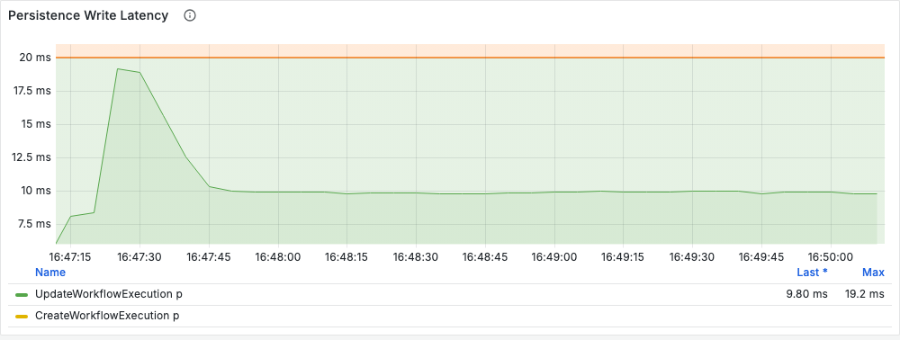
*Persistence Write Latency: ~10 ms, the same as with one slot. Twice the writes in flight did not slow the database.*

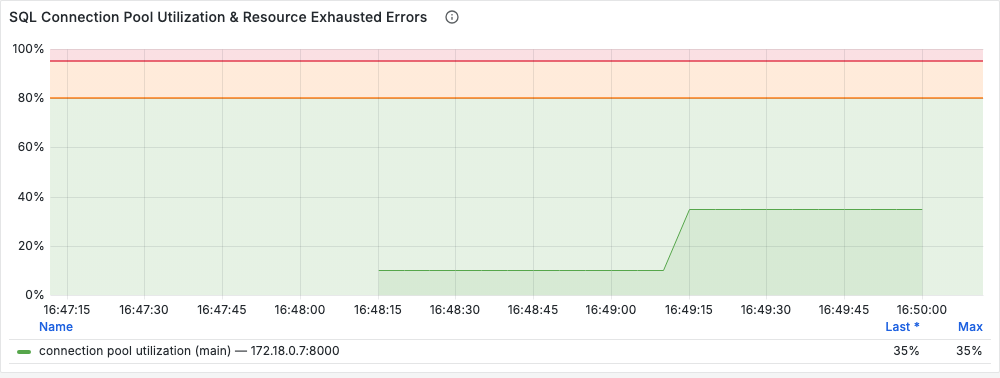
*Pool utilization: up to 35%, still under the 80% limit.*

Step 7 says `raise2` worked and Steps 1-5 still say raise, so go up again. The test jumps from 2 to 4 to save a run;
in production, take 3 first.

```sh
make shardio ARGS="run --scenario raise4"
```

```
load       1000/s target -> 1000/s signals accepted; client signal latency p50 4 ms, p99 18 ms
Step 1     Shard IO Semaphore Latency (High Priority) p99 2.2 ms (p50 0.5)  -> below 20 ms
           Shard IO Semaphore Failures 0.00/s;  deadlock check p99 1.0 ms (alert 34j at 20 s)
Step 2     Persistence Write Latency p99: UpdateWorkflowExecution 13.6 ms  -> 10-50 ms, some room
Step 3     ceiling = maxConns 20 / 4 shards per pod = 5.00
Step 4     pool utilization max 55% (avg 36%) vs the limit for +1 = 80%  -> room for +1
Step 5     nothing to do: writes are not waiting for IO slots
Step 7     vs the last `issue` run: IO slot wait p99 1533.3 -> 2.2 ms (lower);  failures 0.00 -> 0.00/s;
           DB write p99 9.1 -> 13.6 ms (under 50 ms);  pool max 20% -> 55% (ok)
```

With 4 IO slots per shard the wait is gone (2 ms at p99) and client p99 is 18 ms. Going through Steps 1-5 again now
stops at Step 1: below 20 ms, nothing more to gain, so the playbook says stop here, even though the ceiling (5) and
the pool (55% of the 80% limit) would allow one more step. The price is visible too: write p99 went from ~10 to ~14 ms
and the pool from 20% to 55%, because 16 writes can now be in flight at once instead of 4.

This run printed `RESULT: FAIL` when it ran: the scenario's pass rule then expected Step 4 to report no pool room
(the pool reached 55%, not 80%). The rule was corrected to "the wait is lower and Step 1 now says stop", which these
readings meet; the measurements are the ones above.

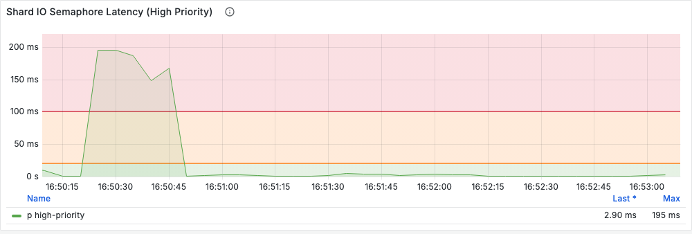
*Shard IO Semaphore Latency, `shardIOConcurrency: 4`: a ~200 ms burst while the sinks are created and the load starts,
then a few milliseconds, well under the orange 20 ms line.*

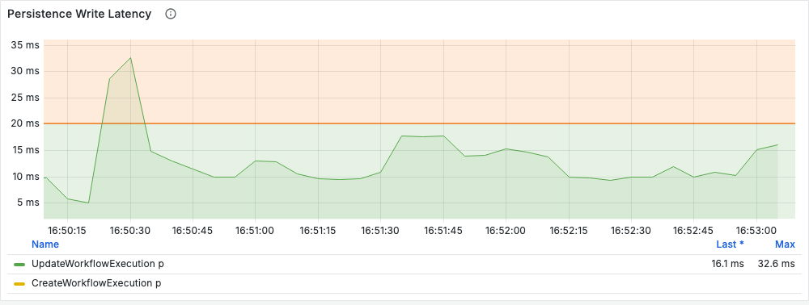
*Persistence Write Latency: ~10-18 ms at p99, a little higher than with 1 or 2 slots, still far below 50 ms.*

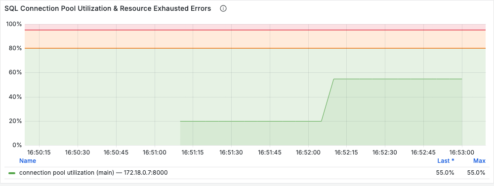
*Pool utilization: 20%, then 55% for the second half of the run. Under the 80% limit.*

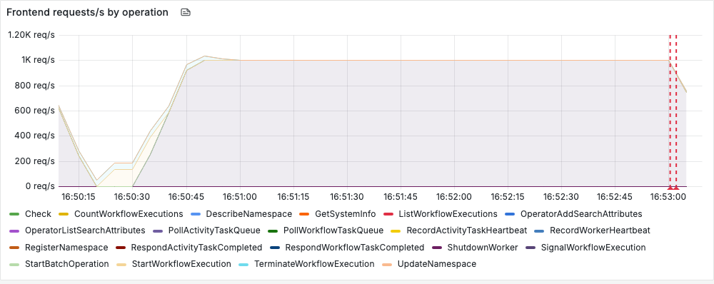
*Lab dashboard, Frontend requests/s: SignalWorkflowExecution at the full 1,000/s.*

### Trap: the database is the slow part (playbook Step 2)

```sh
make shardio ARGS="run --scenario slowdb"      # shardIOConcurrency 1, Postgres capped at 0.25 CPU
```

```
load       1000/s target -> 187/s signals accepted; 121819 not sent (the generator's in-flight cap was full);
           client signal latency p50 3584 ms, p99 23702 ms; errors {'RPCError': 57}
Step 1     Shard IO Semaphore Latency (High Priority) p99 4984.2 ms (p50 3283.4)  -> above 100 ms
           Shard IO Semaphore Failures 0.60/s;  deadlock check p99 9850.0 ms (alert 34j at 20 s)
Step 2     Persistence Write Latency p99: UpdateWorkflowExecution 98.2 ms  -> above 50 ms, THE DATABASE IS THE SLOW PART
Step 4     pool utilization max 30% (avg 26%)  -> room for +1
Step 5     DO NOT RAISE: the database is the slow part, fix it first
RESULT: PASS
```

Step 1 looks like `issue`, only worse: writes wait seconds for an IO slot, and some give up. But Step 2 reads 98 ms,
so the wait is the database's time, multiplied by the queue. Note that p50 write latency was still ~5 ms: it is the
tail that crosses 50 ms, which is why the playbook reads the high percentile.

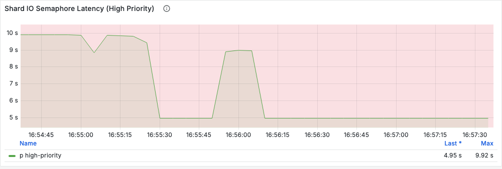
*Shard IO Semaphore Latency: 5-10 s at p99 for the whole run. The flat stretches at 5 s and 10 s are histogram
bucket edges: read them as "over 5 s".*

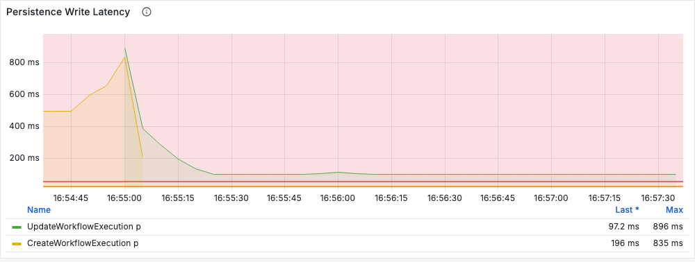
*Persistence Write Latency: UpdateWorkflowExecution ~100 ms at p99 (after a peak near 900 ms while the sinks were
created), well above the 50 ms band.*

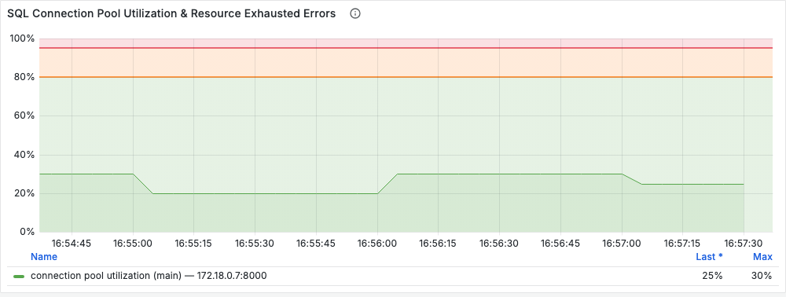
*Pool utilization 20-30%: the pool is not the problem; the database is.*

What happens if you raise it anyway:

```sh
make shardio ARGS="run --scenario slowdb4"     # shardIOConcurrency 4 on the same 0.25-CPU Postgres
```

```
load       1000/s target -> 85/s signals accepted; 136513 not sent; client signal latency p50 8395 ms, p99 29104 ms;
           errors {'RPCError': 678}
Step 1     Shard IO Semaphore Latency (High Priority) p99 9087.6 ms (p50 3448.7)
           Shard IO Semaphore Failures 5.29/s
Step 2     Persistence Write Latency p99: UpdateWorkflowExecution 498.0 ms  -> above 50 ms
Step 4     pool utilization max 100% (avg 82%)  -> NO room for +1
vs slowdb   signals accepted 187/s -> 85/s (0.46x);  DB write p99 98.2 -> 498.0 ms
RESULT: PASS
```

Four times the writes in flight against a database that was already the bottleneck **halved** throughput (187 to 85
signals/s), made each write five times slower at p99, filled the connection pool and multiplied the failures by nine.
This is the playbook's "more writes in flight add to its load and every write slows further", measured.

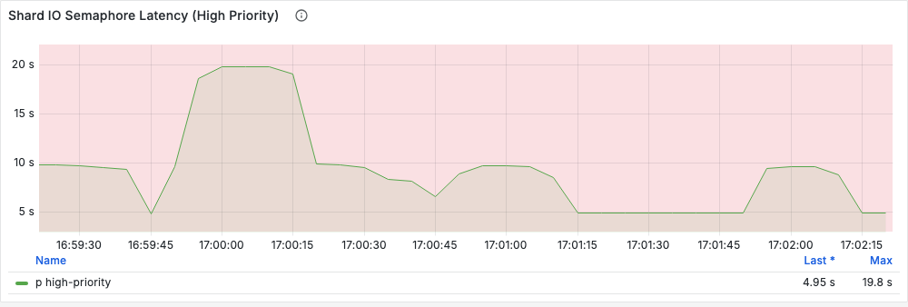
*Shard IO Semaphore Latency: 5-20 s at p99, no better than with one slot.*

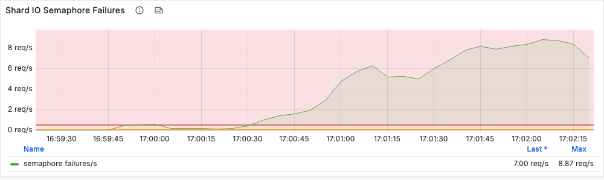
*Shard IO Semaphore Failures: writes giving up while waiting for a slot, because the request behind them hit its
deadline.*

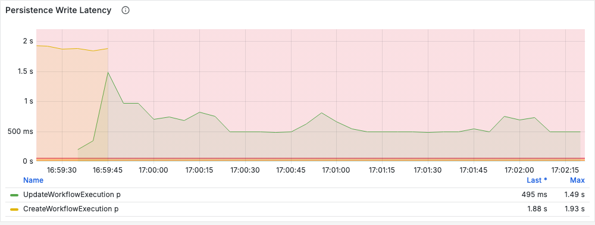
*Persistence Write Latency: ~0.5 s at p99, against ~0.1 s with one slot.*

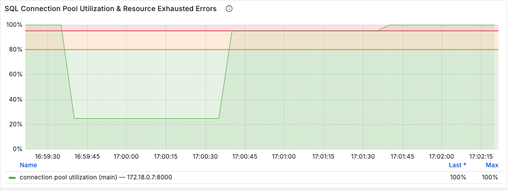
*Pool utilization reaches 100%: 4 shards x 4 slots = 16 writes in flight, plus reads, on a 20-connection pool.*

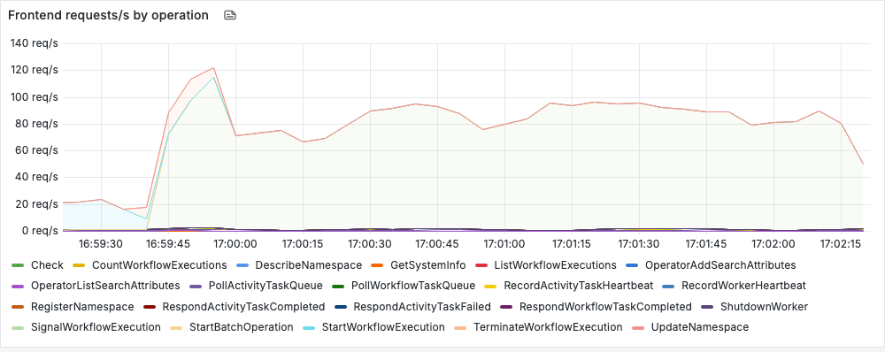
*Lab dashboard, Frontend requests/s: SignalWorkflowExecution at ~70-95/s, a tenth of the load offered.*

The fix for this case is the database (capacity, slow queries, or the connection pool), not more IO slots. In the
lab: `chaos/chaos.sh cpu postgres 0`.

### Trap: a pool too small for the value (playbook Steps 3 and 4)

```sh
make shardio ARGS="run --scenario pool"        # maxConns 4 (ceiling 4 / 4 shards = 1), shardIOConcurrency 4 anyway
```

```
load       1000/s target -> 995/s signals accepted; 787 not sent (the generator's in-flight cap was full);
           client signal latency p50 4 ms, p99 1252 ms
Step 1     Shard IO Semaphore Latency (High Priority) p99 1653.6 ms (p50 0.7)  -> above 100 ms
           Shard IO Semaphore Failures 0.00/s;  deadlock check p99 940.0 ms (alert 34j at 20 s)
Step 2     Persistence Write Latency p99: UpdateWorkflowExecution 47.5 ms  -> 10-50 ms, some room
Step 3     ceiling = maxConns 4 / 4 shards per pod = 1.00  -> BELOW 2: the pool cannot serve 2 writes per shard
Step 4     pool utilization max 100% (avg 92%)  -> NO room for +1
Step 5     DO NOT RAISE YET: the pool cannot serve 2 writes per shard; raise maxConns or add history pods
RESULT: PASS
```

Four IO slots per shard bought nothing here. The IO slot wait (1.65 s at p99) and client p99 (1.25 s) are about the
same as `issue` with **one** slot: with 4 connections for 4 shards, at most about one write per shard can reach the
database at a time, whatever `shardIOConcurrency` says. A write takes an IO slot and then waits again for a
connection, which is where Persistence Write Latency went from ~9 ms (`issue`) to 47.5 ms with the database unchanged.

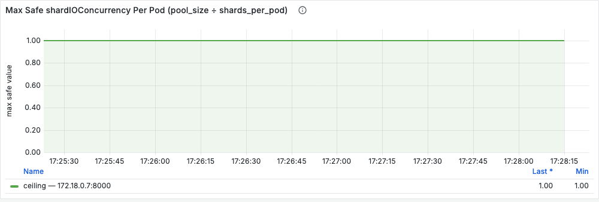
*Max Safe shardIOConcurrency Per Pod: 4 / 4 = **1**. Below 2: Step 3 says stop and grow the pool (or add history pods)
before raising anything.*

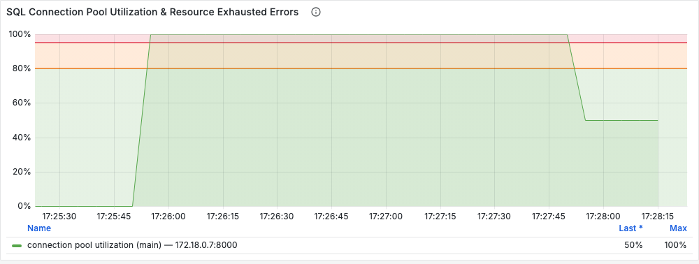
*Pool utilization pinned at 100% for most of the load (17:26-17:27:45).*

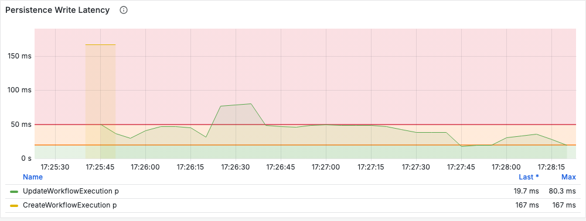
*Persistence Write Latency: 30-80 ms at p99, around the 50 ms line, against ~9 ms in `issue`. The database is the
same; the extra time is waiting for one of the 4 connections.*

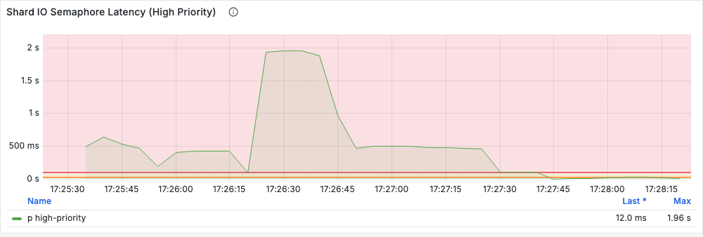
*Shard IO Semaphore Latency: 0.2-2 s at p99, the same picture as `issue` with one slot per shard.*

Shard IO Semaphore Failures stayed at zero in this run.

## Results at a glance

1,000 signals/s offered for 150 s, 4 shards, one history pod; readings over the last 120 s of the load.

| Scenario | `shardIOConcurrency` | Accepted signals/s | Client p99 | IO slot wait p99 | Slot failures/s | DB write p99 | Pool max | Ceiling | Step 5 |
|---|---|---|---|---|---|---|---|---|---|
| `issue` | 1 | 1,000 | 1,211 ms | 1,533 ms | 0 | 9.1 ms | 20% | 5 | raise |
| `raise2` | 2 | 1,000 | 33 ms | 20.6 ms | 0 | 9.9 ms | 35% | 5 | raise |
| `raise4` | 4 | 1,000 | 18 ms | 2.2 ms | 0 | 13.6 ms | 55% | 5 | stop: below 20 ms |
| `slowdb` | 1 | 187 | 23.7 s | 4,984 ms | 0.6 | 98 ms | 30% | 5 | do not raise (database) |
| `slowdb4` | 4 | 85 | 29.1 s | 9,088 ms | 5.3 | 498 ms | 100% | 5 | do not raise (database) |
| `pool` | 4 | 995 | 1.25 s | 1,654 ms | 0 | 47.5 ms | 100% | 1 | do not raise yet (pool) |

## 4. Things this test showed that the playbook does not spell out

- **A full pool inflates Persistence Write Latency.** In `pool`, Persistence Write Latency rose from ~9 ms to 47.5 ms
  at p99 with nothing changed in the database. The latency the history service records includes waiting for a
  connection from its own pool (`common/persistence/persistence_metric_clients.go` times the whole call, and Go's
  `database/sql` blocks inside it for a free connection once `maxConns` is reached). Here it stayed just under the
  50 ms band, so Step 2 passed and Step 3 (ceiling 1) caught it; with a little more load it would cross 50 ms and
  Step 2 would blame the database. The playbook's Step 2 row lists "the connection pool" among the things to fix;
  Steps 3 and 4 tell the two apart. The test prints a note when Step 2 reads slow while the pool is full.
- **More IO slots than connections is the same as fewer IO slots.** `pool` (4 slots, 4 connections) behaved like
  `issue` (1 slot, 20 connections): the effective limit per shard is the smaller of `shardIOConcurrency` and
  connections per shard.
- **The deadlock check queues with everyone else.** Shard IO Deadlock Check Latency read ~2 s in `issue`, ~1 s in `pool` and ~10 s in
  `slowdb`: the check takes an IO slot like any write, so it measures the queue. Alert 34j (20 s for
  5 minutes) was never reached here; `slowdb` came within a factor of two.
- **Raising on a slow database is worse than doing nothing.** `slowdb4` halved throughput compared with `slowdb`;
  the extra writes in flight competed for the same CPU-starved database and also filled the pool.
- **The tail decides Step 2.** In `slowdb` the median write was still ~5 ms; only the p99 crossed 50 ms. Reading
  Persistence Write Latency at p50 would have sent you down the "raise" branch.
- **Shards per pod is what makes this matter.** At 512 shards on one pod (this lab's other setting) a 1,000/s load
  puts ~2 writes/s on each shard and nothing queues, while the ceiling `20 / 512` is far below 2: on such a cluster
  the playbook stops at Step 1 or Step 3.

## Options

```
make shardio ARGS="run --scenario issue --rate 1000 --load-s 150 --workflows 2000 --processes 4 --max-inflight 256"
make shardio ARGS="readings"            # Steps 1-5 on the last 3 minutes of whatever is running (--minutes N)
make shardio ARGS="reset"               # remove the dynamic-config block after a crash
```

`--rate` is the knob that matters: at 1,000/s one IO slot per shard is just past its capacity on this machine. On a
faster or slower machine, pick the rate at which `issue` reads 20 ms or more while Step 2 stays under 10 ms.

Results are written to `results/shardio-<scenario>-<time>-<id>.json`.

## Cleaning up

Each run restores the lab itself (block removed, Postgres uncapped, history back to `maxConns` 20). The sink
workflows time out 10 minutes after the run. To go back to the 512-shard setup used by the other guides:
`make reset SHARDS=512` (wipes the database).
