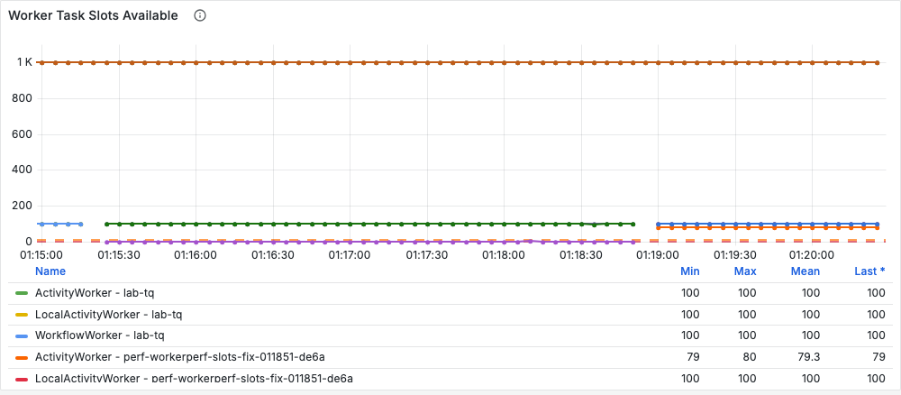
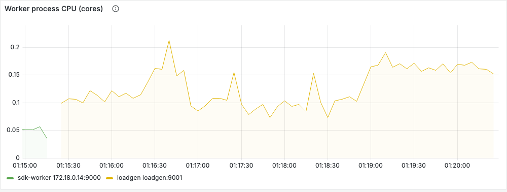
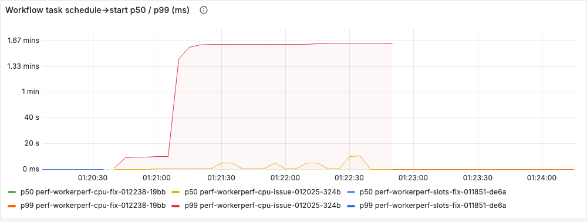
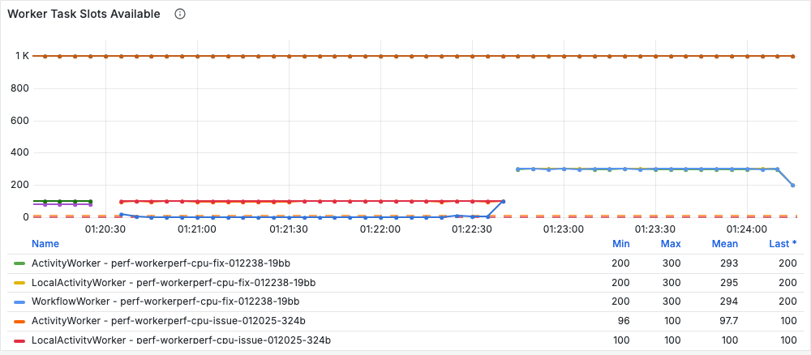
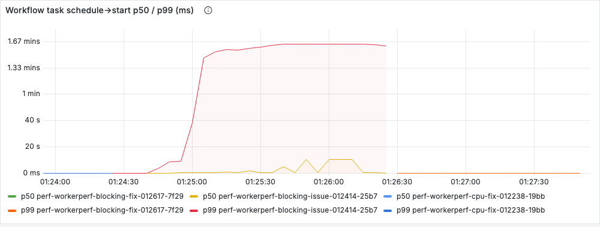
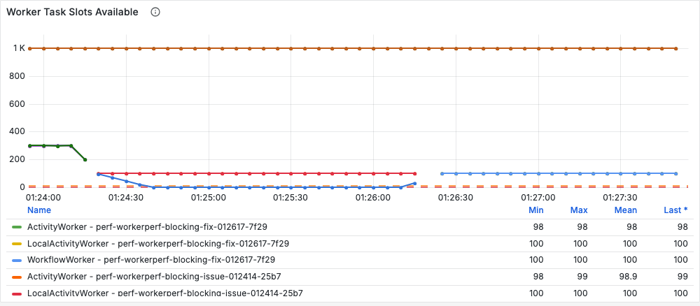
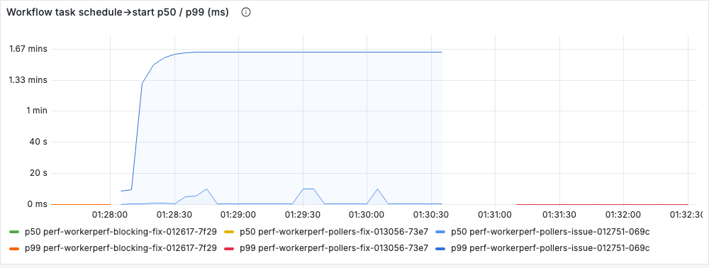
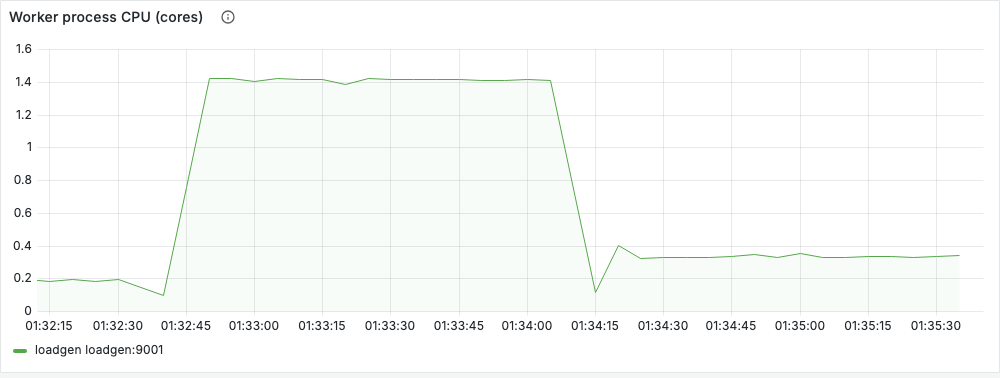
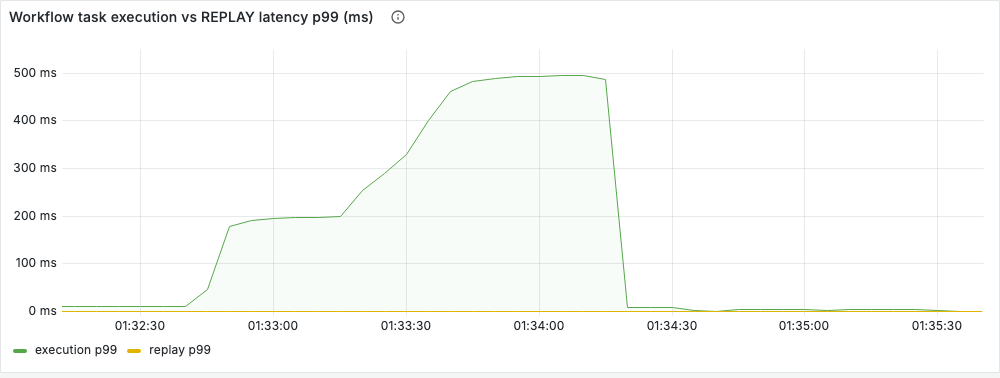
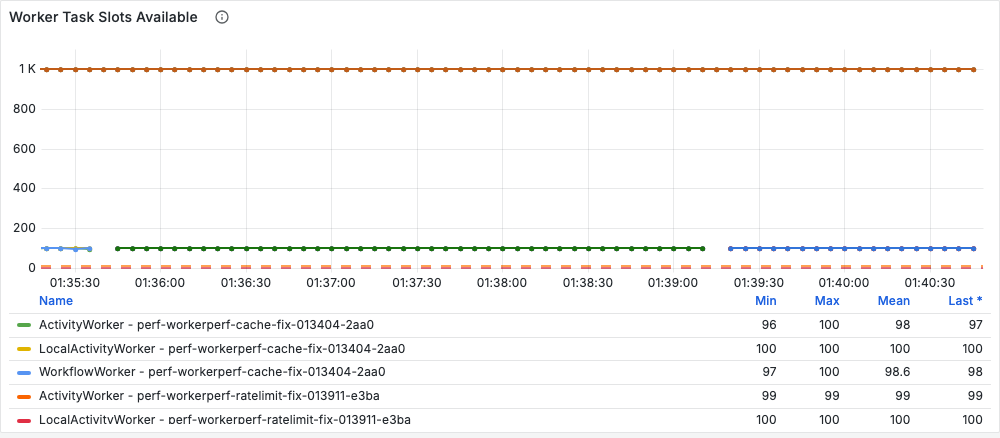

# Worker performance: produce it, investigate it, fix it

A runnable companion to Temporal's worker tuning guidance:

* [Worker tuning reference](https://docs.temporal.io/develop/worker-tuning-reference)
* [Worker runtime tuning](https://docs.temporal.io/develop/worker-performance/runtime-tuning)
* [Worker tuning skill](https://github.com/temporalio/skill-temporal-workertuning/blob/main/SKILL.md), especially
  *Recipe 2: Diagnosing High Schedule-to-Start Latency*

The test is `lab/workerperf.py` (`make workerperf ARGS="..."`). Each **scenario** starts a Python worker with one
specific problem, drives a fixed workload, reads the worker's own metrics every second, and walks the skill's
decision tree to a diagnosis. Run it once to reproduce and diagnose the problem, then again with `--fix` to show the
recommended fix works.

## What the test does

```
                      ┌──────────────── loadgen container (make workerperf) ────────────────┐
 workload ── starts ─►│ worker under test: `python -m lab.worker` x N, task queue perf-<run> │
 (open loop, fixed    │   the lab's own worker, configured with the same env knobs as .env   │
  rate, 90 s)         │   metrics :9001.. ──► scraped every 1 s by the test (and Prometheus) │
                      │   CPU + RSS from /proc, event-loop lag from the worker's own probe   │
                      └──────────────────────────────────────────────────────────────────────┘
```

* **The worker under test** is the lab's normal worker (`lab/worker.py`), so every knob is the same environment
  variable you would set in `.env` for the lab's `sdk-worker` (`MAX_CONCURRENT_ACTIVITIES`, `MAX_CACHED_WORKFLOWS`,
  `POLLER_AUTOSCALE`, ...). Each run uses a fresh task queue, so runs cannot affect each other.
* **The workload** starts workflows at a fixed rate and never waits for results. Completions and start→close latency
  come from the worker's `temporal_workflow_completed` and `temporal_workflow_endtoend_latency` metrics.
* **Measurement** covers the 90 s load window minus a 15 s warm-up. It also takes `DescribeTaskQueue` stats (backlog,
  backlog age, add/dispatch rate, effective rate limit) at the end of the window.
* **Diagnosis** walks the skill's decision tree in this order:

```
 sticky cache evicting AND replays costly?               ── yes ─► CACHE      (Recipe 4)
   (workflow task p95 >= 50 ms or replay p95 >= 5 ms)
 schedule→start p95 > 200 ms (or event loop / WFT slow)?  ── no ──► HEALTHY
 step 1:   worker CPU >= 0.8 cores per process?          ── yes ─► CPU        (2a: scale out / up)
 python:   event loop busy >= 80% (p50) with CPU low,    ── yes ─► BLOCKING   (blocking call in async code)
           or loop lag p95 >= 250 ms?
 step 2b-A: slots at 0 in >= 30% of samples?             ── yes ─► SLOTS      (raise slots)
 step 2b-B/D: RespondWorkflowTaskCompleted p50 > 50 ms?  ── yes ─► POLLERS    (more pollers / autoscaling)
 step 2b-C: a task-queue or worker rate limit is set?    ── yes ─► RATELIMIT  (remove / raise it)
```

The event-loop check runs **before** the slot check on purpose. A stalled asyncio loop keeps workflow-task slots
occupied, so it looks exactly like slot depletion (see the `blocking` results below).

**Verdict:** without `--fix`, PASS means the diagnosis named the scenario's problem. With `--fix`, PASS means no rule
fired, schedule→start p95 ≤ 200 ms (the skill's alert threshold), and every workflow finished.
Exit codes: `0` = PASS, `1` = FAIL. Each run writes `results/<run-id>.json` and the worker logs.

## The scenarios

| Scenario | Problem | Workload | Fix the test applies |
|---|---|---|---|
| `slots` | `MAX_CONCURRENT_ACTIVITIES=5` for I/O-bound activities | 20 wf/s × 2 activities of 500 ms | `MAX_CONCURRENT_ACTIVITIES=100` |
| `cpu` | CPU-bound activities in one Python process (GIL) | 40 wf/s × 40 ms CPU (sync activity) | 3 worker processes |
| `blocking` | `time.sleep` (think `requests.get`) inside an `async def` activity | 12 wf/s × 100 ms block | make it a sync `def` activity (thread pool) |
| `pollers` | 2 workflow-task pollers, 1 activity poller, +50 ms to the server | 30 wf/s, 1 instant activity | `POLLER_AUTOSCALE=1` (`PollerBehaviorAutoscaling`) |
| `cache` | `MAX_CACHED_WORKFLOWS=10` with 100 open workflows | 100 long-lived workflows, activity + 1 s timer per iteration | `MAX_CACHED_WORKFLOWS=1000` |
| `ratelimit` | `MAX_TASK_QUEUE_ACTIVITIES_PER_SECOND=5` | 20 wf/s × 1 activity of 50 ms | remove the limit |

`make workerperf ARGS="list"` prints the same table.

---

## 0. Set up

```sh
make up && make smoke                  # the lab; smoke must be 12/12
docker compose build sdk-worker        # only if lab/ changed since the last `make up` (the test runs from the image)
```

`make workerperf` names its container `loadgen`, so Prometheus scrapes the worker under test (job `loadgen`,
ports 9001–9003) and it appears in Grafana. Only one `make workerperf` or `make load` can run at a time, because
the container name is fixed.

---

## 1. Produce the issue

```sh
make workerperf ARGS="run --scenario slots"
```

Every scenario works the same way; swap the name. A run takes 2–4 minutes (90 s of load plus up to 120 s of drain;
anything still open after the drain is batch-terminated). Expect `RESULT: PASS (expect=issue ...)`.

Real output of the `slots` run (server 1.32.0, Python SDK 1.33.0):

```
workflows  started 1800   start->close p50 98045 ms  p95 275592 ms   problems {'unfinished after drain (terminated)': 1262}
step 1     worker CPU [0.14] cores/process (saturated >= 0.8)   RSS [250] MB
latency    schedule->start p95: workflow task 95 ms   activity 95418 ms   (alert > 200 ms)
compute    slots available  workflow: avg 100  at 0 0% of samples   activity: avg 0  at 0 97%
memory     sticky cache: max size 1000  hits 419  misses 307  miss ratio 42%  forced evictions 862
queue      activity {'backlog': 1567, 'backlog_age_s': 58.7, 'add_rate': 27.3, 'dispatch_rate': 9.8, ...}

diagnosis (Recipe 2: diagnosing high schedule-to-start)
  cache: 862 forced evictions (miss ratio 42%) but replay p95 is only 0.9 ms -> a SIDE EFFECT of open workflows piling up, not the bottleneck
  schedule->start p95 95418 ms -> ELEVATED (threshold 200 ms)
  step 1: worker CPU 0.14 cores -> underutilized, go to step 2b
  step 2b-A: activity slots at 0 in 97% of samples -> executor slots depleted
  => SLOTS
RESULT: PASS (expect=issue: the `slots` problem must be surfaced and diagnosed as such; got slots)
```

Useful options:

| Option | Use |
|---|---|
| `--worker-env KEY=VALUE ...` | try your own setting, e.g. `--worker-env MAX_CONCURRENT_ACTIVITIES=20 --expect healthy`. Also accepts `workers=N` (processes) and `latency_ms=N` (added RTT to the server) |
| `--rate`, `--duration`, `--params '{json}'` | change the workload |
| `--expect issue\|healthy` | override what counts as PASS |

---

## 2. Show and investigate it

For a live investigation, run a long scenario in one terminal and watch from another:

```sh
make workerperf ARGS="run --scenario slots --duration 900"
```

Grafana (http://localhost:3000) → **Temporal Lab** dashboard, row *2. SDK workers*. The worker under test shows up
with `task_queue="perf-..."` / `job="loadgen"`. The skill's Recipe 2 maps onto it as follows:

| Recipe 2 step | Question | Panel / metric | What the scenarios showed |
|---|---|---|---|
| Symptom | Is work waiting? | *Workflow task / Activity schedule→start* (`temporal_*_schedule_to_start_latency`) | `slots` 95 s, `ratelimit` 95 s, `cpu` 82 s, `blocking` minutes; < 100 ms when healthy |
| Step 1 | Is the worker busy? | *Worker process CPU* (`worker_process_cpu_cores`), *memory* (`worker_process_rss_bytes`) | `cpu` 1.09 cores (one process); every other scenario ≤ 0.2 |
| Python pre-check | Is the event loop responsive? | *Worker event-loop busy* (`worker_event_loop_busy_ratio`) and *lag* (`worker_event_loop_lag_ms`) | `blocking`: loop busy ~100% at 0.11 cores; see section 4 for why lag alone is not enough |
| 2b-A | Are slots exhausted? | *Task slots available* (`temporal_worker_task_slots_available{worker_type}`) | `slots`: activity slots at 0 in 97% of samples |
| 2b-B/D | Are pollers keeping up / is the link slow? | *Pollers and empty polls* (`temporal_num_pollers`), `temporal_request_latency{operation="RespondWorkflowTaskCompleted"}` | `pollers`: 1 normal + 1 sticky workflow poller, RPC p50 75 ms, workflow backlog 1,096 with 98% of slots free |
| 2b-C | Is a rate limit throttling? | your worker options; `temporal task-queue describe` | `ratelimit`: queue backlog 1,346, dispatch exactly 5.0/s |
| Recipe 4 | Is the cache thrashing? | *Sticky cache hit / miss + size*, *execution vs REPLAY latency* | `cache`: 100% misses, 3,991 forced evictions, workflow task p95 405 ms |

From the CLI (all of these were run against the lab):

```sh
# backlog, add/dispatch rate and the effective rate limit of the queue under test
make cli ARGS="task-queue describe --task-queue perf-<run-id> --task-queue-type activity"
# the worker's raw metrics while a test runs (inside the test container)
docker exec loadgen python -c "import urllib.request;print(urllib.request.urlopen('http://127.0.0.1:9001/metrics').read().decode())" | grep -E 'slots_available|num_pollers|event_loop|cpu_cores'
```

What the test prints maps one-to-one onto these metrics, and `results/<run-id>.json` keeps all of them.

**Python-specific investigation tool: asyncio debug mode.** The `blocking` scenario starts its worker with
`PYTHONASYNCIODEBUG=1`. asyncio then logs every callback that holds the loop longer than 100 ms:

```
WARNING asyncio: Executing <Task pending name='Task-14' coro=<_ActivityWorker._handle_start_activity_task()
  running at .../temporalio/worker/_activity.py:351> ...> took 0.103 seconds
```

The issue run logged one such line per activity (1,080); the fixed run logged 1. The log tells you an **activity**
blocks the loop (`_handle_start_activity_task`), not which one. To find the exact line, take
`py-spy dump --pid <worker pid>` while the lag is high, or check which `async def` activities call sync clients.

---

## 3. Fix it

```sh
make workerperf ARGS="run --scenario slots --fix"
```

Measured in this lab, issue vs `--fix` (the same workload both times). All 12 runs (6 scenarios × issue/fix) pass
on the current code:

| Scenario | Fix | Issue | Fixed |
|---|---|---|---|
| `slots` | `MAX_CONCURRENT_ACTIVITIES` 5 → 100 | activity schedule→start p95 95 s; slots at 0 in 97%; 1,262 workflows unfinished | < 100 ms; avg 80 of 100 slots free; all 1,800 done, start→close p50 1.25 s |
| `cpu` | 1 → 3 worker processes | 1.09 cores, workflow backlog 1,044, start→close p50 22 s | 0.63 cores × 3, backlog ~0, p50 56 ms |
| `blocking` | `async def` + `time.sleep` → sync `def` activity | event loop busy 99.9% at 0.11 cores; workflow slots at 0 in 81%; start→close p50 27 s; 1,080 asyncio slow-callback warnings | loop busy 7.5%; 0 warnings; p50 300 ms (bucket interpolation, see below) |
| `ratelimit` | remove `MAX_TASK_QUEUE_ACTIVITIES_PER_SECOND` | dispatch capped at 5.0/s, backlog 1,346, start→close p50 84 s | p50 50 ms |
| `pollers` | `POLLER_AUTOSCALE=1` | 1 normal + 1 sticky workflow poller; workflow schedule→start p95 89 s; backlog 1,096; start→close p50 35 s | autoscaled to **38** workflow pollers; < 100 ms; backlog 0; p50 300 ms |
| `cache` | `MAX_CACHED_WORKFLOWS` 10 → 1000 | 100% misses, 3,991 forced evictions; CPU 1.41 cores; workflow task p95 405 ms; schedule→start p95 4.7 s | 0 misses; CPU 0.37; workflow task p95 1 ms; < 100 ms |

What each fix means for your own workers:

> **About the screenshots.** Each image below covers one scenario's issue run followed directly by its `--fix` run,
> so the change is visible in one panel (Temporal Lab dashboard, row *2. SDK workers*, and *Worker Task Slots
> Available* from the Temporal SDK dashboard). They come from a re-run on 2026-10-18 (times in UTC), because
> Prometheus keeps 7 days; every verdict reproduced and the figures were within a few percent of those quoted here.

### `slots`: size executor slots from the workload (2b-A)

Slots ≈ arrival rate × task duration × headroom. Here that is 40 activities/s × 0.5 s = 20 in flight; 100 leaves 5×
headroom. Raise slots only when CPU and memory have room (step 1 first). For long I/O-bound activities such as LLM or
HTTP calls, prefer generous **fixed-size** slots: a resource-based tuner keys on CPU, and those activities hold a slot
with almost no CPU. To try a size:
`make workerperf ARGS="run --scenario slots --worker-env MAX_CONCURRENT_ACTIVITIES=20 --expect healthy"`.


*Activity schedule→start p50/p99, `slots` issue run (01:15:30–01:18:50 UTC) then fix: during the issue activities wait minutes for a slot, with p99 reaching ~17 minutes as the backlog drains; after the fix both lines sit near zero.*


*Worker Task Slots Available per task queue, same window: the issue run's `ActivityWorker` slots at 0 (the line on the axis), the fix run's at 100. Note the y-axis reaches 1K because of one long-lived series.*


*Worker process CPU, same window: 0.1–0.2 cores in both runs. Slots exhausted with idle CPU is step 2b-A.*

### `cpu`: scale out, not up (2a)

A Python worker process runs Python code on about **one core** (the GIL). Sync activities in a thread pool do not
change that; neither do more slots. Run more worker processes or pods (`--worker-env workers=3`; in the lab,
`make scale SVC=sdk-worker N=3`), or move CPU-heavy work to a `ProcessPoolExecutor`. Note that CPU saturation showed
up as **workflow**-task slot depletion and a workflow-task backlog: the GIL starved the event loop that completes
workflow tasks.


*Worker process CPU, `cpu` issue run (01:20:35–01:22:40) then fix: one process pinned just above 1 core, then three processes at ~0.63 each.*


*Workflow task schedule→start p50/p99, same window: p99 at ~1.6 minutes while the single process is saturated; near zero with three.*


*Worker Task Slots Available, same window: `WorkflowWorker` slots at 0 during the issue run (the GIL starved the event loop that completes workflow tasks), 300 free across three processes after.*

### `blocking`: never block the event loop in `async def`

`async def` activities share the worker's event loop with workflow-task processing. One blocking call (a sync HTTP
client, `time.sleep`, CPU-heavy parsing) stalls every task on that worker. The fix is code, not configuration:
use an async client (`httpx.AsyncClient`, `aiohttp`), or make the activity a plain `def` so it runs in the activity
thread pool (`activity_executor`, sized ≥ `max_concurrent_activities`). **Raising slots would not help**, although
the slot panel says otherwise.


*Worker event-loop busy, `blocking` issue run (01:24:20–01:26:20) then fix: the asyncio loop ~100% busy while the process uses 0.11 cores; ~7% after moving the blocking call to a sync activity.*


*Workflow task schedule→start, same window: p99 at ~1.6 minutes during the issue run, near zero after the fix.*


*Worker Task Slots Available, same window: `WorkflowWorker` slots drain to 0 during the issue run. This is the panel that says "raise slots"; the loop-busy panel above says why that would not help.*

### `pollers`: let the SDK size pollers (2b-B/D)

A poller holds one request at a time, so on a slow link each poller can only fetch about `1 / RTT` tasks per second.
At +50 ms, two workflow pollers (one for the normal queue, one for the sticky queue) dispatched 17.8 of the 30
workflow tasks/s offered, and the rest queued. Slots and CPU were idle the whole time, which is the skill's 2b-B
signature. `PollerBehaviorAutoscaling` (`POLLER_AUTOSCALE=1`, server ≥ 1.28) scaled the worker to 38
workflow-task pollers on its own and cleared the backlog. Prefer it over hand-tuned counts. The manual knobs
(`max_concurrent_*_task_polls`) are deprecated and override poller behavior when set.

Two notes:
* The workflow-task pollers starved, not the activity poller. Activities on the worker's own queue were dispatched
  eagerly (see section 4).
* RPC p50 stays 75 ms after the fix. Autoscaling does not make the link faster; it hides the latency with more
  requests in flight. If you can, also move workers closer to the server (2b-D).


*Pollers and empty polls, `pollers` issue run then fix: every poller count at 1–5 and successful workflow polls flat at ~36/s during the issue run; after switching to `PollerBehaviorAutoscaling` (around 01:30:30) the workflow-task pollers (blue) vary between ~10 and ~40 on their own and successful polls rise to ~60/s.*


*Workflow task schedule→start, same window: p99 at ~1.6 minutes with two pollers on the slow link; near zero once autoscaling has added pollers.*

### `cache`: size the sticky cache to the open workflows (Recipe 4)

With 100 open workflows and a 10-entry cache, every workflow task was a miss (3,991 forced evictions). Each one
replayed the whole history: workflow tasks went from 1 ms to 405 ms (p95), and the worker's CPU nearly quadrupled
(0.37 → 1.41 cores). In Recipe 2 terms this **looks like step 2a, CPU saturation**: scaling out would help a little
but waste CPU on replays. Size `max_cached_workflows` (`MAX_CACHED_WORKFLOWS`) to the open workflows per worker,
memory permitting. Here, 1,000 cached all 100 (RSS 125 MB) with zero misses.
`temporal_sticky_cache_size` sitting exactly at the limit, plus `temporal_sticky_cache_total_forced_eviction`
climbing, is the tell. Note that `temporal_workflow_task_replay_latency` stayed under 1 ms here (section 4), so watch
workflow-task execution latency and CPU instead.


*Sticky cache hit / miss and size, `cache` issue run (01:32:45–01:34:15) then fix: misses (yellow) up to ~90/s with hits near zero and 10 cached workflows; after the fix, ~190 hits/s, no misses, 100 workflows cached.*


*Worker process CPU, same window: ~1.4 cores while every workflow task replays, ~0.35 cores with the cache sized to the open workflows.*


*Workflow task execution vs replay latency p99, same window: execution climbs to ~490 ms as histories grow, while the replay series draws nothing at all. This is finding 4 in section 4: watch execution latency and CPU, not the replay metric.*

### `ratelimit`: check your own options (2b-C)

`max_task_queue_activities_per_second` is enforced **by the server** for the whole task queue, and any worker can
set it. Here dispatch flat-lined at exactly 5.0/s while 99% of slots sat idle; `temporal task-queue describe` shows
the effective limit. Remove it, or set it above real demand. The per-worker version is `max_activities_per_second`.

---


*Activity schedule→start p50/p99, `ratelimit` issue run (01:35:40–01:39:00) then fix: activities queue for minutes behind the 5/s task-queue limit (p99 up to ~17 minutes as the backlog drains), then near zero once it is removed.*


*Worker Task Slots Available, same window: slots free (~100) throughout. Slow dispatch with idle slots and idle CPU is step 2b-C.*

## 4. Things this test showed that the references do not spell out

1. **A blocked event loop looks like slot depletion.** In `blocking`, workflow-task slots were at 0 in 81% of
   samples with idle CPU. Recipe 2 step 2b-A then says "raise slots", which cannot help. Check the event loop first.
2. **Measure event-loop utilization, not just lag.** A lag probe gave 533 ms in one `blocking` run and 42 ms in
   another with identical damage. Back-to-back 100 ms blocks let the probe run in between, so lag depends on how many
   tasks happen to be queued. Lag also reached 95 ms in the healthy-loop `slots` run. *Utilization* (the share of time
   the loop is not idle in `select()`) separated cleanly: **99.9%** in `blocking` against **7.5–9%** in every other
   low-CPU run. A loop that is busy while the process barely uses CPU is waiting on synchronous I/O. The lab worker
   exports both (`worker_event_loop_busy_ratio`, `worker_event_loop_lag_ms`) through the SDK's `runtime.metric_meter`;
   copy `lab/worker.py` to do the same in production.
3. **Bottlenecks cascade into the sticky cache.** In `slots` and `ratelimit`, the backlog left more than 1,000
   workflows open, so the default 1,000-entry cache overflowed (862 forced evictions). Replays were cheap (0.9 ms), so
   it was a side effect. Fix the bottleneck and the evictions disappear. The test's cache rule therefore also requires
   replay to be expensive.
4. **`temporal_workflow_task_replay_latency` did not show the replay cost.** In `cache`, every workflow task was a
   full replay, yet that metric stayed under 1 ms (p95), while workflow-task execution latency went from 1 ms to
   405 ms and CPU from 0.37 to 1.41 cores. In the Python SDK, judge replay cost by workflow-task execution latency and
   CPU alongside cache misses.
5. **Eager activity dispatch hides activities from the task queue.** With free slots, the Python SDK runs activities
   scheduled on its own task queue *eagerly*, returning them in the workflow-task response. `DescribeTaskQueue` then
   reports an activity add rate of **0** while 40 activities/s run. Activity task-queue stats only become meaningful
   once eager dispatch stops (no free slots, another queue, or `disable_eager_activity_execution`).
6. **SDK histograms are coarse.** Python SDK request and activity latency buckets are 50 / 100 / 500 / 1000 / 2500 ms,
   so a p50 of "25 ms" means "under 50 ms" and 100–150 ms activities all read as "~300 ms". Do not compare small
   execution times across runs; use slot, lag and backlog signals instead.
7. **Python workers do export `temporal_sticky_cache_total_forced_eviction`** (SDK 1.33). Some guides say it is Go/Java
   only.
8. **Awaiting many results is itself a load problem.** The first version of this test awaited every result. About
   1,400 concurrent result long-polls hit the frontend's per-namespace long-poll limit (`RESOURCE_EXHAUSTED`,
   `ConcurrentLimit`) and starved the worker's own history fetches.

---

## Clean up

Nothing to undo. Each run uses its own task queue, the workers stop when the test ends, and leftover workflows are
batch-terminated. The `pollers` scenario adds a toxiproxy proxy `frontend_wan` (port 17233, internal only) and
removes its latency when it finishes.

## Options

`make workerperf ARGS="run --help"` lists everything. Most used:

| Option | Default | Meaning |
|---|---|---|
| `--scenario` | (required) | `slots`, `cpu`, `blocking`, `pollers`, `cache`, `ratelimit` |
| `--fix` | off | apply the scenario's recommended fix and expect healthy |
| `--worker-env K=V ...` | | override worker knobs; plus `workers=N`, `latency_ms=N` |
| `--rate` / `--duration` / `--warmup` / `--drain-s` | per scenario / 90 / 15 / 120 | workload shape |
| `--params` | | JSON merged into the workflow params |
| `--expect` | `issue` (`healthy` with `--fix`) | what counts as PASS |
